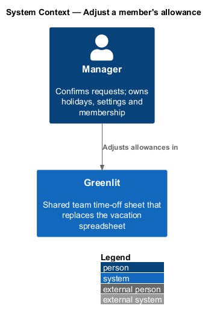
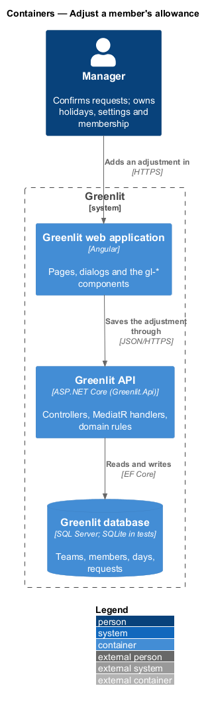
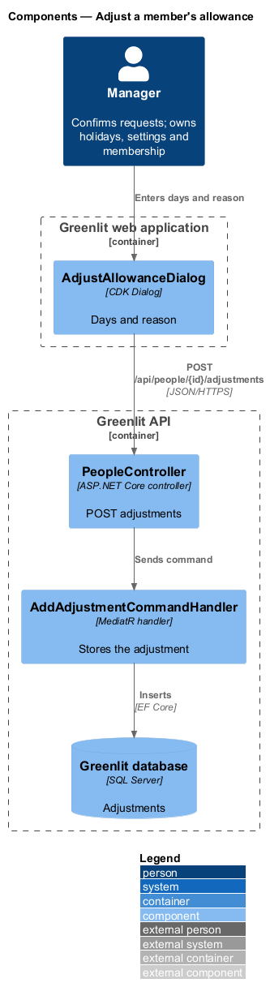
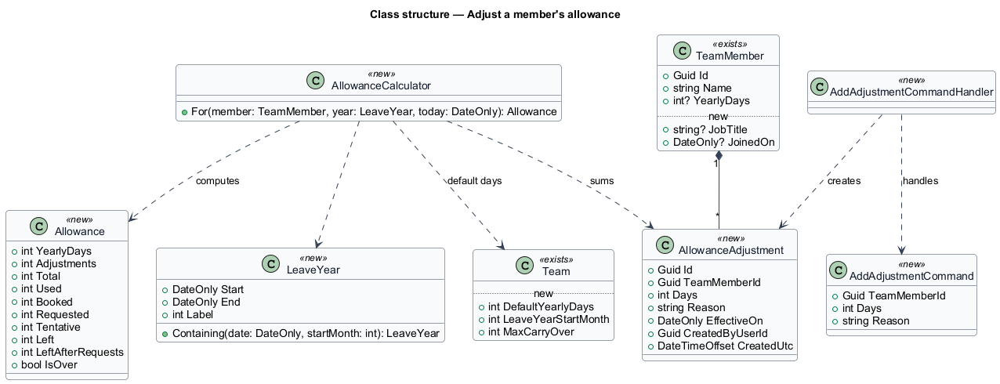
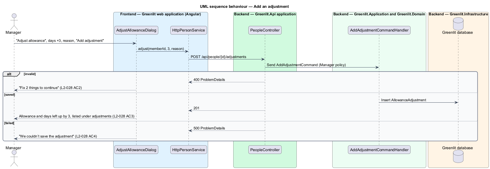

# Adjust a member's allowance

## Overview

An adjustment adds days to or removes days from one member's allowance: carry-over from last year, extra days, or a correction. The manager adds it from the member's person page with a number of days (negative to remove) and a reason, so the history makes sense later.

Adjustments are listed on the person page with their amount, reason and date, and the allowance shows their total ("28 incl. +3 adj.").

**adjustment** — signed number of days with a reason and a date, added to one member's allowance for the leave year containing that date

## Description

The feature is a vertical slice from the Greenlit web application to the Greenlit database.

**Frontend**

- **`AdjustAllowanceDialog`** — CDK Dialog in `app/dialogs/adjust-allowance` with Days (placeholder "+2") and Reason (placeholder "e.g. Carried over from 2025"), "Add adjustment", and "Adding…" while busy.
- **`PersonService / PERSON_SERVICE`** — `adjust(memberId, days, reason)`.

**Backend**

- **`PeopleController`** — `POST /api/people/{id}/adjustments` behind the `Manager` policy.
- **`AddAdjustmentCommandHandler`** — Stores an `AllowanceAdjustment` with `EffectiveOn` = today in the team's time zone. `<TO SUPPLY>`: whether the manager may date an adjustment, as the mock's "1 Jan 2026" suggests.
- **`AddAdjustmentCommandValidator`** — Days other than 0 ("Enter a number other than 0."), a reason ("Give a reason so the history makes sense later.").
- **`AllowanceAdjustment`** — New entity listed in the class diagram.

**Shared plumbing (exists today)**

- **`ExceptionHandlingMiddleware`** — Greenlit.Api middleware. It maps application exceptions (`ValidationException`, `NotFoundException`, `ForbiddenException`, `ConflictException`, `BadRequestException`) to ProblemDetails responses with a `code` extension.
- **`ValidationBehavior`** — MediatR pipeline behaviour in Greenlit.Application. It runs each request's FluentValidation validator before the handler and raises `ValidationException` on failure.
- **`IAppDbContext`** — Greenlit.Application abstraction over the EF Core context, implemented by `AppDbContext` in Greenlit.Infrastructure. Handlers read and write through it in one unit of work.

**Decision record.** ADR-003 states that balances are out of scope. The requirements in `docs/specs` (from the mocks) introduce allowances, so this subsystem needs a new ADR that supersedes that clause before implementation: `<TO SUPPLY>`.

## Requirements

The feature realizes the following level-2 (L2) requirements. Each L2 requirement refines a level-1 (L1) requirement, cited by identifier; the acceptance criteria for each are in `docs/specs/L2.md`.

| L2 ID | Refines (L1) | Requirement |
|-------|--------------|-------------|
| `L2-028` | `L1-006` | **Adjust an allowance.** The manager adds or removes days from one member's allowance with a reason. |

## Diagrams

### System context

The manager adjusts a member's allowance in Greenlit.

### Containers

The dialog posts the adjustment to the Greenlit API.

### Components

One handler stores the adjustment; `AllowanceCalculator` picks it up on the next read.

### Class structure

`AllowanceAdjustment` rows belong to a `TeamMember` and are summed by `AllowanceCalculator`.

### Behaviour — add an adjustment

Zero days and a blank reason come back together (`L2-028` AC2); a failure leaves the allowance unchanged (`L2-028` AC4).

