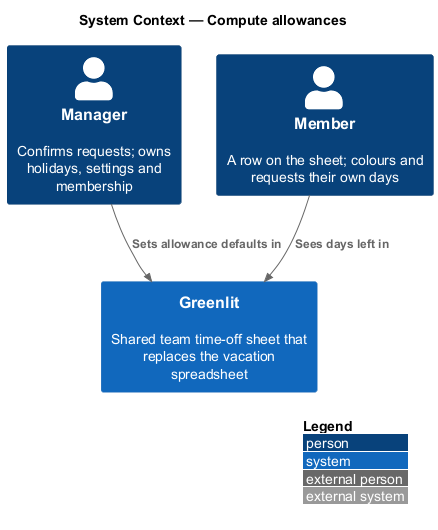
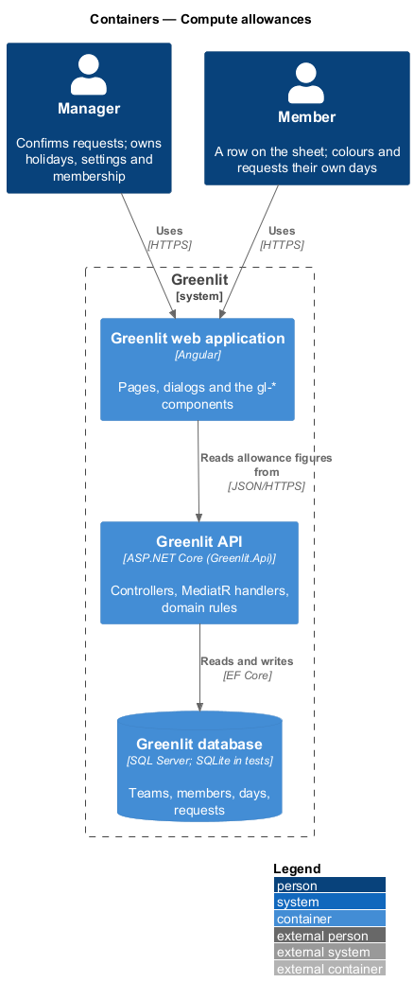
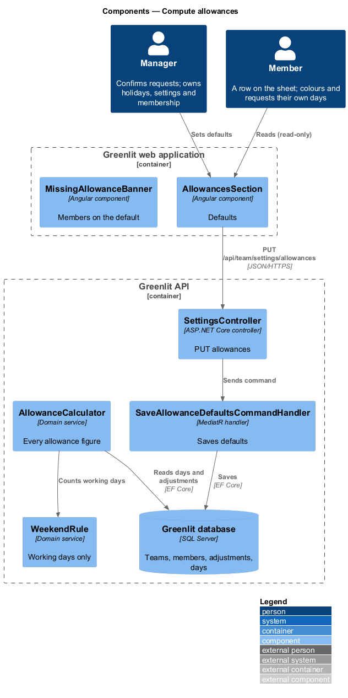
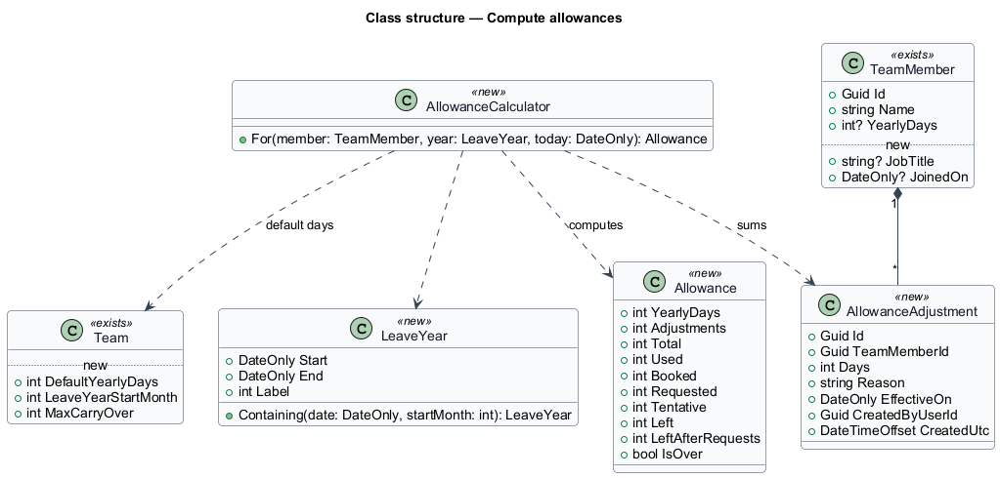
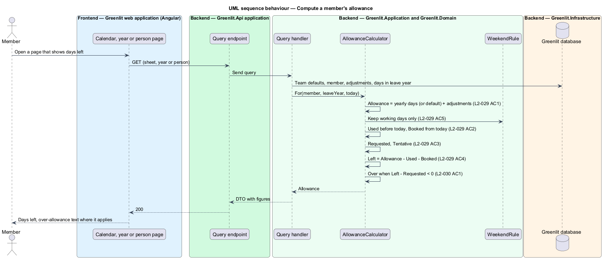

# Compute allowances

## Overview

Each member has a yearly allowance of days off. Greenlit computes from it how many days the member has used, booked, requested and left, and every screen that shows a number (the calendar's Left column, the year table, the person page, the request dialog) uses the same calculation.

Settings holds the defaults for new people in its Allowances section: days per year, the month the leave year starts, and the maximum carry-over. A member with no yearly days of their own uses the default, and a banner tells the manager when that is the case.

**allowance** — member's yearly days plus their adjustments for one leave year

**leave year** — twelve months starting on the first day of `Team.LeaveYearStartMonth`

**over allowance** — state in which a member's days left minus their requested days is below zero

**Max carry-over** is a stored setting only (ADR-007). Greenlit runs no year-end step: the manager enters carry-over as an adjustment with a reason (journey 23, "Carried over from 2025"), and the setting is the ceiling the Allowances section will show.

## Description

The feature is a vertical slice from the Greenlit web application to the Greenlit database.

**Frontend**

- **`AllowancesSection`** — Settings section with Days per year, Leave year starts (January to December) and Max carry-over. A negative Days per year shows "Enter 0 or more days."
- **`MissingAllowanceBanner`** — Settings banner "Two members have no allowance set" with "They’re using the default of 25 days until you change it."

**Backend**

- **`SettingsController`** — `GET /api/team/settings` (manager only) and `PUT /api/team/settings/allowances` (manager only; a member gets `403 forbidden`).
- **`SaveAllowanceDefaultsCommandHandler`** — Saves `Team.DefaultYearlyDays`, `Team.LeaveYearStartMonth` and `Team.MaxCarryOver`; the validator rejects negative values with a `400` whose `errors` name the field ("Enter 0 or more days.").
- **`AllowanceCalculator`** — Greenlit.Application service that computes an `Allowance` for each member of a team and a `LeaveYear`, counting only working days (`WorkingDayRule` and the team's holidays). It is the single source of every allowance figure; `GetMonthQueryHandler`, `QuoteRequestQueryHandler` and `SetDaysCommandHandler` call it.
- **`GetTeamSettingsQueryHandler`** — Adds `MembersWithoutAllowance` for the banner.
- **`TimeProvider`** — the existing .NET abstraction supplies "today" (converted to the team's time zone), so tests freeze it with `FrozenClockApiFactory`. No new `IClock` is introduced.

**Shared plumbing (exists today)**

- **`ExceptionHandlingMiddleware`** — Greenlit.Api middleware. It maps application exceptions (`ValidationException`, `NotFoundException`, `ForbiddenException`, `ConflictException`, `BadRequestException`) to ProblemDetails responses with a `code` extension.
- **`ValidationBehavior`** — MediatR pipeline behaviour in Greenlit.Application. It runs each request's FluentValidation validator before the handler and raises `ValidationException` on failure.
- **`IAppDbContext`** — Greenlit.Application abstraction over the EF Core context, implemented by `AppDbContext` in Greenlit.Infrastructure. Handlers read and write through it in one unit of work.

**Figures.** For a member and a leave year, with "today" in the team's time zone. Only working days for that member count; weekends, holidays and their non-working days never count (`L2-029` AC5).

| Figure | Definition |
|---|---|
| Yearly days | `TeamMember.YearlyDays`, or `Team.DefaultYearlyDays` when null |
| Adjustments | Sum of `AllowanceAdjustment.Days` effective in the year |
| Allowance | Yearly days + Adjustments |
| Used | Confirmed days before today |
| Booked | Confirmed days from today on |
| Requested | Days of pending requests |
| Tentative | Tentative days |
| Left | Allowance − Used − Booked |
| Left after requests | Left − Requested; the member is *over* when it is below 0 |

**Decision record.** ADR-007 supersedes ADR-003's clause that balances are out of scope.

**Where the figures surface (journey 11).**

- `GET /api/sheet`: each member row's `daysLeft` is **Left**, and `allowance` carries every figure (`yearlyDays`, `adjustments`, `allowance`, `used`, `booked`, `requested`, `tentative`, `left`). The calendar's Left column shows `daysLeft`, negative with a minus sign.
- `GET /api/requests/quote`: also returns `daysAvailable` (Left minus Requested, shown as "You have {n} days left to request." before any dates; negative counts as 0) and `daysOver`, how many days the caller's requested days would exceed their days left once the quoted days are added: `max(0, requested + days − left)`. The dialog adds "That’s {n} days over." when it is above zero (L2-030 AC3).
- `POST /api/sheet/days` (paint): the change set also returns `daysOver`, the caller's over-allowance after the stroke; the toast says "That’s {n} days over your allowance." when it is above zero (L2-030 AC2 for painted days; the selection bar is journey 12).
- The person page and the year table (journeys 21 and 22) read the same figures.

**Security and privacy.** Every endpoint is authenticated by the fallback policy. Figures are scoped to the caller's team; a member's sheet response includes the team's allowance figures because the Left column shows them to everyone (L2-014 AC1). `GET`/`PUT` of the defaults are manager only. A warning never blocks (L2-030 AC4), and errors reveal nothing about other teams.

**Open decisions resolved.** The over-allowance test counts the member's pending requested days: a new request is over by `requested + new days − left`. Team defaults when a team is created: 25 days per year, leave year starts in January, max carry-over 5. The Allowances section and the missing-allowance banner on the Settings page are built with journey 18; this journey ships their endpoints (`GET`/`PUT`, `membersWithoutAllowance`).

## Requirements

The feature realizes the following level-2 (L2) requirements. Each L2 requirement refines a level-1 (L1) requirement, cited by identifier; the acceptance criteria for each are in `docs/specs/L2.md`.

| L2 ID | Refines (L1) | Requirement |
|-------|--------------|-------------|
| `L2-027` | `L1-006` | **Allowance defaults.** Settings sets the defaults for new people. |
| `L2-029` | `L1-006` | **Allowance figures.** Greenlit computes each member's allowance for the leave year. |
| `L2-030` | `L1-006` | **Over-allowance warnings.** Greenlit flags when requests would take a member below zero days left. |

## Diagrams

### System context

Managers set the defaults and everyone reads the figures in Greenlit.

### Containers

The Allowances section saves defaults; every page that shows a figure receives it from the Greenlit API.

### Components

`AllowanceCalculator` is the only component that computes allowance figures; query handlers across the system call it.

### Class structure

An `Allowance` is computed, never stored, from `Team` defaults, `TeamMember.YearlyDays`, `AllowanceAdjustment` rows and the member's days in a `LeaveYear`.

### Behaviour — compute a member's allowance

The steps match the figures table: Left excludes requested days, and Left after requests decides the over-allowance warning (`L2-029` AC4, `L2-030`).

