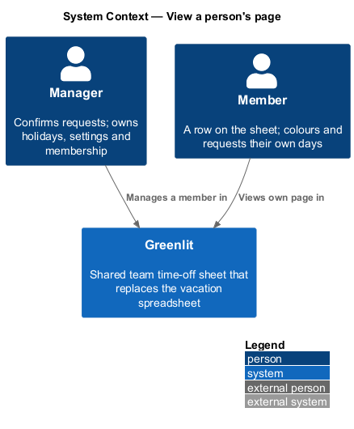
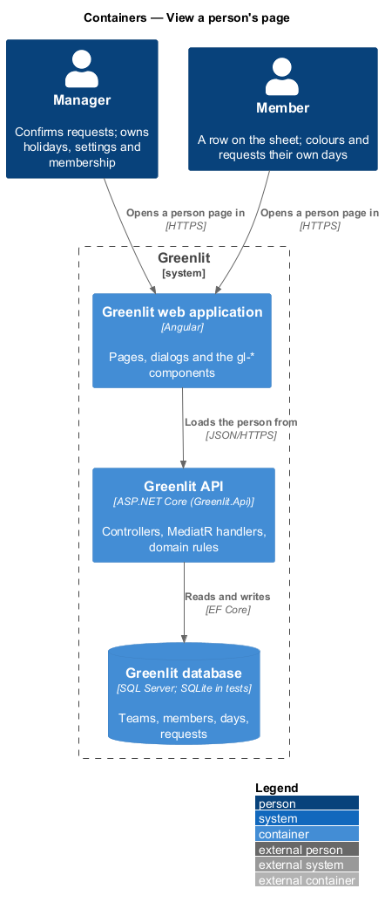
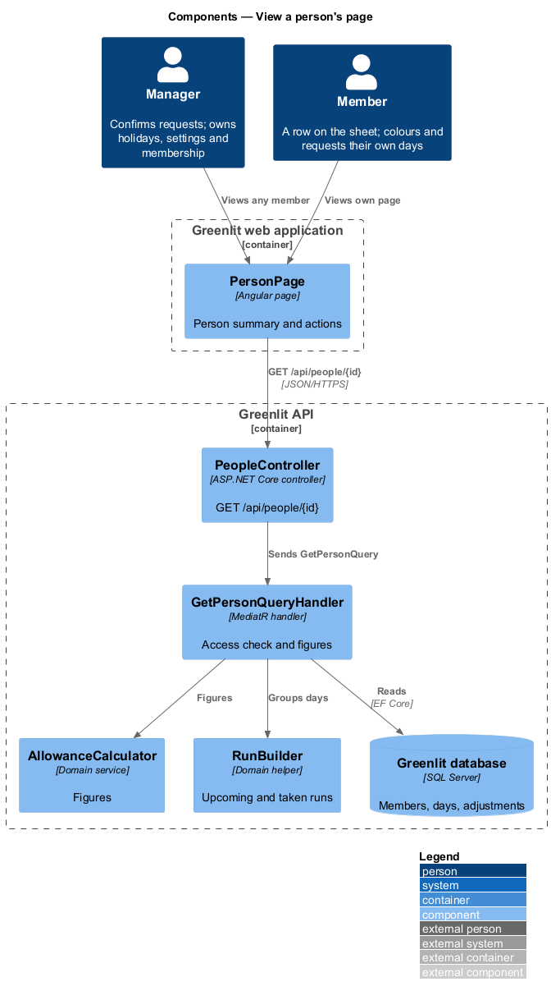
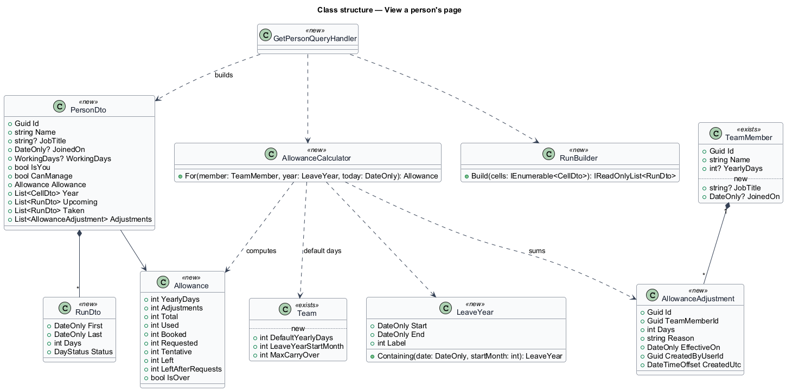
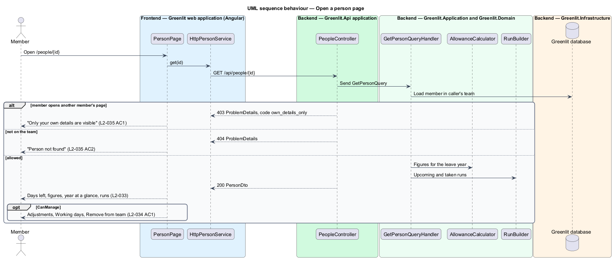

# View a person's page

## Overview

Each member has a person page that summarises their year: their allowance figures, a year at a glance of twelve small month calendars, their upcoming time off and the time off taken this year. A member reaches their own page through "My time off" and can request time off from it.

The manager sees the same page for every member, with three more sections: Allowance adjustments, Working days and Remove from team. A member who opens someone else's page sees that only their own details are visible.

**year at a glance** — twelve month calendars for one member, coloured by day status

**run** — consecutive working days of one member with the same status, listed as one entry ("13–24 Jul 10 days Confirmed")

## Description

The feature is a vertical slice from the Greenlit web application to the Greenlit database.

**Frontend**

- **`PersonPage`** — App-shell page (`page: 'person'`) at `/people/{id}`, and at `/person` for the signed-in person's own page (the account menu's "My time off", `L2-006` AC5). It shows the header (name, job title, "Joined {Mon yyyy}", non-standard working days), "{n} days left in {year}" with the over-allowance text, the `gl-stat` figures, the `gl-month-mini` year, Upcoming and Taken lists (`gl-run-list`), and the manager sections. It handles the loading, forbidden, not-found and error states. The member's own page offers "Request time off", which opens the request dialog of `requests/send-request`. The manager's "Edit working days" opens the dialog of `teams/working-days`.
- **`PersonService / PERSON_SERVICE`** — `get(id)` (the person also names the manager, for the request dialog), where the id is a member's id or `me`. The actions of `allowances/adjust-allowance` and `teams/remove-member` join the service with their journeys (23 and 24).
- **Names link to the page.** For the manager, a name in the allowance table of the year page links to `/people/{id}`; a member's names stay text (`allowances/year-overview`).

**Backend**

- **`PeopleController`** — `GET /api/people/{id}` and `GET /api/people/me`. Authenticated by the fallback policy.
- **`GetPersonQueryHandler`** — Allows the manager for any member of the caller's team and a member for themselves only (`ForbiddenException`, code `own_details_only`, 403). An unknown id, or the id of someone on another team, raises `NotFoundException` (code `person_not_found`, 404), so the response never says whether a person exists elsewhere. It returns the figures from `AllowanceCalculator`, the year's days, runs grouped by `RunBuilder`, the member's effective working days and their adjustments in the leave year (shown read-only to the member themself).
- **`RunBuilder`** — Application helper that groups consecutive working days with the same status into runs, skipping non-working days. Upcoming runs are the days from today on (any status); Taken runs are the confirmed days before today, newest first.
- **`TeamMember.JobTitle, TeamMember.JoinedOn`** — New nullable fields (migration `AddPersonDetails`). Resolved: no screen enters them in this journey (the mocks show no form); the demo seed sets them, and the header shows each only when it is present. Entering them belongs with the Account page (journey 27) or a later team-member edit; it is not decided here.

**Shared plumbing (exists today)**

- **`ExceptionHandlingMiddleware`** — Greenlit.Api middleware. It maps application exceptions (`ValidationException`, `NotFoundException`, `ForbiddenException`, `ConflictException`, `BadRequestException`) to ProblemDetails responses with a `code` extension.
- **`ValidationBehavior`** — MediatR pipeline behaviour in Greenlit.Application. It runs each request's FluentValidation validator before the handler and raises `ValidationException` on failure.
- **`IAppDbContext`** — Greenlit.Application abstraction over the EF Core context, implemented by `AppDbContext` in Greenlit.Infrastructure. Handlers read and write through it in one unit of work.

## Requirements

The feature realizes the following level-2 (L2) requirements. Each L2 requirement refines a level-1 (L1) requirement, cited by identifier; the acceptance criteria for each are in `docs/specs/L2.md`.

| L2 ID | Refines (L1) | Requirement |
|-------|--------------|-------------|
| `L2-033` | `L1-008` | **Person page.** Each member has a page summarising their year. |
| `L2-034` | `L1-008` | **Manager actions on the person page.** The manager manages a member from their page. |
| `L2-035` | `L1-008` | **Person page access.** Members see only their own person page. |

## Diagrams

### System context

The manager views and manages any member, and a member views their own page, in Greenlit.

### Containers

The person page loads one `PersonDto` from the Greenlit API; its actions belong to other features.

### Components

`GetPersonQueryHandler` enforces who may see the page, then assembles figures and runs.

### Class structure

`CanManage` tells the page whether to show the manager sections; `Adjustments` is read-only for a member viewing themselves.

### Behaviour — open a person page

A member sees only their own page (`L2-035` AC1); a removed member's page is not found (`L2-035` AC2). The manager sections appear only when `CanManage` is true (`L2-034`).

## Decisions

- **Which year.** The page shows the leave year that contains today (`ADR-007`): the figures are its allowance, "{year}" is the year it starts in, and "{year} at a glance" is that calendar year.
- **Hidden until built.** "Adjust allowance" (journey 23) and "Remove {first name}" (journey 24) are not shown until those journeys land; the manager's page shows the adjustments list and Working days. `L2-034` AC1 is fully true once they land.
- **Settings keeps its Edit working days buttons.** The Team list in Settings still opens the same dialog; the person page is a second entry point, not a replacement.
- **Over allowance.** The big number turns red (`data-over`) and the caption adds "{n} days over once requests are approved" when requested days exceed days left (`ADR-007`).
- **Day labels.** Each mini day is named "{d} {Month}: {Confirmed|Requested|Tentative|Working|Not working|{holiday name}}"; the colour is never the only carrier.
