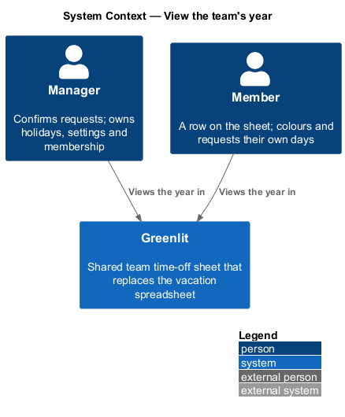
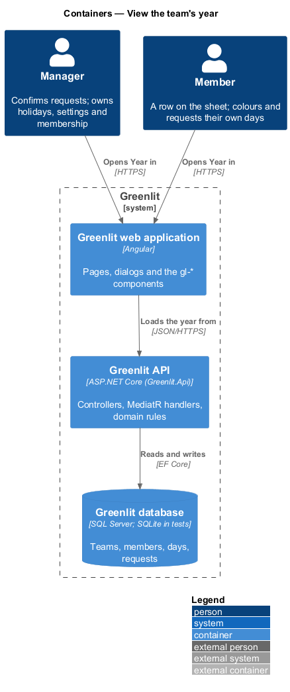
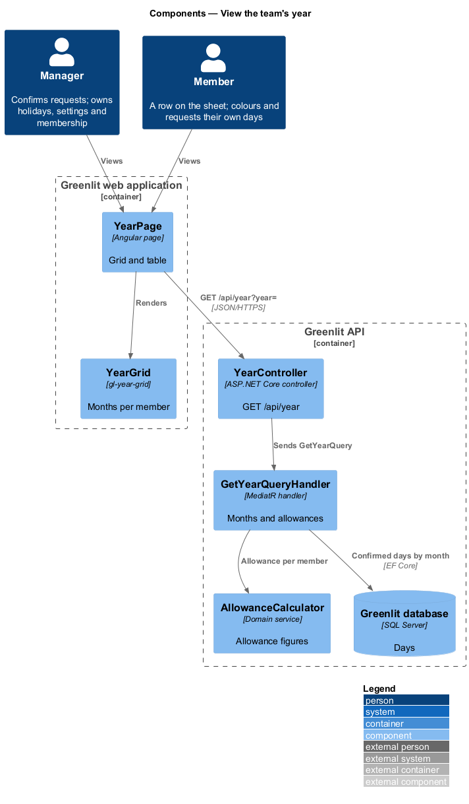
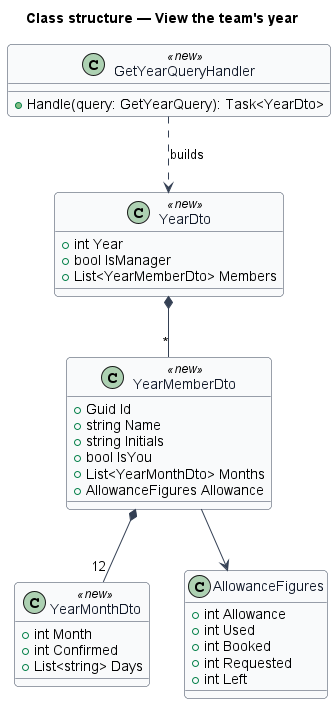
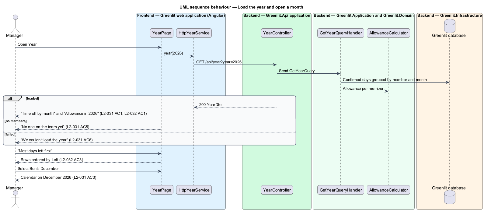

# View the team's year

## Overview

The year page shows the whole team's year in one view. A grid has one row per member and one column per month, each cell giving the confirmed days off in that month; selecting a month opens the calendar on it.

Below the grid, a table gives each person's allowance for the year: Allowance, Used, Booked, Requested, Left and a usage bar. Sorting by days left, most first, shows who has not had a break.

## Decisions

- **Everyone sees the allowance table.** The mocks show it to members as well as the manager, while the person page tells members that only managers see everyone's allowance (`L2-035` AC1). The year page follows the year mocks: every member of the team sees every row of the table, because the calendar already shows each person's days left (`L2-014` AC1) and the same figures. What a member does not get is the link from a name to that person's page, which is for the manager (`pages/year/member`). The endpoint returns only the caller's own team (`ADR-007`).
- **The year is a calendar year.** `GET /api/year?year=2026` groups days from 1 January to 31 December and takes the allowance for the leave year that starts in that year, at the team's leave-year start month (`ADR-007`). Used and Booked still split at today in the team's time zone, so a past year is all Used and a future year all Booked.
- **A sliver per day.** The grid draws one sliver per calendar day (mock `pages/year/default`), so each month carries its days' statuses as well as the confirmed count the cell is named by. Weekends, holidays and days a member does not work are `off`; a day with no row is `empty`.
- **Names link to the person page.** For the manager, a name in the allowance table links to `/people/{id}` (built with `allowances/person-page`); the mock links only the table, not the grid, and member mocks never link. A member's names stay text.
- **Sorting is the client's.** The endpoint returns the rows with the caller first, then in team order; "Most days left first" reorders them in the browser and toggles back (`aria-pressed`).
- **Empty means no one but the manager.** As on the calendar (`L2-012` AC6), a team of one shows "No one on the team yet".
- **Errors.** A year that is not a four-digit year from 2000 to 2100 answers 400 with the validation `code`; a caller on no team is 404 `not_found`; no session is 401. Nothing in an error names another team.

## Description

The feature is a vertical slice from the Greenlit web application to the Greenlit database.

**Frontend**

- **`YearPage`** — App-shell page (`page: 'year'`) with "Previous year" and "Next year", the legend, the `gl-year-grid` "Time off by month" and the allowance `gl-table` with the sort control "Most days left first".
- **`YearGrid`** (`gl-year-grid`) and **`AllowanceTable`** (`gl-allowance-table`, with the sort toggle `aria-pressed` and `aria-sort` on Left) — Cells named "{member}, {Month}: {n} confirmed days off"; activating one navigates to the calendar for that month.
- **`YearService / YEAR_SERVICE`** — `year(yyyy)`; `HttpYearService` calls `GET /api/year`.

**Backend**

- **`YearController`** — `GET /api/year?year=2026`.
- **`GetYearQueryHandler`** — Reads the team's days and holidays for the calendar year in one query each, builds each member's twelve months (day statuses and the confirmed count) and takes each member's `AllowanceFigures` from `AllowanceCalculator`. The signed-in person's row comes first.

**Shared plumbing (exists today)**

- **`ExceptionHandlingMiddleware`** — Greenlit.Api middleware. It maps application exceptions (`ValidationException`, `NotFoundException`, `ForbiddenException`, `ConflictException`, `BadRequestException`) to ProblemDetails responses with a `code` extension.
- **`ValidationBehavior`** — MediatR pipeline behaviour in Greenlit.Application. It runs each request's FluentValidation validator before the handler and raises `ValidationException` on failure.
- **`IAppDbContext`** — Greenlit.Application abstraction over the EF Core context, implemented by `AppDbContext` in Greenlit.Infrastructure. Handlers read and write through it in one unit of work.

## Requirements

The feature realizes the following level-2 (L2) requirements. Each L2 requirement refines a level-1 (L1) requirement, cited by identifier; the acceptance criteria for each are in `docs/specs/L2.md`.

| L2 ID | Refines (L1) | Requirement |
|-------|--------------|-------------|
| `L2-031` | `L1-007` | **Year grid.** The year page shows the whole team's confirmed time off month by month. |
| `L2-032` | `L1-007` | **Allowance table on the year page.** Below the grid, a table shows each person's allowance for the year. |
| `L2-057` | `L1-015` | **A team of one.** A team whose only member is its manager is complete and usable on every screen. |
| `L2-060` | `L1-016` | **Child members.** A manager-set member attribute: no allowance, no days left; a login-less child's days are saved as Confirmed. |
| `L2-061` | `L1-016` | **School closures.** Labelled date ranges on one child's or all children's rows, shown with an icon and text, never red, counted nowhere. |

## Diagrams

### System context

Everyone on the team views the year in Greenlit.

### Containers

The year page loads one `YearDto` from the Greenlit API.

### Components

`GetYearQueryHandler` aggregates confirmed days by month and asks `AllowanceCalculator` for each row's figures.

### Class structure

Each `YearMemberDto` has twelve `YearMonthDto` (a confirmed count and a status per day) and its `AllowanceFigures`; sorting happens on the client.

### Behaviour — load the year and open a month

Sorting by Left is a client-side reorder (`L2-032` AC3). Selecting a month cell opens the calendar on that month (`L2-031` AC3).

## Open questions answered (ADR-015, 8 Nov 2026)

- **A team of one** shows the manager's row in the grid and the table (`pages/year/team-of-one`).
- **A child** shows "No allowance" across the figure columns of the allowance table (`pages/year/school-calendar`); sorting by a figure puts children last.
- **Closures are not drawn or counted** on the year grid (`L2-061` AC5).
