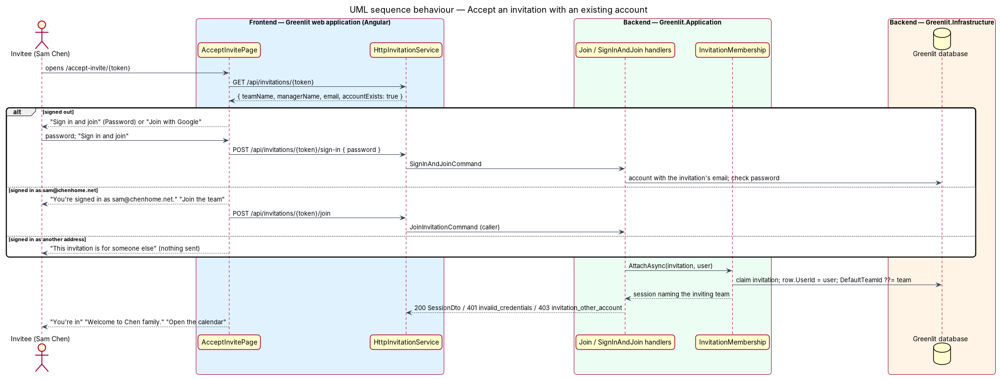

# Accept an invitation

## Overview

A manager adds people to a team by name and, optionally, email (see `teams/invite-member`). A person with an email receives an invitation link. Until they accept it, they are a row on the sheet without an account.

This feature covers the invitee's side. The link opens a page titled with the team's name, naming the manager who sent it. The invitee confirms their name, chooses a password and joins. An invitation works for seven days.

**invitation** — single-use link that turns a team member row into a signed-in account, valid for seven days from sending

## Description

The feature is a vertical slice from the Greenlit web application to the Greenlit database.

**Frontend**

- **`AcceptInvitePage`** — Bare-shell page. It loads the invitation summary, pre-fills Email (read-only, "This is where your invitation was sent.") and "Your name", and validates the password rules of `L2-003`.
- **`InvitationService / INVITATION_SERVICE`** — Contract and token: `get(token)` and `accept(token, name, password)`.

**Backend**

- **`InvitationsController`** — `GET /api/invitations/{token}` and `POST /api/invitations/{token}/accept`, both `[AllowAnonymous]`.
- **`GetInvitationQueryHandler`** — Returns the team name, the manager's name and the email, or code `invitation_expired` past `ExpiresUtc` or after acceptance.
- **`AcceptInvitationCommandHandler`** — Creates the `User`, links it through `TeamMember.UserId`, stamps `AcceptedUtc` and issues a session through `ITokenService`. The member's existing `TimeOffDay` rows stay on the row (`L2-004` AC5).
- **`Invitation`** — New entity: `Id`, `TeamMemberId`, `Email`, `TokenHash`, `SentUtc`, `ExpiresUtc` (sent + 7 days), `AcceptedUtc`.
- **`TeamMember`** — Existing entity; `UserId` moves from null to the new user.

**Shared plumbing (exists today)**

- **`ExceptionHandlingMiddleware`** — Greenlit.Api middleware. It maps application exceptions (`ValidationException`, `NotFoundException`, `ForbiddenException`, `ConflictException`, `BadRequestException`) to ProblemDetails responses with a `code` extension.
- **`ValidationBehavior`** — MediatR pipeline behaviour in Greenlit.Application. It runs each request's FluentValidation validator before the handler and raises `ValidationException` on failure.
- **`IAppDbContext`** — Greenlit.Application abstraction over the EF Core context, implemented by `AppDbContext` in Greenlit.Infrastructure. Handlers read and write through it in one unit of work.

## Requirements

The feature realizes the following level-2 (L2) requirements. Each L2 requirement refines a level-1 (L1) requirement, cited by identifier; the acceptance criteria for each are in `docs/specs/L2.md`.

| L2 ID | Refines (L1) | Requirement |
|-------|--------------|-------------|
| `L2-004` | `L1-001` | **Accept an invitation.** An invited person joins the team by setting their name and password. Invitations work for seven days. |
| `L2-058` | `L1-015` | **Invite a person who already has an account.** Accepting attaches a membership to the existing account (signed out with the password or Google, or signed in); a different account is refused. |

## Diagrams

### System context

The invitee joins a team in Greenlit through the emailed link; sending the invitation belongs to `teams/invite-member`.

### Containers

The page reads and accepts the invitation through the Greenlit API, which writes the new user to the Greenlit database.

### Components

A query handler reads the invitation for display; a command handler accepts it and issues a session.

### Class structure

An `Invitation` belongs to a `TeamMember`; accepting it creates the `User` and fills `TeamMember.UserId`.

### Behaviour — join the team from an invitation

An invitation older than seven days shows "This invitation has expired" (`L2-004` AC4). Acceptance keeps the member's existing days (`L2-004` AC5).

## Decisions (journey 6)

- **Who may call it.** Both endpoints are `[AllowAnonymous]`: the holder of the token is the credential. The token is 32 random bytes (ADR-006), so it cannot be guessed; it is looked up by its SHA-256 hash and never stored or logged by the API.
- **What each answer reveals.** A token that matches nothing is `404` with code `invitation_not_found` and names no team or person. A token that matches an invitation that is past `ExpiresUtc`, already accepted, or retired by a newer invitation is `410` with code `invitation_expired` and the manager's name in a `managerName` extension, which is what the page needs to say "Ask Maya Chen to send you a new one." Only someone who holds a real token learns the manager's name; the answer never contains the email or the team of an unknown token. The page treats `404` like the expired state but names no one.
- **Reading an invitation.** `GET /api/invitations/{token}` returns `teamName`, `managerName`, `memberName` (pre-fills Your name) and `email` (read-only). Opening a link never changes anything.
- **Accepting.** `POST /api/invitations/{token}/accept` takes `{ name, password }`. The handler validates the name (required, up to 120 characters; "Enter your name.") and the password (at least 10 characters; "Password must be at least 10 characters", the rule of `L2-003`); the confirmation field is checked by the page only, because it is not a server concept. In one unit of work it creates the `User` (email = the invitation's email, role = `TeamMember.Role`, password hashed by `IPasswordHasher`), sets `TeamMember.UserId`, updates the member's and the user's display name to the submitted name, stamps `AcceptedUtc`, and returns the same session `POST /api/auth/sign-in` returns (`ITokenService`). `TimeOffDay` rows are not touched (`L2-004` AC5).
- **Email already has an account.** A person who already has a Greenlit account with the invitation's email (case-insensitive) cannot create a second one: `409` with code `account_exists`, nothing created, the invitation stays valid. The page tells them to sign in. Linking an existing account to the team is out of scope here.
- **Double submit and races.** The accepting update is guarded by `AcceptedUtc is null`; the second of two concurrent submits finds the invitation used and gets `410`.
- **Mock states.** Besides the six mocks, `failed` (account could not be created) and `unavailable` (invitation could not be loaded) were added, and `loading` says "Join your team" because the team's name is not known until the invitation loads. `account_exists` and the unknown-token variant reuse the `failed` and `error` layouts with their own sentences.
- **After joining.** The page shows the `success` state ("Welcome, Finn", "You're in") for 1.5 seconds with an "Open the calendar" button, then opens the calendar, as sign-in does. The session is stored like a sign-in; a signed-in visitor who opens the link is not redirected, and accepting replaces their session.
- **Route.** `/accept-invite/:token` (the link of `teams/invite-member`, `{Greenlit:App:Origin}/accept-invite/{token}`), bare shell, `data-page="accept-invite"`.
- **E2E.** The token exists only in the email, which the e2e API writes to its log (ADR-006); the Playwright fixture reads the link for an address from `.run/logs/e2e-api.out.log`.

### Behaviour — accept with an existing account (ADR-015)

An email that already has an account joins with that account, signed out with its password or Google, or signed in; another account is refused (`L2-058`).

## Open questions answered (ADR-015, 8 Nov 2026)

- **The email already has an account.** `GET /api/invitations/{token}` returns `accountExists`. The page then shows the existing-account card instead of the name and password form: signed out, "Sign in and join" with the account's password (`POST /api/invitations/{token}/sign-in`) or "Join with Google"; signed in as that address, "Join the team" (`POST /api/invitations/{token}/join`); signed in as another address, "This invitation is for someone else" and nothing is attached (`403 invitation_other_account`). Mocks: `pages/accept-invite/account`, `account-busy`, `account-wrong`, `signed-in`, `signed-in-busy`, `other-account`, `account-failed`, `account-success`.
- **One attach step.** `InvitationMembership.AttachAsync` claims the invitation with the existing conditional update, sets the row's `UserId` and name, sets `User.DefaultTeamId` when the person had no team, and issues a session for the inviting team. A wrong password leaves the invitation open.
- **How does the page know who is signed in?** It reads `GET /api/account` when a session exists and compares the email with the invitation's, ignoring case; the API enforces the same check.
- **`account_exists` on the create form** remains for a race (an account appearing between load and submit); the client then reloads the invitation and shows the existing-account card.
