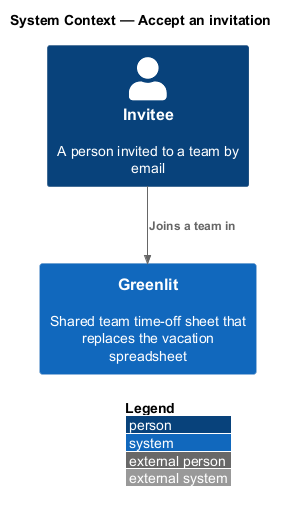
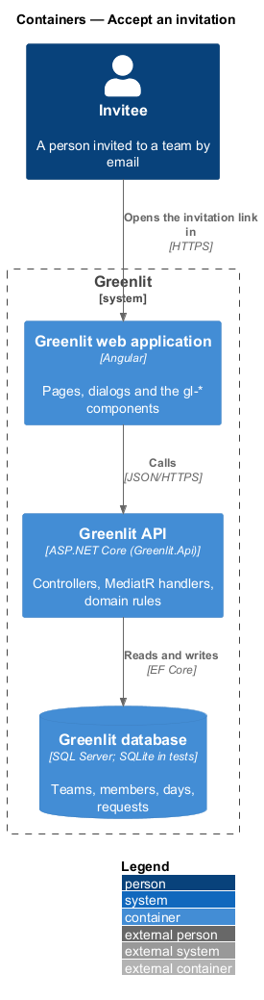
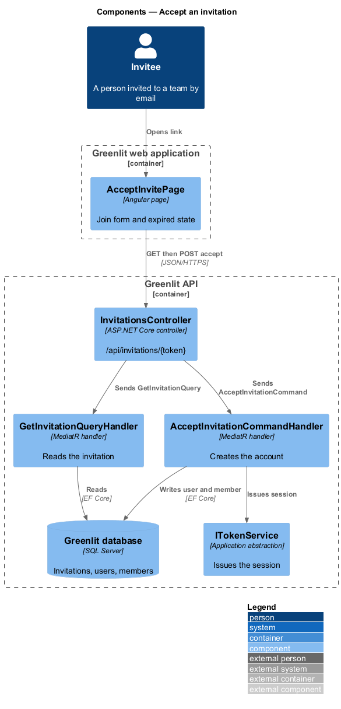
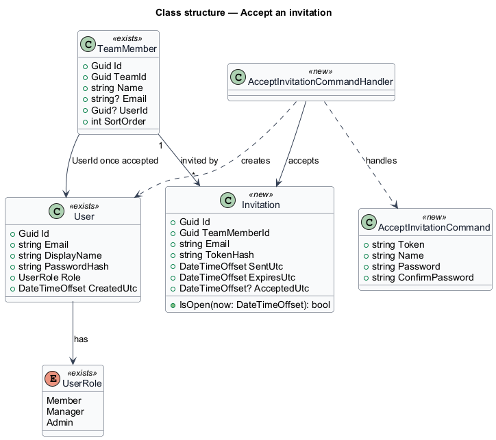
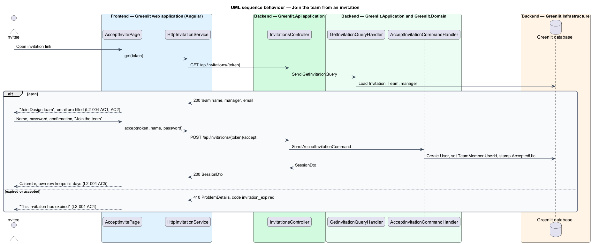

# Accept an invitation

## Overview

A manager adds people to a team by name and, optionally, email (see `teams/invite-member`). A person with an email receives an invitation link. Until they accept it, they are a row on the sheet without an account.

This feature covers the invitee's side. The link opens a page titled with the team's name, naming the manager who sent it. The invitee confirms their name, chooses a password and joins. An invitation works for seven days.

**invitation** — single-use link that turns a team member row into a signed-in account, valid for seven days from sending

## Description

The feature is a vertical slice from the Greenlit web application to the Greenlit database.

**Frontend**

- **`AcceptInvitePage`** — Bare-shell page. It loads the invitation summary, pre-fills Email (read-only, "This is where your invitation was sent.") and "Your name", and validates the password rules of `L2-003`.
- **`InvitationService / INVITATION_SERVICE`** — Contract and token: `get(token)` and `accept(token, name, password)`.

**Backend**

- **`InvitationsController`** — `GET /api/invitations/{token}` and `POST /api/invitations/{token}/accept`, both `[AllowAnonymous]`.
- **`GetInvitationQueryHandler`** — Returns the team name, the manager's name and the email, or code `invitation_expired` past `ExpiresUtc` or after acceptance.
- **`AcceptInvitationCommandHandler`** — Creates the `User`, links it through `TeamMember.UserId`, stamps `AcceptedUtc` and issues a session through `ITokenService`. The member's existing `TimeOffDay` rows stay on the row (`L2-004` AC5).
- **`Invitation`** — New entity: `Id`, `TeamMemberId`, `Email`, `TokenHash`, `SentUtc`, `ExpiresUtc` (sent + 7 days), `AcceptedUtc`.
- **`TeamMember`** — Existing entity; `UserId` moves from null to the new user.

**Shared plumbing (exists today)**

- **`ExceptionHandlingMiddleware`** — Greenlit.Api middleware. It maps application exceptions (`ValidationException`, `NotFoundException`, `ForbiddenException`, `ConflictException`, `BadRequestException`) to ProblemDetails responses with a `code` extension.
- **`ValidationBehavior`** — MediatR pipeline behaviour in Greenlit.Application. It runs each request's FluentValidation validator before the handler and raises `ValidationException` on failure.
- **`IAppDbContext`** — Greenlit.Application abstraction over the EF Core context, implemented by `AppDbContext` in Greenlit.Infrastructure. Handlers read and write through it in one unit of work.

## Requirements

The feature realizes the following level-2 (L2) requirements. Each L2 requirement refines a level-1 (L1) requirement, cited by identifier; the acceptance criteria for each are in `docs/specs/L2.md`.

| L2 ID | Refines (L1) | Requirement |
|-------|--------------|-------------|
| `L2-004` | `L1-001` | **Accept an invitation.** An invited person joins the team by setting their name and password. Invitations work for seven days. |

## Diagrams

### System context

The invitee joins a team in Greenlit through the emailed link; sending the invitation belongs to `teams/invite-member`.

### Containers

The page reads and accepts the invitation through the Greenlit API, which writes the new user to the Greenlit database.

### Components

A query handler reads the invitation for display; a command handler accepts it and issues a session.

### Class structure

An `Invitation` belongs to a `TeamMember`; accepting it creates the `User` and fills `TeamMember.UserId`.

### Behaviour — join the team from an invitation

An invitation older than seven days shows "This invitation has expired" (`L2-004` AC4). Acceptance keeps the member's existing days (`L2-004` AC5).

