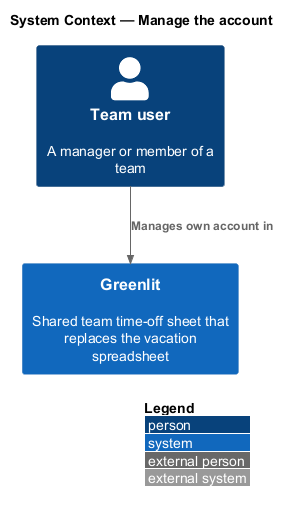
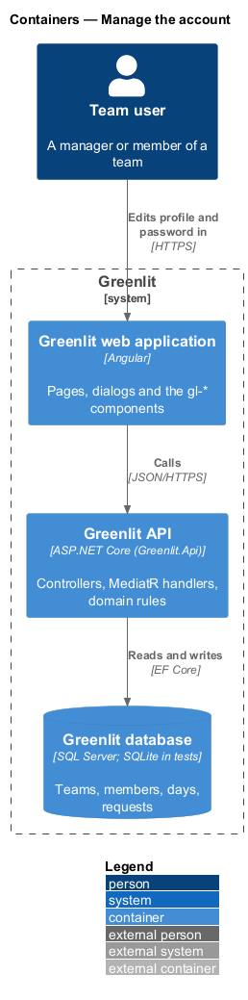
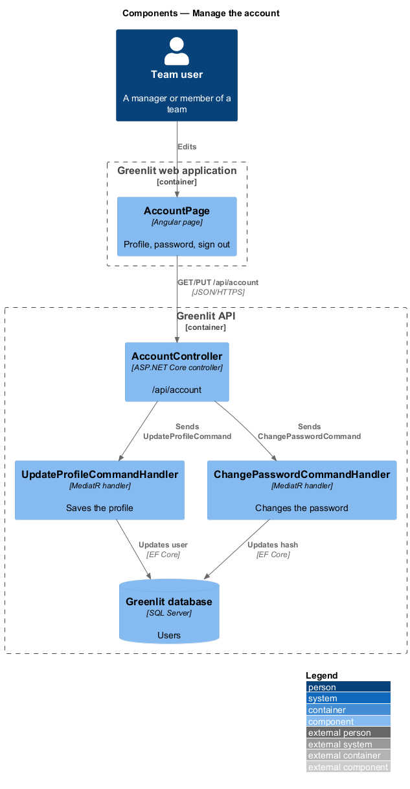
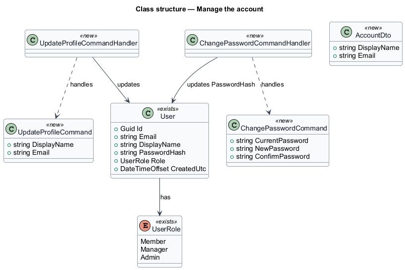
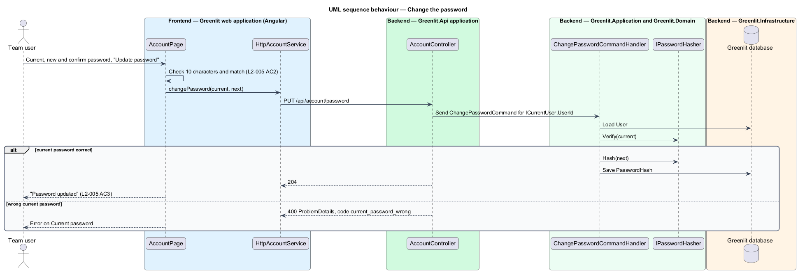

# Manage the account

## Overview

Every signed-in person has an Account page reached from the account menu. It holds the profile (display name and the sign-in email), a password change, and a sign-out section.

The profile and the password are saved separately. Changing the password requires the current password.

## Description

The feature is a vertical slice from the Greenlit web application to the Greenlit database.

**Frontend**

- **`AccountPage`** — App-shell page (`page: 'account'`) with the sections Profile, Password and Sign out, following `docs/mocks/pages/account/*`.
- **`AccountService / ACCOUNT_SERVICE`** — `get()`, `updateProfile(displayName, email)` and `changePassword(current, next, confirm)`.

**Backend**

- **`AccountController`** — `GET /api/account`, `PUT /api/account/profile` and `PUT /api/account/password`.
- **`UpdateProfileCommandHandler`** — Updates `User.DisplayName` and `User.Email`; a taken email raises code `email_taken`. The caller's own `TeamMember` row follows the profile: its `Name` and `Email` are set to the same values in the same save, so the sheet, the top bar and the people lists agree (decision: one name per person, no separate sheet label). The email is trimmed and compared case-insensitively; a changed address needs no verification (deferred).
- **`ChangePasswordCommandHandler`** — Verifies the current password through `IPasswordHasher`, then stores the new hash. A wrong current password raises a 400 with code `current_password_wrong`; the page shows it on the Current password field. The session stays valid (the token carries only the user id), so the person is not signed out by either change.
- **`ChangePasswordCommandValidator`** — At least 10 characters and a matching confirmation, as in `L2-003`.
- **`ICurrentUser`** — Greenlit.Application abstraction. It exposes the caller's `UserId` from the JWT `sub` claim; this design needs nothing more. It exposes the caller's `UserId`, `TeamId`, `TeamMemberId` and `IsManager` from the JWT claims, so every handler scopes data to the caller's team.

**Shared plumbing (exists today)**

- **`ExceptionHandlingMiddleware`** — Greenlit.Api middleware. It maps application exceptions (`ValidationException`, `NotFoundException`, `ForbiddenException`, `ConflictException`, `BadRequestException`) to ProblemDetails responses with a `code` extension.
- **`ValidationBehavior`** — MediatR pipeline behaviour in Greenlit.Application. It runs each request's FluentValidation validator before the handler and raises `ValidationException` on failure.
- **`IAppDbContext`** — Greenlit.Application abstraction over the EF Core context, implemented by `AppDbContext` in Greenlit.Infrastructure. Handlers read and write through it in one unit of work.

**Security and privacy.** All three endpoints require a session (fallback policy) and act only on the caller's own `User`, taken from the token, never from the request. `email_taken` (409) says only that the address is in use; sign-in and reset flows keep revealing nothing about other accounts. `current_password_wrong` reveals nothing beyond the caller's own account. The page's profile error text for a taken email is "That email is already in use."; the wrong current password text is "That isn’t your current password.".

**Email field.** The mocks showed the Email input read-only; L2-005 says the person edits it, so the mocks now show it editable. "Save changes" stays disabled until the name or email differs from what was loaded.

## Requirements

The feature realizes the following level-2 (L2) requirements. Each L2 requirement refines a level-1 (L1) requirement, cited by identifier; the acceptance criteria for each are in `docs/specs/L2.md`.

| L2 ID | Refines (L1) | Requirement |
|-------|--------------|-------------|
| `L2-005` | `L1-001` | **Account page.** A signed-in person edits their display name and email and changes their password. |

## Diagrams

### System context

A signed-in team user manages their own account; no external system takes part.

### Containers

The Account page reads and updates the user through the Greenlit API.

### Components

Two handlers keep the profile and the password apart, so each section saves on its own.

### Class structure

Both commands act on the caller's own `User`, resolved from `ICurrentUser`.

### Behaviour — change the password

The page checks length and confirmation first and lists both errors under "Fix 2 things to continue" (`L2-005` AC2); the API rechecks them and verifies the current password.

