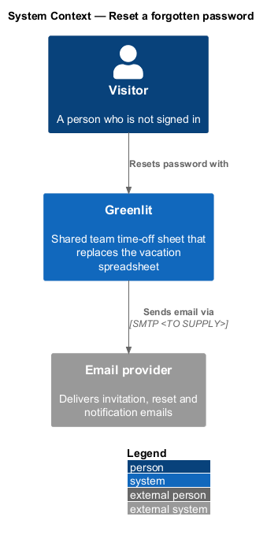
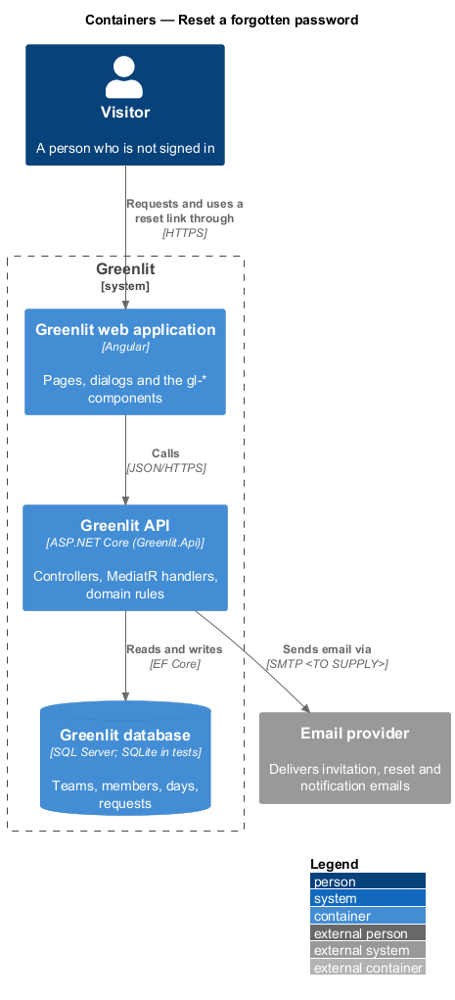
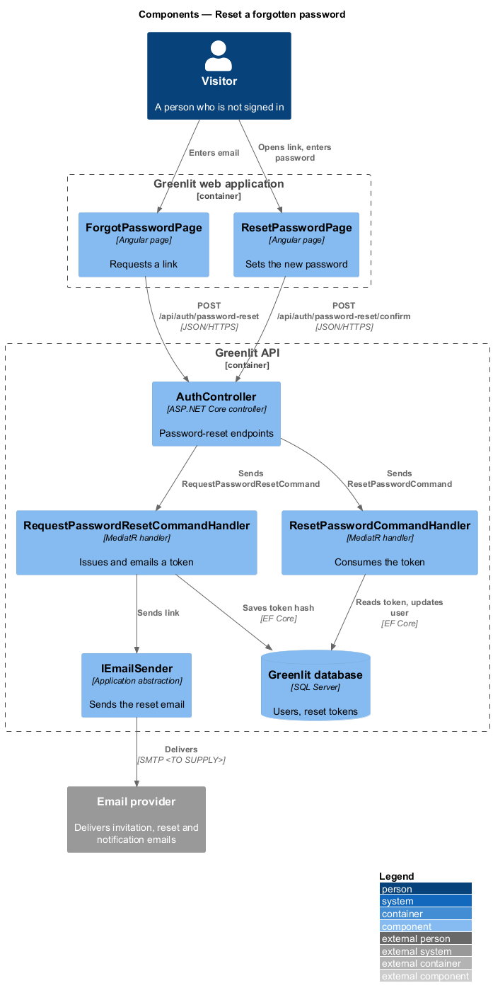
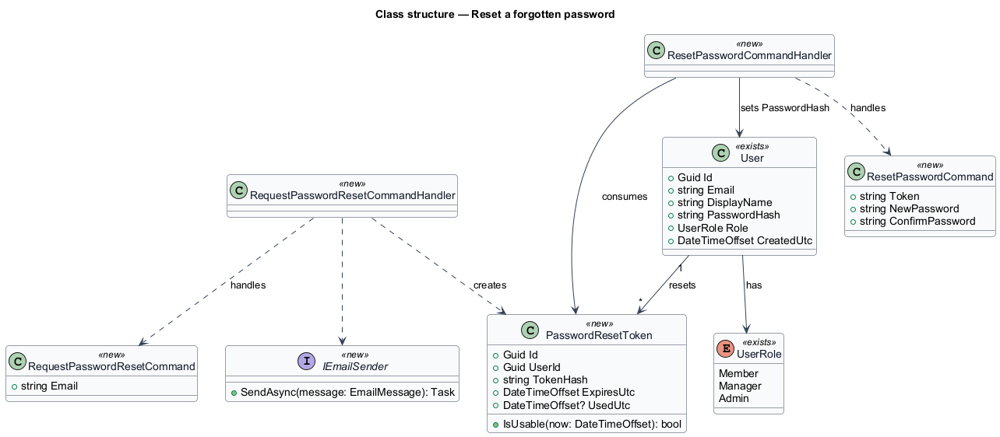
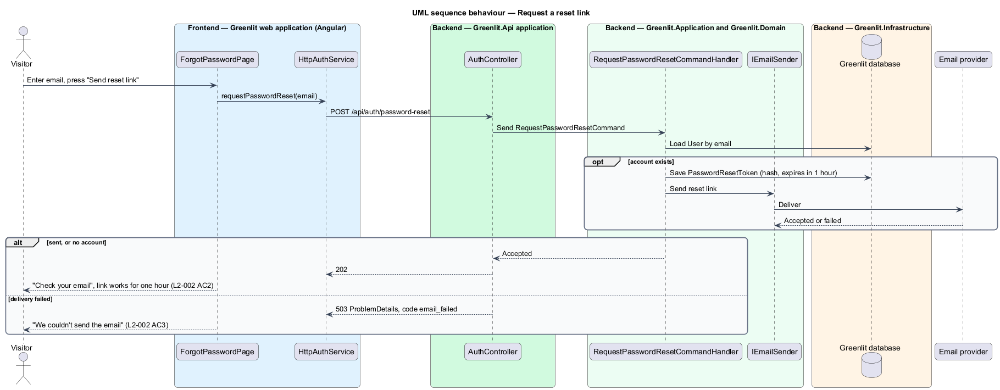
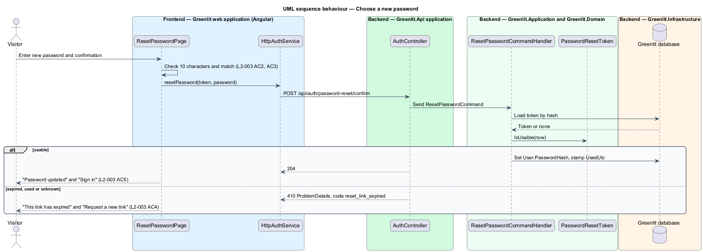

# Reset a forgotten password

## Overview

A person who has forgotten their password asks Greenlit for a reset link. Greenlit emails a link to the address if an account exists, and says the same thing either way so the page does not reveal which addresses have accounts.

The link opens a page where the person chooses a new password of at least 10 characters. A link works for one hour and only once.

**reset token** — single-use random secret embedded in the reset link; Greenlit stores only its hash, with an expiry one hour after issue

## Description

The feature is a vertical slice from the Greenlit web application to the Greenlit database.

**Frontend**

- **`ForgotPasswordPage`** — Bare-shell page. It posts the email and shows "Check your email" or "We couldn't send the email".
- **`ResetPasswordPage`** — Bare-shell page that reads the token from the link. It validates length and confirmation client-side and shows "This link has expired" or "Password updated".
- **`AuthService / AUTH_SERVICE`** — Adds `requestPasswordReset(email)` and `resetPassword(token, password)`.

**Backend**

- **`AuthController`** — Adds `POST /api/auth/password-reset` (204 whether or not the address has an account), `GET /api/auth/password-reset/{token}` (204 if the link works, 410 `reset_link_expired` if not, so the page can say so on opening, `L2-003` AC4) and `POST /api/auth/password-reset/confirm`, all `[AllowAnonymous]`.
- **`RequestPasswordResetCommandHandler`** — Creates a `PasswordResetToken` for an existing user and emails the link. For an unknown address it returns the same success, so the response does not disclose the account.
- **`ResetPasswordCommandHandler`** — Hashes the presented token, finds an unused token not past `ExpiresUtc`, sets the new password hash and stamps `UsedUtc`. An expired or used token raises code `reset_link_expired`.
- **`ResetPasswordCommandValidator`** — Requires at least 10 characters and a matching confirmation.
- **`PasswordResetToken`** — New entity: `Id`, `UserId`, `TokenHash`, `ExpiresUtc`, `UsedUtc`.
- **`TimeProvider`** — the .NET clock the application already injects; tests replace it to fix "now" (the design's `IClock` is this).
- **`IEmailSender`** — Greenlit.Application abstraction (ADR-006) implemented in Greenlit.Infrastructure by `LoggingEmailSender`, which writes the message to the log. This design reuses it; the reset email's words live in `PasswordResetEmail`.

**Shared plumbing (exists today)**

- **`ExceptionHandlingMiddleware`** — Greenlit.Api middleware. It maps application exceptions (`ValidationException`, `NotFoundException`, `ForbiddenException`, `ConflictException`, `BadRequestException`) to ProblemDetails responses with a `code` extension.
- **`ValidationBehavior`** — MediatR pipeline behaviour in Greenlit.Application. It runs each request's FluentValidation validator before the handler and raises `ValidationException` on failure.
- **`IAppDbContext`** — Greenlit.Application abstraction over the EF Core context, implemented by `AppDbContext` in Greenlit.Infrastructure. Handlers read and write through it in one unit of work.

## Requirements

The feature realizes the following level-2 (L2) requirements. Each L2 requirement refines a level-1 (L1) requirement, cited by identifier; the acceptance criteria for each are in `docs/specs/L2.md`.

| L2 ID | Refines (L1) | Requirement |
|-------|--------------|-------------|
| `L2-002` | `L1-001` | **Forgot password.** A person asks for a password reset link by email. |
| `L2-003` | `L1-001` | **Reset password.** A reset link lets a person choose a new password once, within one hour. |

## Diagrams

### System context

A visitor resets their password through Greenlit, which sends the link through the email provider.

### Containers

Both pages call the Greenlit API; the API stores the token hash in the Greenlit database and sends the email.

### Components

One handler issues and emails the token; a second handler checks and consumes it.

### Class structure

Each `User` may hold several `PasswordResetToken` rows; `IsUsable` combines the one-hour expiry and the single-use rule.

### Behaviour — request a reset link

The response is the same whether or not the address has an account (`L2-002` AC2). Only a delivery failure changes it (`L2-002` AC3).

### Behaviour — choose a new password

The token is usable once within one hour (`L2-003` AC4); the password rules match `L2-003` AC2 and AC3.

## Decisions and open questions resolved

- **Email provider** — none yet; `LoggingEmailSender` (ADR-006, ADR-011). The link is `{Greenlit:App:Origin}/reset-password/{token}`.
- **Token** — 32 random bytes, base64url; only the SHA-256 hash is stored (`PasswordResetToken.TokenHash`). A new request retires the person's earlier unused tokens, so only the newest link works.
- **Unknown or used token** — both answer `reset_link_expired` (410). Nothing tells a never-issued token from a used one.
- **Delivery failure** — `POST /api/auth/password-reset` answers 503 with code `email_failed` and the token just made is removed (`L2-002` AC3). Delivery can only fail for an address with an account, so an outage lets a caller infer existence; this is accepted because `L2-002` AC3 requires the failure to be shown.
- **Other sessions** — sessions are stateless eight-hour bearer tokens (ADR-004), so a reset cannot end them. Not done.
- **Confirmation** — the confirm request carries `password` and `confirmPassword`; the API checks length (`New password must be at least 10 characters`) and a match (`Passwords don't match`).
- **Sign-in** — the reset does not sign the person in; the success state offers "Sign in".
