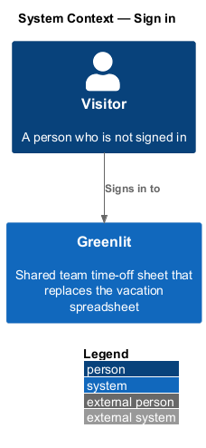
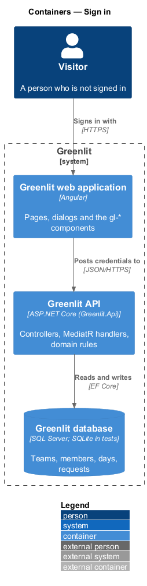
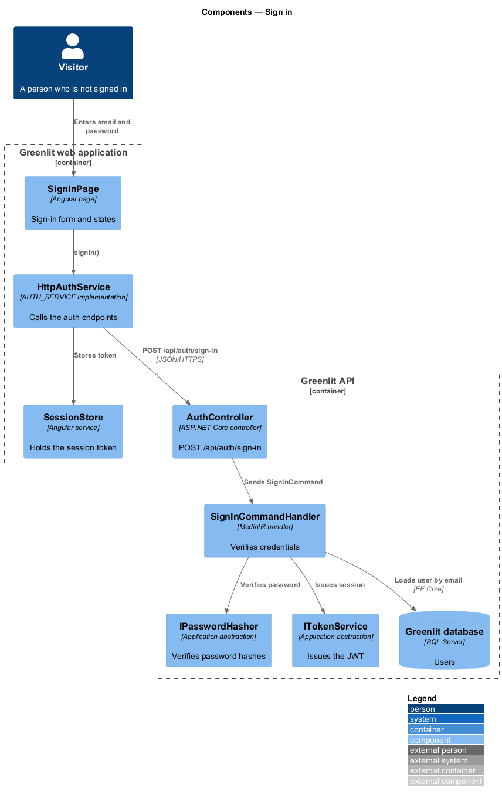
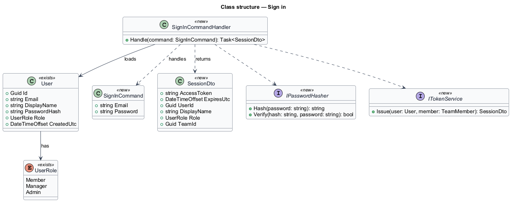
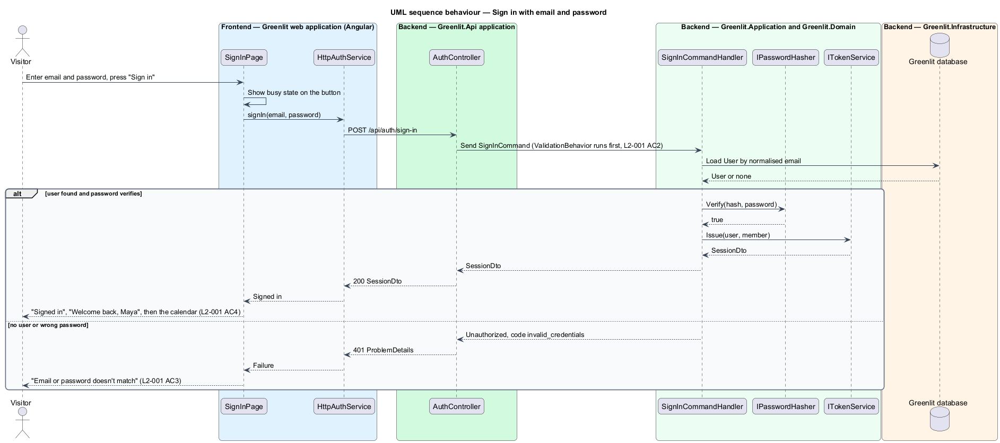

# Sign in

## Overview

Greenlit is a shared time-off sheet for a small team. Every page except the sign-in, password and invitation pages requires a signed-in user, because each request is scoped to the caller's team.

This feature covers the sign-in page. A person enters an email address and a password. Greenlit checks them against the stored account and, on success, issues a session and opens the calendar. Greenlit is invite-only, so the page offers no self sign-up; it tells a newcomer to ask a manager for an invitation.

**session** — signed JWT bearer token that identifies the user, their team and their role until it expires

**invite-only** — property of Greenlit whereby accounts exist only for people a manager has invited

## Description

The feature is a vertical slice from the Greenlit web application to the Greenlit database.

**Frontend**

- **`SignInPage`** — Angular page at the bare shell (`data: { shell: 'bare', page: 'sign-in' }`). It renders the form, the error summary and the success panel from `docs/mocks/pages/sign-in/*`, and navigates to the calendar after "Signed in".
- **`AuthService / AUTH_SERVICE`** — Contract and injection token in the `api` project. `signIn(email, password)` returns the session or a typed failure; the HTTP implementation `HttpAuthService` stores the token.
- **`SessionStore`** — Holds the current token and user summary in memory and in browser storage; an HTTP interceptor adds the `Authorization: Bearer` header.

**Backend**

- **`AuthController`** — Greenlit.Api controller with `POST /api/auth/sign-in`, marked `[AllowAnonymous]`.
- **`SignInCommand / SignInCommandHandler`** — MediatR request and handler. The handler loads the `User` by normalised email, verifies the password hash, and returns a `SessionDto`. A wrong email and a wrong password both raise the same failure, code `invalid_credentials`.
- **`SignInCommandValidator`** — Rejects an empty email ("Enter your email address.") or an empty password ("Enter your password.").
- **`IPasswordHasher`** — Greenlit.Application abstraction, implemented in Greenlit.Infrastructure with ASP.NET Core Identity's `PasswordHasher<User>`.
- **`ITokenService`** — Issues the JWT from the existing `JwtOptions` with the claims `sub`, `team_id`, `team_member_id` and `role`. Token lifetime: `<TO SUPPLY>`.
- **`User`** — Existing entity (`Id`, `Email`, `DisplayName`, `PasswordHash`, `Role`, `CreatedUtc`).

**Shared plumbing (exists today)**

- **`ExceptionHandlingMiddleware`** — Greenlit.Api middleware. It maps application exceptions (`ValidationException`, `NotFoundException`, `ForbiddenException`, `ConflictException`, `BadRequestException`) to ProblemDetails responses with a `code` extension.
- **`ValidationBehavior`** — MediatR pipeline behaviour in Greenlit.Application. It runs each request's FluentValidation validator before the handler and raises `ValidationException` on failure.
- **`IAppDbContext`** — Greenlit.Application abstraction over the EF Core context, implemented by `AppDbContext` in Greenlit.Infrastructure. Handlers read and write through it in one unit of work.

## Requirements

The feature realizes the following level-2 (L2) requirements. Each L2 requirement refines a level-1 (L1) requirement, cited by identifier; the acceptance criteria for each are in `docs/specs/L2.md`.

| L2 ID | Refines (L1) | Requirement |
|-------|--------------|-------------|
| `L2-001` | `L1-001` | **Sign in.** A person signs in with email and password. Greenlit is invite-only, and the sign-in page says so. |

## Diagrams

### System context

A visitor signs in to Greenlit. No external system takes part.

### Containers

The sign-in page posts the credentials to the Greenlit API, which reads the user from the Greenlit database.

### Components

`AuthController` sends a `SignInCommand`; the handler verifies the password through `IPasswordHasher` and issues the token through `ITokenService`. `SessionStore` keeps the token for later requests.

### Class structure

`SignInCommandHandler` loads the existing `User` entity and returns a `SessionDto`; the hashing and token services are abstractions with Infrastructure implementations.

### Behaviour — sign in with email and password

The validator rejects empty fields before the handler runs (`L2-001` AC2). A mismatch returns `invalid_credentials`, which the page shows as "Email or password doesn't match" without saying which field was wrong (`L2-001` AC3).

