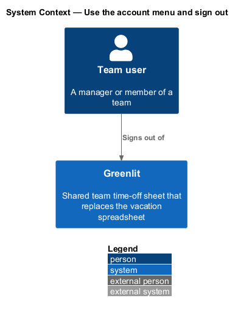
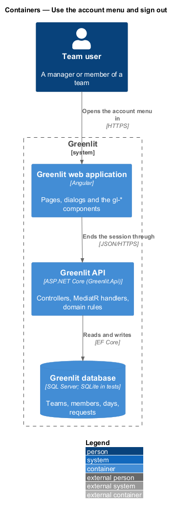
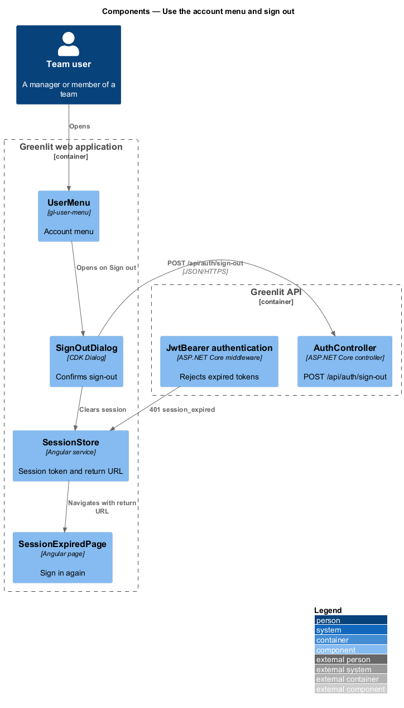
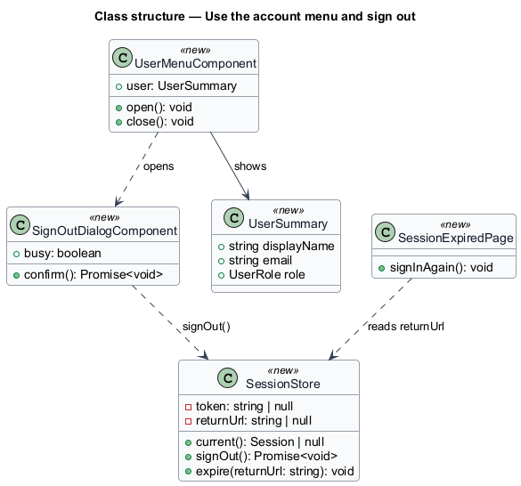
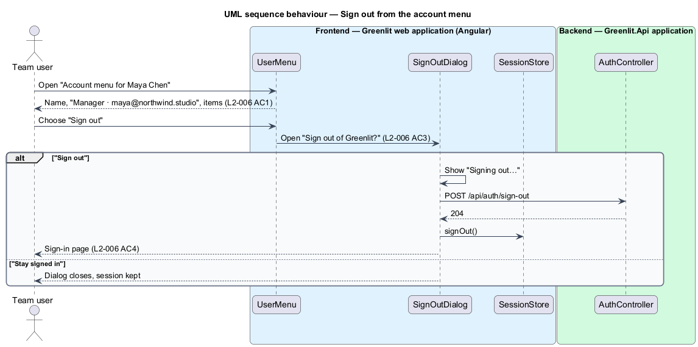
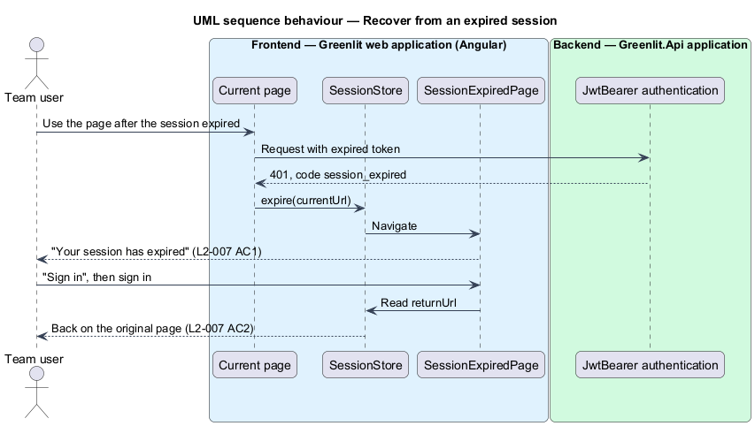

# Use the account menu and sign out

## Overview

The avatar at the right of the header opens the account menu. The menu names the signed-in person and their role, and links to their own person page, the Account page, the brand guide and sign-out.

Signing out asks for confirmation in a dialog. Greenlit also ends a session that has expired and sends the person to a page that offers to sign in again and return to where they were.

**account menu** — menu attached to the header avatar, following the WAI-ARIA menu button pattern

**session expiry** — point at which the session token stops being accepted; its duration is `<TO SUPPLY>`

## Description

The feature is a vertical slice from the Greenlit web application to the Greenlit database.

**Frontend**

- **`UserMenu`** — `gl-user-menu` component built on the CDK Overlay. Escape closes it and returns focus to the avatar; arrow keys move between items.
- **`SignOutDialog`** — CDK Dialog in `app/dialogs/sign-out`. It shows "Signing out…" while busy.
- **`SessionStore`** — Clears the token on sign-out. The HTTP interceptor turns a `401` with code `session_expired` into navigation to the session-expired page, remembering the current URL.
- **`SessionExpiredPage`** — Bare-shell page (`page: 'session-expired'`) whose "Sign in" returns to the remembered URL after signing in.

**Backend**

- **`AuthController`** — `POST /api/auth/sign-out` records the sign-out. Server-side token revocation is `<TO SUPPLY>`; without it the client discards the token.
- **`JwtBearer middleware`** — Existing ASP.NET Core authentication. An expired token fails validation and the API returns `401`.

**Shared plumbing (exists today)**

- **`ExceptionHandlingMiddleware`** — Greenlit.Api middleware. It maps application exceptions (`ValidationException`, `NotFoundException`, `ForbiddenException`, `ConflictException`, `BadRequestException`) to ProblemDetails responses with a `code` extension.
- **`ValidationBehavior`** — MediatR pipeline behaviour in Greenlit.Application. It runs each request's FluentValidation validator before the handler and raises `ValidationException` on failure.
- **`IAppDbContext`** — Greenlit.Application abstraction over the EF Core context, implemented by `AppDbContext` in Greenlit.Infrastructure. Handlers read and write through it in one unit of work.

## Requirements

The feature realizes the following level-2 (L2) requirements. Each L2 requirement refines a level-1 (L1) requirement, cited by identifier; the acceptance criteria for each are in `docs/specs/L2.md`.

| L2 ID | Refines (L1) | Requirement |
|-------|--------------|-------------|
| `L2-006` | `L1-001` | **User menu and sign out.** The avatar in the header opens the account menu; signing out asks for confirmation. |
| `L2-007` | `L1-001` | **Session expiry.** A session that has expired sends the person to sign in again. |

## Diagrams

### System context

A signed-in team user signs out of Greenlit; no external system takes part.

### Containers

The web application ends the session and tells the Greenlit API; the API rejects expired tokens.

### Components

The menu opens the sign-out dialog; an expired token reaches `SessionStore` as a `401` and leads to the session-expired page.

### Class structure

The slice is mostly frontend: `SessionStore` owns the token and the return URL used by the session-expired page.

### Behaviour — sign out from the account menu

"Stay signed in" closes the dialog and keeps the session (`L2-006` AC4).

### Behaviour — recover from an expired session

The return URL saved at expiry brings the person back to the page they were on (`L2-007` AC2).

