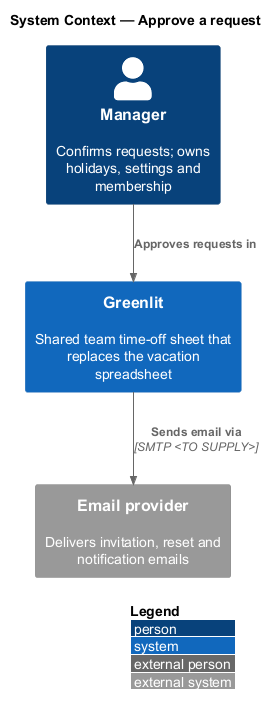
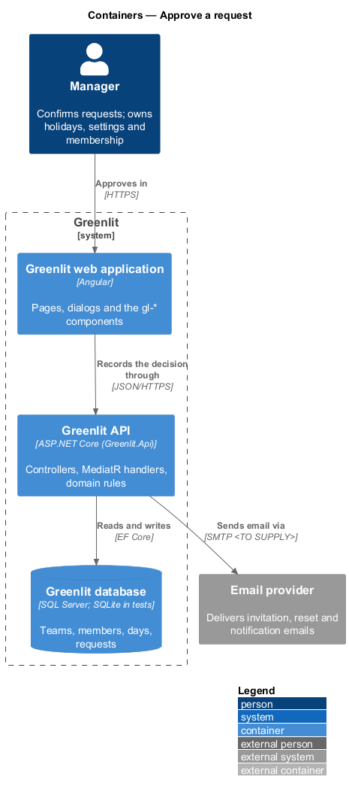
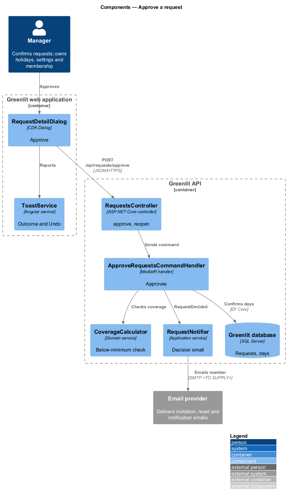
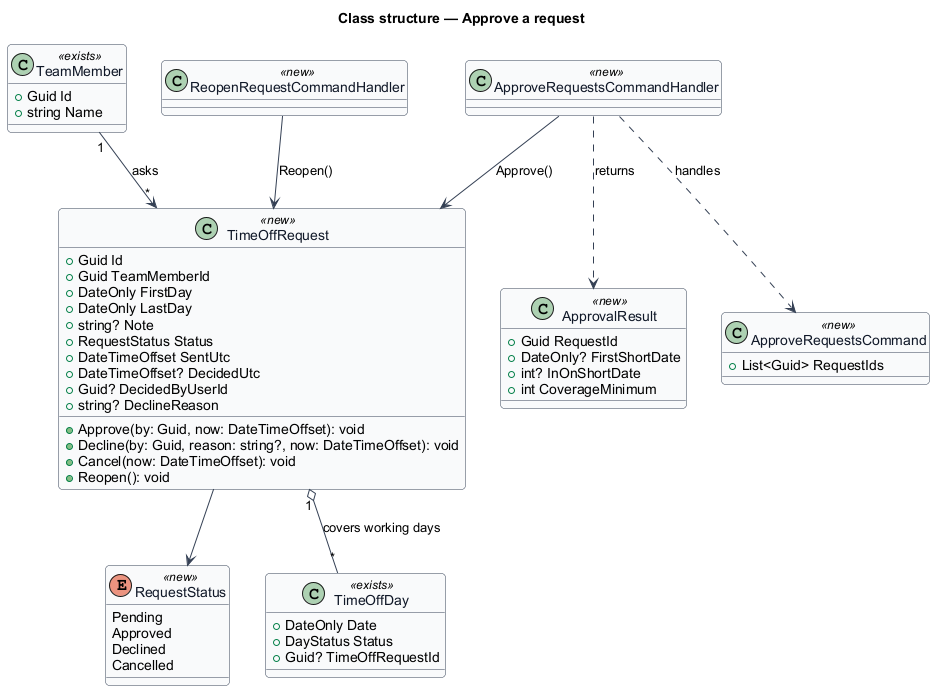
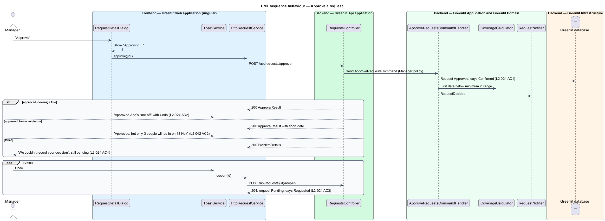

# Approve a request

## Overview

Approving a request confirms its days: the request becomes Approved, its yellow days turn green, and the member is emailed when decision emails are on. A toast confirms the approval and offers Undo, which returns the request to Pending.

When the approval leaves fewer people in than the coverage minimum on any day, the toast says so. The approval still stands; the warning informs the manager.

## Description

The feature is a vertical slice from the Greenlit web application to the Greenlit database.

**Frontend**

- **`RequestRow / RequestDetailDialog`** — Both call `approve([id])`; the dialog shows "Approving…" while busy and "Try approving again" on failure.
- **`ToastService`** — Shows "Approved Ana’s time off", or "Approved, but only {n} people will be in on {date}" with "That’s below your minimum of {min}.", each with Undo.
- **`RequestService / REQUEST_SERVICE`** — Contract and injection token in the `api` project: `mine()`, `list(status)`, `get(id)`, `send(request)`, `cancel(id)`, `approve(ids)`, `decline(id, reason)` and `reopen(id)`.

**Backend**

- **`RequestsController`** — `POST /api/requests/approve` (one or many ids) and `POST /api/requests/{id}/reopen` for Undo.
- **`ApproveRequestsCommandHandler`** — Calls `TimeOffRequest.Approve`, sets the linked days to Confirmed with `ConfirmedUtc`, commits, asks `CoverageCalculator` for the first date below the minimum in the range, and calls `RequestNotifier.RequestDecided`.
- **`ReopenRequestCommandHandler`** — Calls `TimeOffRequest.Reopen` and returns the days to Requested. Undo sends no follow-up email (see the decisions below).
- **`CoverageCalculator`** — Defined in `teams/coverage-minimum`.

**Shared plumbing (exists today)**

- **`ExceptionHandlingMiddleware`** — Greenlit.Api middleware. It maps application exceptions (`ValidationException`, `NotFoundException`, `ForbiddenException`, `ConflictException`, `BadRequestException`) to ProblemDetails responses with a `code` extension.
- **`ValidationBehavior`** — MediatR pipeline behaviour in Greenlit.Application. It runs each request's FluentValidation validator before the handler and raises `ValidationException` on failure.
- **`IAppDbContext`** — Greenlit.Application abstraction over the EF Core context, implemented by `AppDbContext` in Greenlit.Infrastructure. Handlers read and write through it in one unit of work.

**Request lifecycle.** A `TimeOffRequest` starts `Pending`. The manager moves it to `Approved` or `Declined`; the member moves a pending request to `Cancelled`. Undo after a decision calls `Reopen`, which returns it to `Pending`. Each transition updates the request's `TimeOffDay` rows in the same unit of work: Pending = Requested, Approved = Confirmed, Declined = Tentative (from the mocks' declined request, whose days show tentative), Cancelled = row removed.

## Decisions for the first build (journey 8)

- **Where it is done.** A minimal Requests page (`/requests`, `pages/requests/default`) lists the pending requests for the manager, each row with Approve and a name button that opens the request detail drawer (`dialogs/request-detail/default`). The tabs, "Select all", overlaps, bulk approve and the drawer's "Team those weeks" are journey 9 (`requests/review-requests`, built); Decline is journey 10, so neither the row nor the drawer shows Decline yet, and "Days left after" waits for journey 11. A member who opens `/requests` is sent to the calendar (journey 13 gives members "My requests" at that address, `pages/requests/member`); the main navigation already shows Requests to everyone.
- **Endpoints.** `GET /api/requests?status=Pending` lists the team's requests with that status, oldest first, as `{ id, memberId, memberName, firstDay, lastDay, days, note, status, sentUtc }` (manager only; `status` defaults to `Pending`; journey 9 added the other tabs and the fields `decidedUtc`, `declineReason` and `overlaps`, see `requests/review-requests`). `POST /api/requests/approve` takes `{ ids }` and answers 200 with one `ApprovalResult` per id: `{ requestId, memberName, firstDay, lastDay, days, emailed, coverageMinimum, firstShortDate, inOnShortDate }`; the two short fields are null unless a day falls below the minimum. `POST /api/requests/{id}/reopen` answers 204.
- **Who and which team.** All three are manager-only: a member gets 403 `forbidden`, a caller on no team 404. A request id that is unknown or belongs to another team is the same 404 `request_not_found`, so nothing about other teams leaks. `approve` is all or nothing: if any id is unknown, another team's, or not pending (409 `request_not_pending`), nothing changes. An empty `ids` list or more than 100 is a 400 validation error. Errors name no one but the caller's own team.
- **Approve.** `TimeOffRequest.Approve(by, now)` requires `Pending`, sets `Approved`, `DecidedUtc` and `DecidedByUserId`, and the handler sets every linked `TimeOffDay` to `Confirmed` with `ConfirmedUtc`, in one `SaveChangesAsync`. Linked days keep their `TimeOffRequestId` while the request is Approved (so Undo can find them); the comment on `TimeOffDay.TimeOffRequestId` says so.
- **Reopen (Undo).** `TimeOffRequest.Reopen()` requires `Approved` (409 `request_not_approved`), returns it to `Pending`, clears the decision, and the handler turns its still-Confirmed linked days back to `Requested` (a day the manager has since changed or cleared is left as it is). **Undo sends no follow-up email**: the member was told once, and a second message would only confuse; the decision email is the only one.
- **Coverage.** `Team.CoverageMinimum` (int, default 0 = no minimum, so nothing is ever flagged until the manager sets one) is added now because the warning needs it; setting it is journey 17 (`teams/coverage-minimum`), and the demo seed sets it to 4 as the mocks show. `CoverageCalculator` (Application, shared later with the sheet) counts for each working day of the request (not a weekend or holiday) the members out (Requested or Confirmed) and the members in (team size minus out); the first date, earliest first, where in is below the minimum is the short date. It is read after the days are confirmed, so the number is what the team will look like. The approval stands either way (`L2-042` AC2); the toast changes to "Approved, but only {n} people will be in on {date}" with "That’s below your minimum of {min}." and "Undo". With several ids, each result is computed after all are confirmed. `L2-042` AC1 and AC3 (the Out row outline and the drawer grid) are journeys 17 and 9, where the sheet and the grid render coverage.
- **Email.** `RequestNotifier` (Application) composes the decision email in one place (`ApprovalEmail`) and sends it through `IEmailSender` after the days are saved: "Your time off was approved", "Maya Chen approved your request for 16–20 Nov. It is on the calendar in green." The address is the row's email, or its account's. Decision emails are always sent until the Decisions switch of journey 25 exists; that journey makes the notifier read it. A member with no address, or a send that fails, does not undo the approval: `emailed` is false and the toast drops "and Ana has been emailed". The failure is logged. (ADR-006: development and the e2e API log the message.)
- **Toast copy.** Success: "Approved {first name}’s time off" with "{range} is green on the calendar and {first name} has been emailed." (or just "{range} is green on the calendar." when `emailed` is false), action "Undo". Failure: danger toast "We couldn’t approve {first name}’s request", "It’s still pending. Check your connection and try again." with "Try again" (`notifications/request-toast/danger`). Undo that works clears the toast and puts the row back; one that fails shows "We couldn’t undo that" with "Try again".
- **Busy and failed.** Pressing Approve in a row sets `aria-busy` and "Approving…" on that row's button and disables the others on the row; in the drawer the footer button reads "Approving…" (`busy`) and, after a failure, an alert "We couldn’t record your decision" / "Check your connection and try again. The request is still pending." with the button reading "Try approving again" (`failed`). On success the drawer closes and the row leaves the pending list.
- **Open question closed.** Undo and email: no follow-up (above). The decision emails' transport is the logging sender of ADR-006.

## Requirements

The feature realizes the following level-2 (L2) requirements. Each L2 requirement refines a level-1 (L1) requirement, cited by identifier; the acceptance criteria for each are in `docs/specs/L2.md`.

| L2 ID | Refines (L1) | Requirement |
|-------|--------------|-------------|
| `L2-024` | `L1-005` | **Approve a request.** Approving confirms the request's days. |
| `L2-042` | `L1-010` | **Coverage flags.** Days below the minimum are flagged. |

## Diagrams

### System context

The manager approves requests in Greenlit, which emails the member through the email provider.

### Containers

The approval is one call to the Greenlit API; Undo is a second call that reopens the request.

### Components

The handler confirms the days, checks coverage, then notifies; the toast reads the coverage result.

### Class structure

`ApprovalResult` carries the first short date, which turns the success toast into the coverage warning.

### Behaviour — approve a request

Coverage below the minimum changes the toast, not the outcome (`L2-042` AC2). Undo returns the request to Pending and its days to Requested (`L2-024` AC3).

