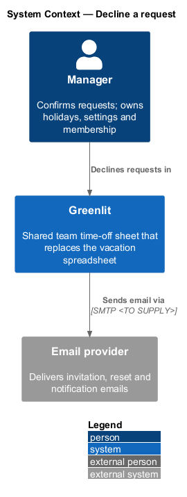
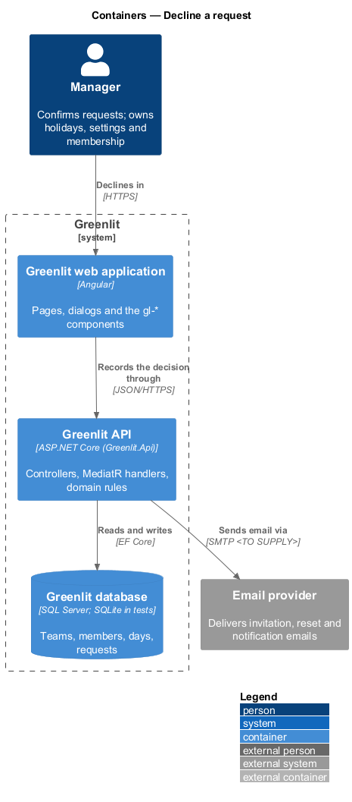
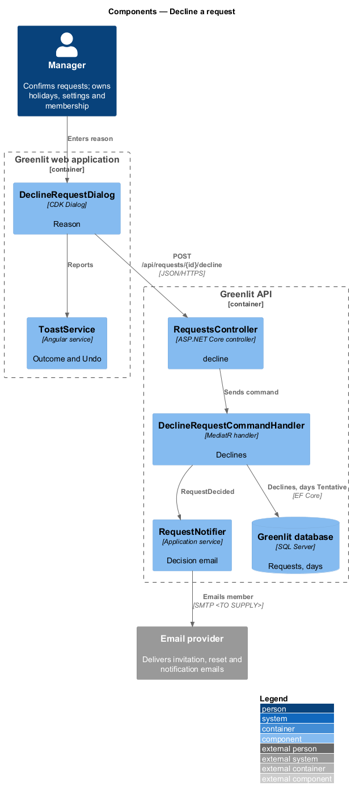
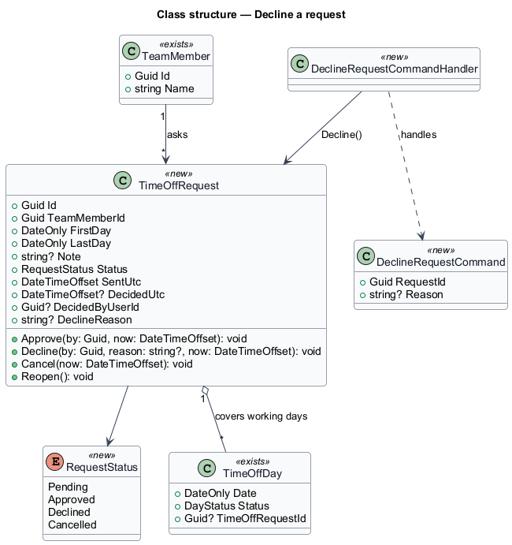
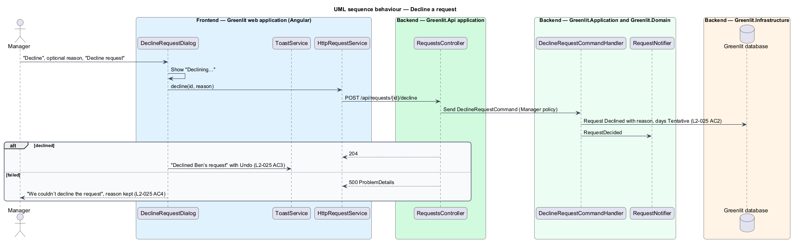

# Decline a request

## Overview

Declining returns a request to the member with an optional reason. The request becomes Declined and its days go back to tentative on the member's row, so the member can move them or request again. The member is emailed the reason when decision emails are on.

**decline reason** — optional free text from the manager, shown to the member and kept with the request

## Description

The feature is a vertical slice from the Greenlit web application to the Greenlit database.

**Frontend**

- **`DeclineRequestDialog`** — CDK Dialog in `app/dialogs/decline-request` with Reason (optional), "Keep pending" and "Decline request". A failure keeps the reason (`L2-025` AC4).
- **`ToastService`** — Shows "Declined Ben’s request" and "Ben has been emailed your reason." with Undo.
- **`RequestService / REQUEST_SERVICE`** — Contract and injection token in the `api` project: `mine()`, `list(status)`, `get(id)`, `send(request)`, `cancel(id)`, `approve(ids)`, `decline(id, reason)` and `reopen(id)`.

**Backend**

- **`RequestsController`** — `POST /api/requests/{id}/decline` with `{ reason }`, manager only, own team only; it answers a `DeclineResult` (request id, member name, range, days, whether the member was `emailed`, the reason) for the toast. A request that is unknown or on another team is one 404 `request_not_found`, one that is not Pending a 409 `request_not_pending`, a member caller a 403 `forbidden`. Undo uses `POST /api/requests/{id}/reopen`, which now also accepts a Declined request.
- **`DeclineRequestCommandHandler`** — Calls `TimeOffRequest.Decline(by, reason, now)`, sets the linked days to Tentative, commits and calls `RequestNotifier.RequestDecided`.
- **`DeclineRequestCommandValidator`** — Reason of at most 500 characters (the same limit as a request note); blank or white space means no reason and is stored as null.

**Decisions (journey 10)**

- The days of a declined request keep their link to it, so Undo finds exactly them: `Reopen` on a Declined request returns every day still Tentative and linked to it to Requested. A day the member or manager has since changed is not Tentative any more, or points at a newer request, and is left alone.
- Declining a Cancelled request is the same 409 as any request that is not Pending.
- The email (`RequestNotifier.DeclinedAsync`) has the subject "Your time off request was declined" and quotes the reason when there is one. It is sent after the decision is saved, so a mail failure never undoes it; `emailed` is false when the member has no address or sending failed, and the toast then drops "has been emailed your reason". Without a reason the toast body is "Ben has been emailed." Undo sends no second email.
- Privacy: the reason is shown only to the manager (ledger, detail) and emailed to the member it concerns; an error never says whether a request exists on another team.

**Shared plumbing (exists today)**

- **`ExceptionHandlingMiddleware`** — Greenlit.Api middleware. It maps application exceptions (`ValidationException`, `NotFoundException`, `ForbiddenException`, `ConflictException`, `BadRequestException`) to ProblemDetails responses with a `code` extension.
- **`ValidationBehavior`** — MediatR pipeline behaviour in Greenlit.Application. It runs each request's FluentValidation validator before the handler and raises `ValidationException` on failure.
- **`IAppDbContext`** — Greenlit.Application abstraction over the EF Core context, implemented by `AppDbContext` in Greenlit.Infrastructure. Handlers read and write through it in one unit of work.

**Request lifecycle.** A `TimeOffRequest` starts `Pending`. The manager moves it to `Approved` or `Declined`; the member moves a pending request to `Cancelled`. Undo after a decision calls `Reopen`, which returns it to `Pending`. Each transition updates the request's `TimeOffDay` rows in the same unit of work: Pending = Requested, Approved = Confirmed, Declined = Tentative (from the mocks' declined request, whose days show tentative), Cancelled = row removed.

## Requirements

The feature realizes the following level-2 (L2) requirements. Each L2 requirement refines a level-1 (L1) requirement, cited by identifier; the acceptance criteria for each are in `docs/specs/L2.md`.

| L2 ID | Refines (L1) | Requirement |
|-------|--------------|-------------|
| `L2-025` | `L1-005` | **Decline a request.** Declining returns the request to the member with an optional reason. |

## Diagrams

### System context

The manager declines requests in Greenlit, which emails the reason through the email provider.

### Containers

The dialog sends the decision to the Greenlit API.

### Components

`DeclineRequestCommandHandler` records the decision and the reason, then notifies the member.

### Class structure

`TimeOffRequest.Decline` stores the reason and moves the covered days to `Tentative`.

### Behaviour — decline a request

A blank reason declines without one (`L2-025` AC1, AC2); a failure leaves the request pending with the reason still typed (`L2-025` AC4).

