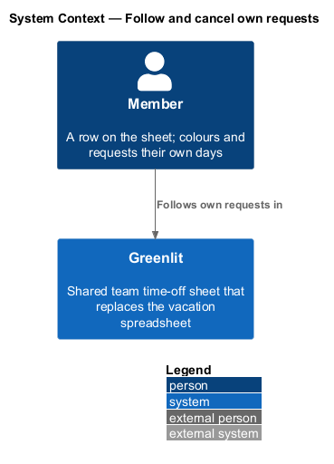
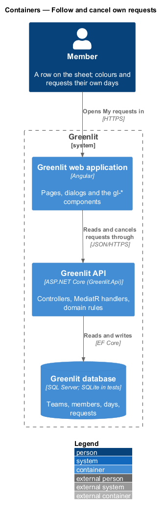
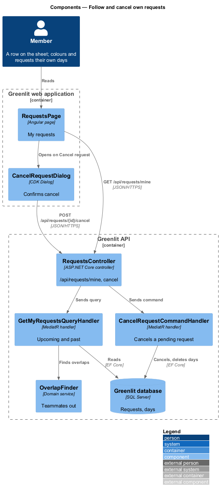
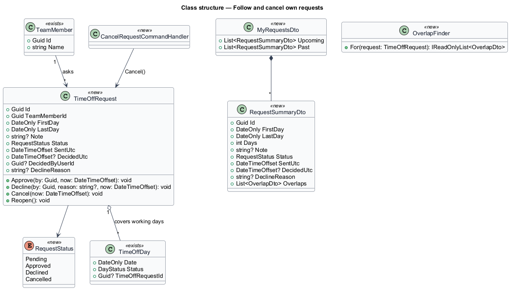
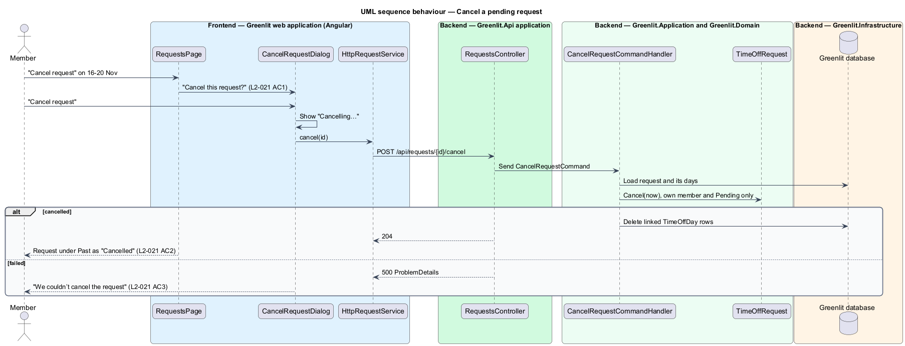

# Follow and cancel own requests

## Overview

A member's Requests page is titled My requests. It lists the member's requests in two groups: Upcoming (pending and future) and Past (decided or cancelled). Each entry shows the dates, the number of days, when it was sent, the note, any overlap with teammates and its status.

A member may cancel a request the manager has not decided. Cancelling removes the request and clears its yellow days from the member's row.

**overlap** — teammate whose requested or confirmed days fall inside the request's range, shown as "Dev also out 18–19 Nov"

## Description

The feature is a vertical slice from the Greenlit web application to the Greenlit database.

**Frontend**

- **`RequestsPage`** — App-shell page (`page: 'requests'`). For a member it renders My requests with "New request", the Upcoming and Past lists, and the empty texts "Nothing planned yet." and "No past requests."
- **`RequestRow`** — `gl-request-row` component shared with the manager's ledger.
- **`CancelRequestDialog`** — CDK Dialog in `app/dialogs/cancel-request` with "Keep request" and "Cancel request".
- **`RequestService / REQUEST_SERVICE`** — Contract and injection token in the `api` project: `mine()`, `list(status)`, `get(id)`, `send(request)`, `cancel(id)`, `approve(ids)`, `decline(id, reason)` and `reopen(id)`.

**Backend**

- **`RequestsController`** — `GET /api/requests/mine` and `POST /api/requests/{id}/cancel`.
- **`GetMyRequestsQueryHandler`** — Returns the caller's requests split into upcoming and past, each with its overlaps from `OverlapFinder`.
- **`CancelRequestCommandHandler`** — Allows only the request's own member and only while `Pending` (code `not_pending`). It calls `TimeOffRequest.Cancel` and deletes the linked `TimeOffDay` rows.
- **`OverlapFinder`** — Domain service: for a range, lists each other member with requested or confirmed days inside it and the dates they cover.

**Shared plumbing (exists today)**

- **`ExceptionHandlingMiddleware`** — Greenlit.Api middleware. It maps application exceptions (`ValidationException`, `NotFoundException`, `ForbiddenException`, `ConflictException`, `BadRequestException`) to ProblemDetails responses with a `code` extension.
- **`ValidationBehavior`** — MediatR pipeline behaviour in Greenlit.Application. It runs each request's FluentValidation validator before the handler and raises `ValidationException` on failure.
- **`IAppDbContext`** — Greenlit.Application abstraction over the EF Core context, implemented by `AppDbContext` in Greenlit.Infrastructure. Handlers read and write through it in one unit of work.

**Request lifecycle.** A `TimeOffRequest` starts `Pending`. The manager moves it to `Approved` or `Declined`; the member moves a pending request to `Cancelled`. Undo after a decision calls `Reopen`, which returns it to `Pending`. Each transition updates the request's `TimeOffDay` rows in the same unit of work: Pending = Requested, Approved = Confirmed, Declined = Tentative (from the mocks' declined request, whose days show tentative), Cancelled = row removed.

## Requirements

The feature realizes the following level-2 (L2) requirements. Each L2 requirement refines a level-1 (L1) requirement, cited by identifier; the acceptance criteria for each are in `docs/specs/L2.md`.

| L2 ID | Refines (L1) | Requirement |
|-------|--------------|-------------|
| `L2-020` | `L1-005` | **My requests.** A member sees their own requests split into upcoming and past. |
| `L2-021` | `L1-005` | **Cancel a request.** A member withdraws a request the manager has not decided. |

## Diagrams

### System context

A member follows and cancels their own requests in Greenlit.

### Containers

The page reads the member's requests from the Greenlit API and cancels through it.

### Components

The query handler groups the requests and adds overlaps; the cancel handler enforces own-and-pending.

### Class structure

`RequestSummaryDto` is the row shape shared by My requests and the manager's ledger.

### Behaviour — cancel a pending request

Only a pending request offers cancel (`L2-021` AC4). Cancelling clears the yellow days from the member's row (`L2-021` AC2).

