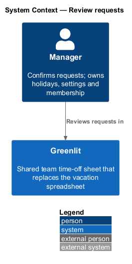
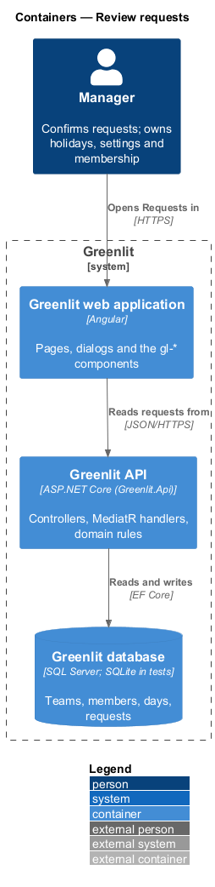
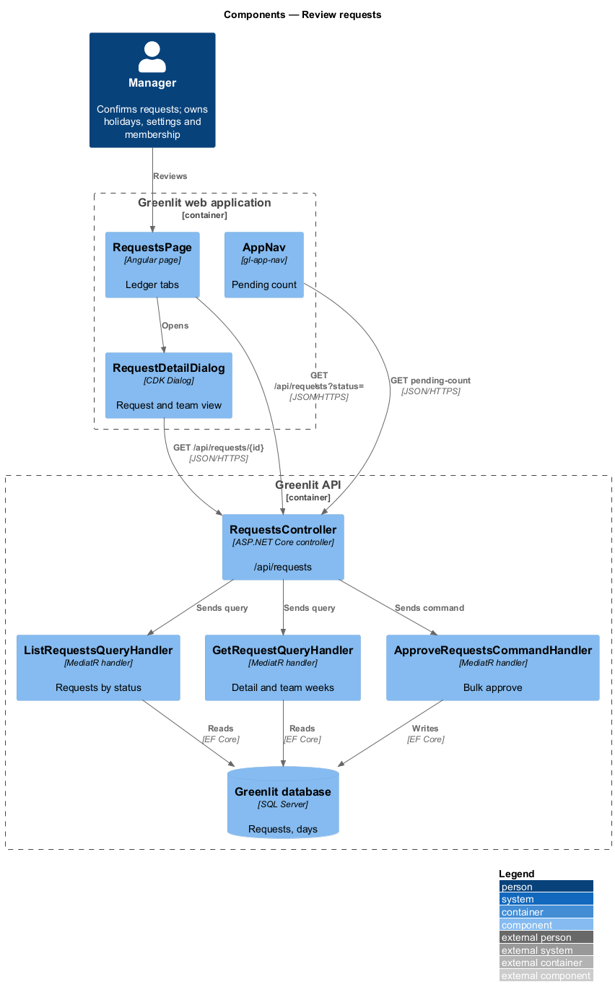
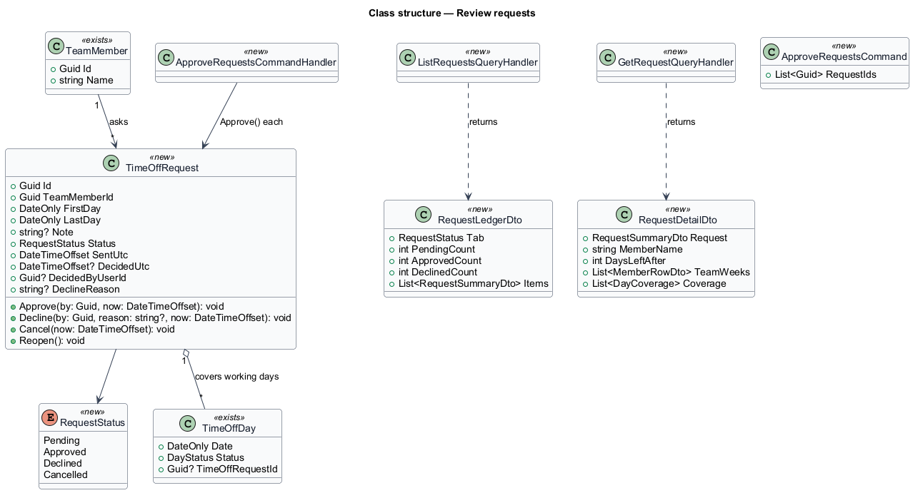
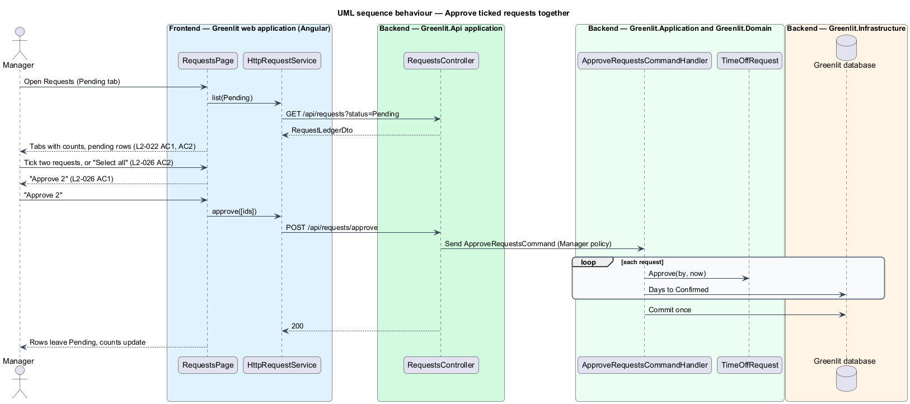

# Review requests

## Overview

For the manager, the Requests page is the team's ledger. Tabs split it into Pending, Approved and Declined, each with its count, and the main navigation shows the pending count on every page. Each pending entry shows the person, the dates, the note and the overlaps, with Decline and Approve.

Opening a request shows its detail: status, when it was sent, the days the member has left after it, the note, and the team for the weeks around it with the Out row. The manager may also tick several pending requests and approve them together.

**ledger** — manager's list of every request on the team, grouped by status

**team those weeks** — grid of every member for the request's dates, with the Out row, shown in the request detail

## Description

The feature is a vertical slice from the Greenlit web application to the Greenlit database.

**Frontend**

- **`RequestsPage`** — For the manager it renders the Pending, Approved and Declined tabs with counts (the mock's `tablist`; the selected tab is `aria-selected`, arrow keys move between tabs), the "Select all" checkbox and "Approve {n}" (Pending tab only), and one row per request in `gl-request-list`. A pending row shows the checkbox "Select {name}'s request", the overlaps line, and Approve; an Approved, Declined or Cancelled row shows "Sent {date} · decided {date}" (or "Reason: {reason}") and its status. The empty text is "Nothing waiting. Everyone's greenlit." Loading shows the skeleton and a failure "We couldn't load requests" with "Try again". A long note keeps to one line. A pending row also has Decline before Approve (`decline-request` design).
- **`RequestDetailDialog`** — CDK Dialog drawer in `app/dialogs/request-detail`. It loads `GET /api/requests/{id}` and shows the status, "Sent {date}", the note and "Team those weeks": a read-only `gl-team-grid` (no Left column) of every member from the Monday of the request's first week to the Sunday of its last, with the Out row. Its body scrolls while the footer stays fixed (`L2-023` AC4). A pending request offers Decline and Approve; an approved, declined or cancelled one shows its status (and "Decline reason:") and no actions. "Days left after" is the requester's days left once their requests are approved (journey 11).
- **`AppNav`** — `gl-app-nav` takes an optional `badge` count per item; the shell sets it on Requests from `GET /api/requests/counts` for the manager only (decided from the session token's role, so a member never calls it) and refreshes it after every navigation and every decision. At zero the pill is not shown.
- **`RequestService / REQUEST_SERVICE`** — Contract and injection token in the `api` project: `list(status)`, `counts()`, `get(id)`, `send(request)`, `approve(ids)` and `reopen(id)` today; `mine()`, `cancel(id)` and `decline(id, reason)` arrive with journeys 13 and 10.
- **Bulk approve** — The page keeps the ticked ids. "Approve {n}" sends them to `POST /api/requests/approve` in one call (all or none) and shows one summary toast, "Approved {n} requests", with Undo (which reopens each) and the coverage warning when any day is short (`notifications/request-toast/bulk`).

**Backend**

- **`RequestsController`** — `GET /api/requests?status=`, `GET /api/requests/counts`, `GET /api/requests/{id}` and `POST /api/requests/approve` (bulk, built in journey 8), all manager-only in the handlers: a member gets 403 `forbidden`, a caller on no team 404, and a request id that is unknown or on another team the same 404 `request_not_found`, so nothing about other teams leaks.
- **`ListRequestsQueryHandler`** — Returns the team's requests in one status, oldest first. Each entry carries `overlaps` (the other members who are out, Requested or Confirmed, on any of its days, with their first and last overlapping day), `decidedUtc` and `declineReason`. `status=Declined` also lists Cancelled requests (`L2-022` AC4); `status=Cancelled` lists only those. `days` is the days linked to the request, else its working days.
- **`CountRequestsQueryHandler`** — `GET /api/requests/counts` returns `{ pending, approved, declined }` (Declined includes Cancelled). One call serves the tab counts and the navigation pill, so the separate `pending-count` the first draft named is not built.
- **`GetRequestQueryHandler`** — Returns the request (as in the list) and the team grid for its weeks: `members` (`MemberRowDto`, built with `GetMonthQueryHandler`'s cell logic) and `coverage` (`CoverageDto`, the Out row). `DaysLeftAfter` (Left minus Requested, from `AllowanceCalculator`) is built with journey 11.
- **`ApproveRequestsCommandHandler`** — Approves each listed request as in `requests/approve-request`, in one unit of work (built in journey 8; bulk needs no new endpoint).
- **`DeclineReason`** — A nullable column on `TimeOffRequest` (migration `AddDeclineReason`). Journey 10 writes it; the ledger and the detail only read it.
- **Note-change notice** — "Ana updated her note" (`L2-023` AC5) is not built. No screen or endpoint lets a member edit the note of a request and no mock shows where, so nothing can change a note and there is nothing to notify. Revisit when note editing is designed.

**Shared plumbing (exists today)**

- **`ExceptionHandlingMiddleware`** — Greenlit.Api middleware. It maps application exceptions (`ValidationException`, `NotFoundException`, `ForbiddenException`, `ConflictException`, `BadRequestException`) to ProblemDetails responses with a `code` extension.
- **`ValidationBehavior`** — MediatR pipeline behaviour in Greenlit.Application. It runs each request's FluentValidation validator before the handler and raises `ValidationException` on failure.
- **`IAppDbContext`** — Greenlit.Application abstraction over the EF Core context, implemented by `AppDbContext` in Greenlit.Infrastructure. Handlers read and write through it in one unit of work.

## Requirements

The feature realizes the following level-2 (L2) requirements. Each L2 requirement refines a level-1 (L1) requirement, cited by identifier; the acceptance criteria for each are in `docs/specs/L2.md`.

| L2 ID | Refines (L1) | Requirement |
|-------|--------------|-------------|
| `L2-022` | `L1-005` | **Requests ledger for the manager.** The manager sees every request on the team by status. |
| `L2-023` | `L1-005` | **Request detail.** Opening a request shows its details and the team around it. |
| `L2-026` | `L1-005` | **Approve requests in bulk.** The manager approves several pending requests at once. |

## Diagrams

### System context

The manager reviews the team's requests in Greenlit.

### Containers

The ledger, the detail and the navigation count each read from the Greenlit API.

### Components

Two query handlers serve the ledger and the detail; the bulk command reuses the single approval rules.

### Class structure

`RequestDetailDto` reuses the sheet's `MemberRowDto` and `DayCoverage` for the team view, so it flags the same days as the calendar (`L2-042` AC3).

### Behaviour — approve ticked requests together

The bulk action shows the number ticked (`L2-026` AC1) and approves each as a single approval would (`L2-026` AC3).

