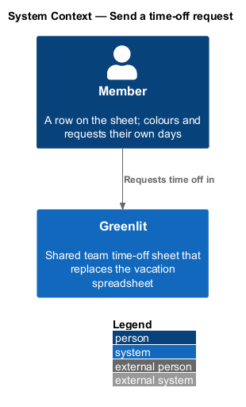
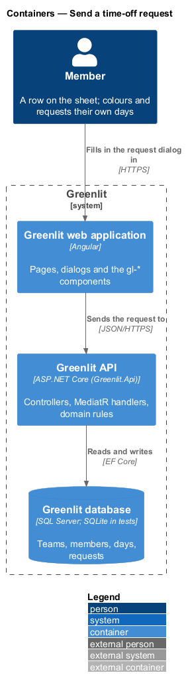
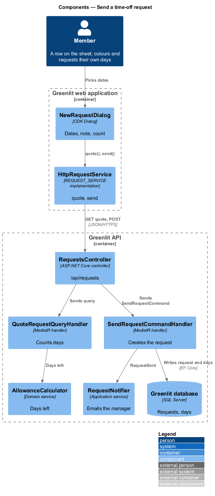
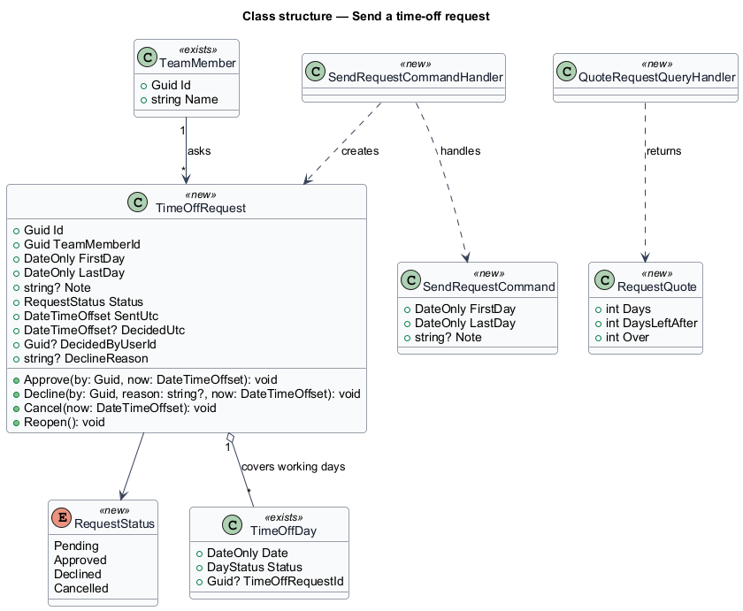
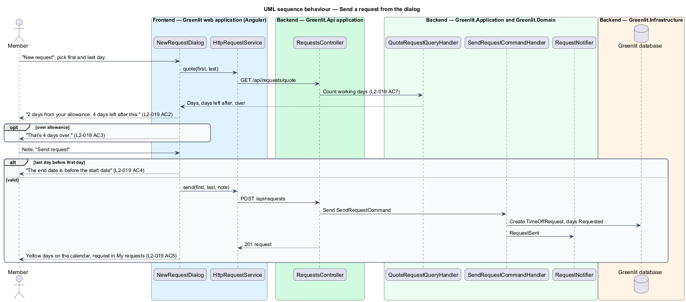

# Send a time-off request

## Overview

A request is a member asking the manager for a run of days off. The member can paint requested days on the calendar (`sheet/mark-days`) or open the request dialog from My requests or their person page. The dialog asks for a first day, a last day and an optional note.

As the dates change, the dialog counts the working days the request takes from the allowance and shows the days left after it. A request that goes over the allowance shows the overage but may still be sent.

**request** — member's ask for the working days between a first and a last day, with an optional note, decided by the manager

**days left to request** — member's days left minus the working days already requested

## Description

The feature is a vertical slice from the Greenlit web application to the Greenlit database.

**Frontend**

- **`NewRequestDialog`** — CDK Dialog in `app/dialogs/new-request`. It shows "Request time off", "Maya Chen will be asked to approve it.", First day, Last day, Note (optional), the live count line, and "Sending your request to Maya Chen…" while busy. A failure keeps the dates (`L2-019` AC6).
- **`RequestQuoteService`** — Client helper in the `api` project that calls the quote endpoint as the dates change.
- **`RequestService / REQUEST_SERVICE`** — Contract and injection token in the `api` project: `mine()`, `list(status)`, `get(id)`, `send(request)`, `cancel(id)`, `approve(ids)`, `decline(id, reason)` and `reopen(id)`.

**Backend**

- **`RequestsController`** — `GET /api/requests/quote?first=&last=` and `POST /api/requests`.
- **`QuoteRequestQueryHandler`** — Counts the working days in the range through `WeekendRule` and returns `Days`, `DaysLeftAfter` and `Over` from `AllowanceCalculator`.
- **`SendRequestCommandHandler`** — Validates the range (code `end_before_start`), creates the `TimeOffRequest`, sets each working day in the range to Requested and links it, then calls `RequestNotifier.RequestSent` after the commit (`teams/notification-settings`).
- **`RequestLedger`** — Application service shared with `sheet/mark-days` so a request created from the dialog and one painted on the calendar are the same thing.
- **`ICurrentUser`** — Greenlit.Application abstraction introduced by this design. It exposes the caller's `UserId`, `TeamId`, `TeamMemberId` and `IsManager` from the JWT claims, so every handler scopes data to the caller's team.

**Shared plumbing (exists today)**

- **`ExceptionHandlingMiddleware`** — Greenlit.Api middleware. It maps application exceptions (`ValidationException`, `NotFoundException`, `ForbiddenException`, `ConflictException`, `BadRequestException`) to ProblemDetails responses with a `code` extension.
- **`ValidationBehavior`** — MediatR pipeline behaviour in Greenlit.Application. It runs each request's FluentValidation validator before the handler and raises `ValidationException` on failure.
- **`IAppDbContext`** — Greenlit.Application abstraction over the EF Core context, implemented by `AppDbContext` in Greenlit.Infrastructure. Handlers read and write through it in one unit of work.

**Request lifecycle.** A `TimeOffRequest` starts `Pending`. The manager moves it to `Approved` or `Declined`; the member moves a pending request to `Cancelled`. Undo after a decision calls `Reopen`, which returns it to `Pending`. Each transition updates the request's `TimeOffDay` rows in the same unit of work: Pending = Requested, Approved = Confirmed, Declined = Tentative (from the mocks' declined request, whose days show tentative), Cancelled = row removed.

## Requirements

The feature realizes the following level-2 (L2) requirements. Each L2 requirement refines a level-1 (L1) requirement, cited by identifier; the acceptance criteria for each are in `docs/specs/L2.md`.

| L2 ID | Refines (L1) | Requirement |
|-------|--------------|-------------|
| `L2-019` | `L1-005` | **New request.** A member asks for a run of days in a dialog. |
| `L2-030` | `L1-006` | **Over-allowance warnings.** Greenlit flags when requests would take a member below zero days left. |

## Diagrams

### System context

A member requests time off in Greenlit; the manager's email is covered by `teams/notification-settings`.

### Containers

The dialog asks the Greenlit API for a quote as the dates change, then sends the request.

### Components

The quote and the send share `WeekendRule` and `AllowanceCalculator`, so the dialog's numbers match the stored request.

### Class structure

A `TimeOffRequest` aggregates the `TimeOffDay` rows it covers; `RequestStatus` drives their `DayStatus`.

### Behaviour — send a request from the dialog

Weekends, holidays and the member's non-working days are not counted (`L2-019` AC7). Going over the allowance warns but does not block (`L2-019` AC3, `L2-030` AC4).

