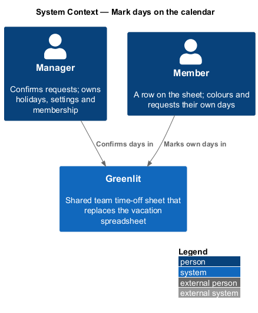
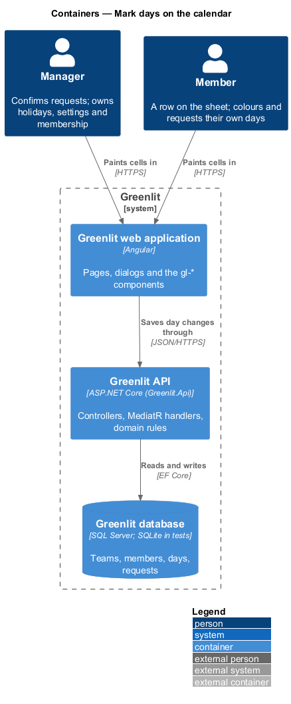
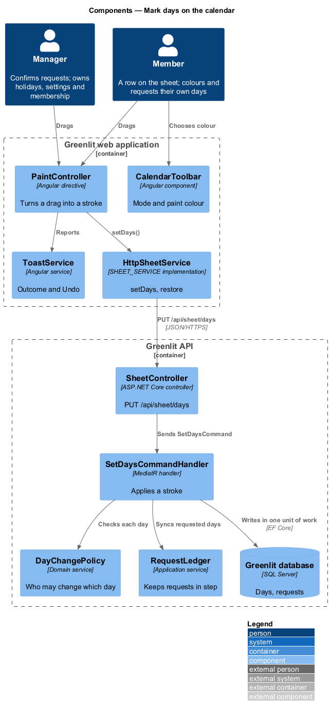
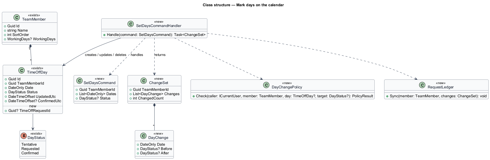
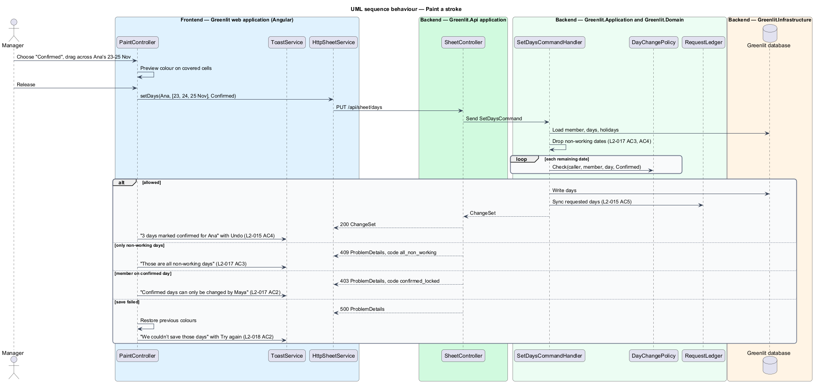
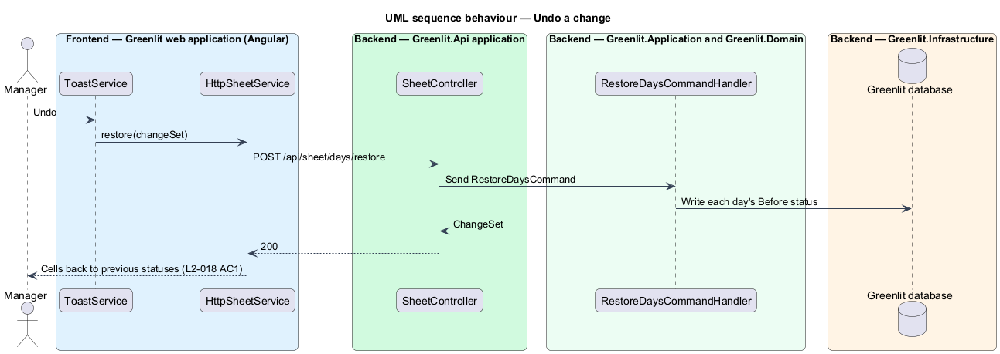

# Mark days on the calendar

## Overview

Marking days is how the spreadsheet was used: pick a colour, drag across the cells. In Paint mode a member chooses Requested, Tentative or Clear and drags across their own row; the manager also has Confirmed and may paint any row. The change applies on release, and a toast reports it with Undo.

A day change follows fixed rules. Members change only their own row and never touch confirmed days; non-working days never change; only the manager confirms. Requested days are a request: painting them creates or extends a pending request for the manager.

**paint stroke** — set of cells covered by one press-drag-release, applied as one change

**change set** — result of one stroke: the cells changed and their previous statuses, which Undo restores

## Description

The feature is a vertical slice from the Greenlit web application to the Greenlit database.

**Frontend**

- **`CalendarToolbar`** — Segmented control "Paint" / "Select" and the paint options. Members see "Requested", "Tentative" and "Clear"; the manager also sees "Confirmed". The hint text differs by role (`L2-015` AC1, AC2).
- **`PaintController`** — Directive on `TeamGrid` that turns pointer down, move and up (mouse and touch) into a stroke, previews the colour during the drag, and calls `SheetService.setDays` on release. Cells outside the caller's editable rows are not collected.
- **`ToastService`** — Shows "3 days marked confirmed for Ana" or "Requested 3 days" with Undo, and the failure toast "We couldn’t save those days" with Try again (`web-experience/feedback-toasts`).
- **`SheetService / SHEET_SERVICE`** — Contract and injection token in the `api` project: `month(yyyyMm)`, `setDays(change)` and `restore(snapshot)`. `HttpSheetService` is the implementation bound in `app.config.ts`.

**Backend**

- **`SheetController`** — `PUT /api/sheet/days` and `POST /api/sheet/days/restore`.
- **`SetDaysCommand / SetDaysCommandHandler`** — Takes a member, a list of dates and a target status (or none for Clear). It drops non-working dates, applies `DayChangePolicy` to each, writes the changes in one unit of work, and returns a `ChangeSet`. A stroke of only non-working days returns code `all_non_working` and changes nothing.
- **`DayChangePolicy`** — Domain service holding the rules of ADR-003 and `L2-017`: a member edits only their own row (`ForbiddenException`, code `not_your_row`); a member cannot set Confirmed or change a Confirmed day (code `confirmed_locked`); the manager may set any status on any row.
- **`RequestLedger`** — Application service shared with `requests/send-request`. Requested days set by a member join a pending `TimeOffRequest` for that run of days, or start one; cleared days leave it.
- **`RestoreDaysCommandHandler`** — Writes a `ChangeSet`'s previous statuses back, for Undo, under the same policy.
- **`ICurrentUser`** — Greenlit.Application abstraction introduced by this design. It exposes the caller's `UserId`, `TeamId`, `TeamMemberId` and `IsManager` from the JWT claims, so every handler scopes data to the caller's team.

**Shared plumbing (exists today)**

- **`ExceptionHandlingMiddleware`** — Greenlit.Api middleware. It maps application exceptions (`ValidationException`, `NotFoundException`, `ForbiddenException`, `ConflictException`, `BadRequestException`) to ProblemDetails responses with a `code` extension.
- **`ValidationBehavior`** — MediatR pipeline behaviour in Greenlit.Application. It runs each request's FluentValidation validator before the handler and raises `ValidationException` on failure.
- **`IAppDbContext`** — Greenlit.Application abstraction over the EF Core context, implemented by `AppDbContext` in Greenlit.Infrastructure. Handlers read and write through it in one unit of work.

## Requirements

The feature realizes the following level-2 (L2) requirements. Each L2 requirement refines a level-1 (L1) requirement, cited by identifier; the acceptance criteria for each are in `docs/specs/L2.md`.

| L2 ID | Refines (L1) | Requirement |
|-------|--------------|-------------|
| `L2-015` | `L1-004` | **Paint mode.** With a paint colour chosen, clicking or dragging across cells applies that status. |
| `L2-017` | `L1-004` | **Who can change which days.** A member edits only their own row and cannot change confirmed days; non-working days never change. |
| `L2-018` | `L1-004` | **Undo and failed saves on the calendar.** Every change made on the calendar can be undone, and a failed save keeps the selection. |

## Diagrams

### System context

Members mark their own days and the manager confirms days in Greenlit.

### Containers

Each stroke is one call to the Greenlit API; Undo is a second call with the previous statuses.

### Components

`SetDaysCommandHandler` applies `DayChangePolicy` to every day and keeps requests in step through `RequestLedger`.

### Class structure

A stroke becomes a `SetDaysCommand`; its result, a `ChangeSet`, records each day's before and after so Undo can restore it.

### Behaviour — paint a stroke

The stroke previews during the drag and saves on release (`L2-015` AC3). The policy keeps members on their own row and off confirmed days (`L2-017`). A failed save restores the cells (`L2-018` AC2).

### Behaviour — undo a change

Undo stays available for the toast's whole lifetime (`L2-018` AC1, `L2-044` AC3) and passes the same policy as the original change.

