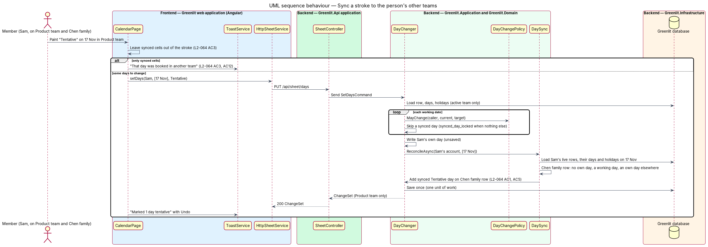

# Mark days on the calendar

## Overview

Marking days is how the spreadsheet was used: pick a colour, drag across the cells. In Paint mode a member chooses Requested, Tentative or Clear and drags across their own row; the manager also has Confirmed and may paint any row. The change applies on release, and a toast reports it with Undo.

A day change follows fixed rules. Members change only their own row and never touch confirmed days; non-working days never change; only the manager confirms. Requested days are a request: painting them creates or extends a pending request for the manager.

**paint stroke** — set of cells covered by one press-drag-release, applied as one change

**change set** — result of one stroke: the cells changed and their previous statuses, which Undo restores

## Description

The feature is a vertical slice from the Greenlit web application to the Greenlit database.

**Frontend**

- **`CalendarToolbar`** — Segmented control "Paint" / "Select" and the paint options. Members see "Requested", "Tentative" and "Clear"; the manager also sees "Confirmed". The hint text differs by role (`L2-015` AC1, AC2).
- **`PaintController`** — Directive on `TeamGrid` that turns pointer down, move and up (mouse and touch) into a stroke, previews the colour during the drag, and calls `SheetService.setDays` on release. Cells outside the caller's editable rows are not collected.
- **`ToastService`** — Shows "3 days marked confirmed for Ana" or "Requested 3 days" with Undo, and the failure toast "We couldn’t save those days" with Try again (`web-experience/feedback-toasts`).
- **`SheetService / SHEET_SERVICE`** — Contract and injection token in the `api` project: `month(yyyyMm)`, `setDays(change)` and `restore(snapshot)`. `HttpSheetService` is the implementation bound in `app.config.ts`.

**Backend**

- **`SheetController`** — `PUT /api/sheet/days` and `POST /api/sheet/days/restore`.
- **`SetDaysCommand / SetDaysCommandHandler`** — Takes a member, a list of dates and a target status (or none for Clear). It drops non-working dates, applies `DayChangePolicy` to each, writes the changes in one unit of work, and returns a `ChangeSet`. A stroke of only non-working days returns code `all_non_working` and changes nothing.
- **`DayChangePolicy`** — Domain service holding the rules of ADR-003 and `L2-017`: a member edits only their own row (`ForbiddenException`, code `not_your_row`); a member cannot set Confirmed or change a Confirmed day (code `confirmed_locked`); the manager may set any status on any row.
- **`RequestLedger`** — Application service shared with `requests/send-request`. Requested days set by a member join a pending `TimeOffRequest` for that run of days, or start one; cleared days leave it.
- **`RestoreDaysCommandHandler`** — Writes a `ChangeSet`'s previous statuses back, for Undo, under the same policy.
- **`DaySync`** — Application service (ADR-016, `L2-064`). After a change on one of a person's rows it keeps the synced days on their other live rows in step for the dates it touched, inside the same unit of work: `ReconcileAsync(userId, dates)`.
- **`ICurrentUser`** — Greenlit.Application abstraction introduced by this design. It exposes the caller's `UserId`, `TeamId`, `TeamMemberId` and `IsManager` from the JWT claims, so every handler scopes data to the caller's team.

**Shared plumbing (exists today)**

- **`ExceptionHandlingMiddleware`** — Greenlit.Api middleware. It maps application exceptions (`ValidationException`, `NotFoundException`, `ForbiddenException`, `ConflictException`, `BadRequestException`) to ProblemDetails responses with a `code` extension.
- **`ValidationBehavior`** — MediatR pipeline behaviour in Greenlit.Application. It runs each request's FluentValidation validator before the handler and raises `ValidationException` on failure.
- **`IAppDbContext`** — Greenlit.Application abstraction over the EF Core context, implemented by `AppDbContext` in Greenlit.Infrastructure. Handlers read and write through it in one unit of work.

## Decisions for the first build (journey 4)

- **Endpoints.** `PUT /api/sheet/days` takes `{ memberId, dates[], status }` (`status` is `Tentative`, `Requested`, `Confirmed` or `null` for Clear) and returns the `ChangeSet`: `{ memberId, memberName, status, changes: [{ date, previous, current }] }`. `POST /api/sheet/days/restore` takes `{ memberId, days: [{ date, status }] }` (`status` null clears) and applies the same policy.
- **Scoping.** A member id outside the caller's team answers 404, the same as an unknown id, so it never reveals other teams. A member on another member's row answers 403 `not_your_row`.
- **Non-working dates.** The handler drops weekends and holidays from a stroke and changes the rest (`L2-017` AC4). A stroke with nothing left answers 400 `all_non_working`, or `day_is_holiday` when every date in it is a holiday (ADR-003); nothing changes.
- **Confirmed days.** A member's stroke leaves their own Confirmed days alone; when that leaves nothing to change the answer is 403 `confirmed_locked` (`L2-017` AC2). A member asking for Confirmed is 403 `confirmed_locked` too. The manager sets any status on any row.
- **No-op days.** A date already at the target status is not a change and is left out of `changes`; a stroke that changes nothing returns an empty `changes` list and shows no toast.
- **Requests (built with journey 7).** `RequestLedger` (Greenlit.Application/Requests) keeps pending requests in step with the Requested days of a stroke, inside `DayChanger`'s unit of work: days that become Requested join the member's pending request for that run, or start one; days that stop being Requested (cleared, Tentative, or Confirmed by the manager) leave theirs, and a request left with no days is removed (`L2-015` AC5). A run is unbroken by weekends and holidays, so Friday and the next Monday are one request. A request spans from its first to its last remaining day. Undo goes through the same ledger. Requested rows stored before requests existed keep no request. The toast says "{manager} will be notified."; the email behind it is journey 25.
- **Manager name.** `GetMonth` gains `managerName` so the client can word "Confirmed days can only be changed by Maya" and "Maya Chen will be notified."
- **Client.** The sheet page keeps the month in a signal, patches the stroke's cells at once, and puts them back if the save fails. After a save it refetches the month quietly, so the Out row stays true. Cells of editable rows are focusable and Enter or Space paints the focused cell; roving focus and arrow keys are journey 12.
- **Select mode and the default.** The paint picker offers Select first and starts on it, as the mocks do; Select does nothing until journey 12, so nothing is painted until a colour is chosen.
- **Touch.** While a paint colour is chosen the sheet takes `touch-action: none`, so a finger dragging along a row paints instead of scrolling; choose Select to scroll the sheet by touch.
- **Toast.** The minimum `ToastService` and `gl-toast` of `web-experience/feedback-toasts` are built here (8 s timer paused on hover and focus; danger stays; newest first) for journey 16 to extend.

## Requirements

The feature realizes the following level-2 (L2) requirements. Each L2 requirement refines a level-1 (L1) requirement, cited by identifier; the acceptance criteria for each are in `docs/specs/L2.md`.

| L2 ID | Refines (L1) | Requirement |
|-------|--------------|-------------|
| `L2-015` | `L1-004` | **Paint mode.** With a paint colour chosen, clicking or dragging across cells applies that status. |
| `L2-017` | `L1-004` | **Who can change which days.** A member edits only their own row and cannot change confirmed days; non-working days never change. |
| `L2-018` | `L1-004` | **Undo and failed saves on the calendar.** Every change made on the calendar can be undone, and a failed save keeps the selection. |
| `L2-055` | `L1-015` | **Several teams per person.** A person may manage some teams and be a member of others; any signed-in person may create a team; each team stays its own sheet. |
| `L2-060` | `L1-016` | **Child members.** A manager-set member attribute: no allowance, no days left; a login-less child's days are saved as Confirmed. |
| `L2-064` | `L1-015` | **Days synced across a person's teams.** A day marked on a person's own row shows on their row in each of their other teams as a read-only synced day. |

## Diagrams

### System context

Members mark their own days and the manager confirms days in Greenlit.

### Containers

Each stroke is one call to the Greenlit API; Undo is a second call with the previous statuses.

### Components

`SetDaysCommandHandler` applies `DayChangePolicy` to every day and keeps requests in step through `RequestLedger`.

### Class structure

A stroke becomes a `SetDaysCommand`; its result, a `ChangeSet`, records each day's before and after so Undo can restore it.

### Behaviour — paint a stroke

The stroke previews during the drag and saves on release (`L2-015` AC3). The policy keeps members on their own row and off confirmed days (`L2-017`). A failed save restores the cells (`L2-018` AC2).

### Behaviour — a day synced to the person's other teams

After the stroke's days are written (still unsaved), `DaySync` reconciles the person's other live rows for the same dates and the handler saves once (`L2-064` AC1, AC4, AC5). Undo goes through the same `DayChanger`, so the synced days follow it.

### Behaviour — undo a change

Undo stays available for the toast's whole lifetime (`L2-018` AC1, `L2-044` AC3) and passes the same policy as the original change.

## Open questions answered (ADR-015, 8 Nov 2026)

- **A login-less child** (`L2-060` AC4): when the manager sets days on a child's row with no email, `DayChanger` stores them as Confirmed whatever was painted, so no request step exists for that row. A child with an email follows `L2-017` unchanged.
- **Several teams** (`L2-055` AC3, AC4): `DayChanger` is scoped to the active team and the caller's role is read from this team's `ManagerUserId`. Since ADR-016 the person's rows on their other teams receive synced days through `DaySync` (below); nothing else of those teams is read or written.

## Synced days (ADR-016, `L2-064`, 9 Nov 2026)

- **What is stored.** A synced day is a `TimeOffDay` with `IsSynced = true`, always `Tentative`, with no `TimeOffRequestId` and no `ConfirmedUtc`. No origin link is stored: `DaySync` derives the synced days from the person's own days each time it runs.
- **The invariant `DaySync.ReconcileAsync(userId, dates)` applies.** For each date, each live row of the person (same `UserId`, `RemovedUtc` null) holds a synced day exactly when it holds no day of its own there, the date is a working day for that row (`WorkingDayRule.For(team, member)` and the team's holidays), and another live row of the person holds a day of its own on that date. It reads the tracked rows (`TimeOffDays.Local` after loading the dates), so it sees the caller's unsaved changes; the caller saves once. A null `UserId` or a person with one live row is a no-op, so login-less rows and children without an account are never synced (`L2-064` AC7).
- **Who calls it.** `DayChanger` (stroke and Undo) with the dates it changed; `SendRequestCommandHandler` with the dates it marked; `HolidayCalendar.ClearDaysAsync` for each person whose day it cleared (`L2-064` AC6); `InvitationMembership.AttachAsync` with the person's own future days on every live row (`L2-064` AC8, `identity-and-access/accept-invitation`). Approving, declining, cancelling and reopening only change a day's status, so they do not call it.
- **The lock.** `DayChanger` treats an existing synced day like a locked day: a stroke that meets only synced days answers `403 synced_day_locked` ("That day was booked in another team. Change it in the team where it was booked."); in a mixed stroke the synced days are skipped and left out of `changes`. This holds for the manager too (`L2-017` AC6, `L2-064` AC3). `SendRequestCommandHandler` skips synced dates like holidays, and a range of only synced days is the same `403 synced_day_locked`.
- **Undo.** Undo of a stroke in the origin team is a `RestoreDaysCommand` through the same `DayChanger`, so the synced days come back or go in the same unit of work (`L2-064` AC4). Undo never writes over a synced day in the team it was copied into: that is the lock above.
- **Client.** `CalendarPage` leaves synced cells out of a stroke and a selection before it calls `setDays`, so their colour never flickers; a stroke or a keyboard press made only of synced cells shows the toast "That day was booked in another team" with "Change it in the team where it was booked." without calling the API. `refusedToast` maps `synced_day_locked` to the same toast for any answer from the API. On the phone week a synced cell is not a button and takes no tap (`L2-064` AC11, AC12).
- **Open questions.** A holiday removed later does not bring a synced day back until the next change on that date (ADR-016); a person who wants a sync switch is deferred.
