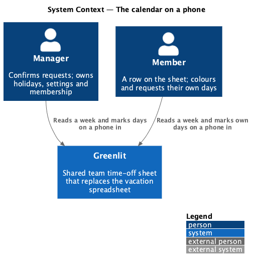
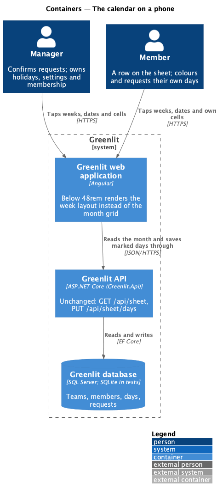
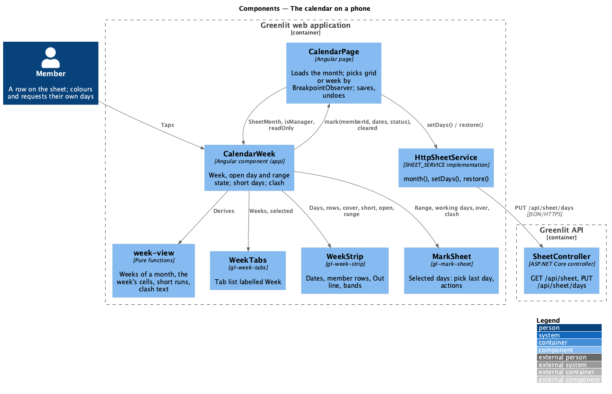
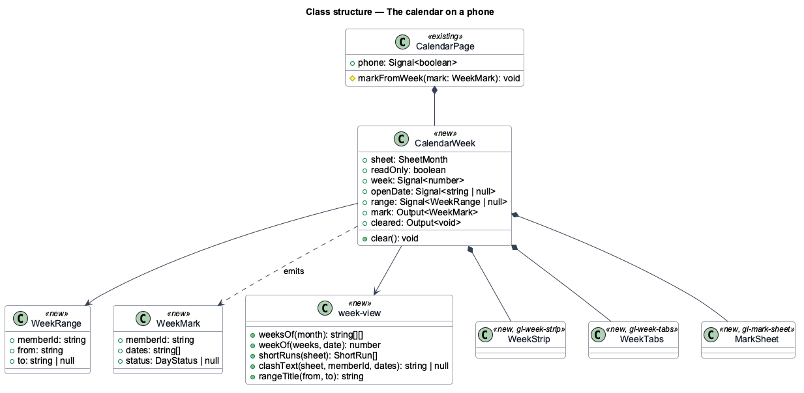
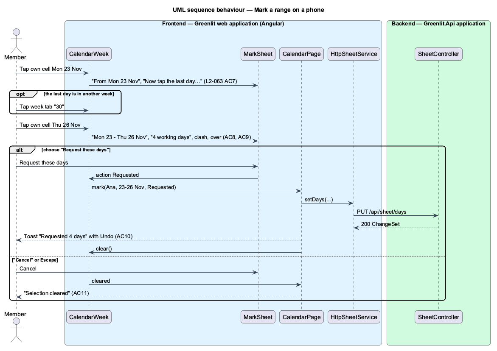

# The calendar on a phone

## Overview

Narrower than 48rem the month grid does not fit: thirty day columns and the paint picker run off the right edge of a 390 px phone. Below that width the calendar shows one Monday-to-Sunday week of the team at full width instead. It answers "who is out together?" first, with a card of the month's short days, and marks time off by tapping a first and a last day, then choosing what they are in a panel at the foot of the screen. Tablets and desktops keep the month grid unchanged.

The design is option A′, "Week strip, refined", of the Magic Patterns canvas "Mobile Calendar Fixes". The prototype was a spec, not code to copy: it was drawn for a family of two with Sunday-first weeks, Tailwind, lucide icons and framer-motion. Here it uses Monday-first weeks, the design-system tokens and `gl-*` components, CSS transitions, the existing Out row and coverage minimum, and the existing rules for who may change which days.

**week strip** — one week of the team: a row of dates, one row of seven cells per member, and the Out line

**short day** — a working day below the coverage minimum, or, with no minimum, a working day on which everyone who works is out

**range** — a first and a last day on one member's row, picked by two taps

## Description

The feature is frontend only. It reads the same `SheetMonth` as the month grid and saves through the same `setDays` call, so the API, the rules of `L2-017` and the undo of `L2-018` are unchanged.

**Frontend**

- **`CalendarPage`** — Existing page. A `BreakpointObserver` on `(max-width: 47.99rem)` sets `phone`; when it is true the page renders `app-calendar-week` instead of the paint picker, the hint row and `gl-team-grid`. Marks from the week go through the page's existing `save()`, so the toasts, Undo and failed-save handling are shared.
- **`CalendarWeek`** — New `app-calendar-week` in `pages/calendar`. Owns the shown week, the open date and the range; composes the short-days card, the week tabs, the week strip, the day panel, the legend and, at the foot, the hint or the mark sheet. Emits `mark` and `cleared`.
- **`week-view`** — New pure helpers beside `calendar-view`: the weeks of a month, the week that holds a date, the month's short runs, the clash text and the range title.
- **`WeekTabs`** — New `gl-week-tabs`: a tab list labelled "Week", one tab per week, with a marker named "Short of people this week".
- **`WeekStrip`** — New `gl-week-strip`: the dates as buttons, a row per member with name, "You" and days left, cells that are buttons on rows the person may change and images otherwise, the Out line, and the bands of short days and the open date.
- **`MarkSheet`** — New `gl-mark-sheet`: a region labelled "Selected days" fixed to the foot of the viewport, in its picking state ("From Mon 23 Nov", "Just this day") or its range state (range, working days, overage, clash, actions).

**Backend**

- Unchanged. `GetMonthQueryHandler` already returns each member's cells, days left, allowance figures and the coverage per day with `belowMinimum`; `SetDaysCommandHandler` applies a mark.

## Requirements

| L2 ID | Refines (L1) | Requirement |
|-------|--------------|-------------|
| `L2-063` | `L1-003`, `L1-004`, `L1-013` | **The calendar on a phone.** One week of the team at full width, short days first, marked by tapping a first and a last day. |

It reuses, on the phone, `L2-012` AC3–AC5, `L2-013`, `L2-014`, `L2-015` AC4–AC5, `L2-016` AC2–AC5, `L2-017`, `L2-018`, `L2-019` AC1, `L2-042` AC1, `L2-045` AC1 and `L2-048`.

## Diagrams

### System context

Managers and members read a week and mark days from a phone.

### Containers

Only the web application changes; it calls the API exactly as the month grid does.

### Components

`CalendarWeek` owns the phone state and hands marks to `CalendarPage`, which saves them.

### Class structure

### Behaviour — mark a range on a phone

## Decisions

- **Breakpoint, not device.** The layout follows the viewport width (48rem, the grid's own breakpoint), so a narrow desktop window gets the week too, and a tablet in portrait (820 px) keeps the grid.
- **Monday-first weeks clipped to the month.** A week tab is named by its days in the month ("1", "2–8", …, "30"); days of a week outside the month are blank placeholders. Weeks never cross into another month; the month controls of `L2-012` stay.
- **Which week opens.** The week holding today in the current month, else the first week. Changing month resets the week, the open date and the range.
- **Short days use the Out row's numbers.** "Out" means requested or confirmed, as in `L2-014`; tentative days are listed in the short-day runs and the day panel but do not make a day short. With a coverage minimum the API's `belowMinimum` decides; with none, a day is short when `in` is 0 and `out` is at least 1. A run joins short days separated only by days nobody works. A team of one has no card.
- **Two taps, not a drag.** A tap on an editable cell starts a range; a second tap on the same row ends it (either order); a tap on another row starts again. The range may cross weeks of the month. Cells on rows the person may not change are not buttons, so a member's tap on another row does nothing (`L2-017` AC1).
- **Clash.** For the range's working days, each other member's count of requested or confirmed days; members with the same count are named together ("Ana, Cleo, Elif and Finn are also out 3 of these days."), "all" when the count equals the working days.
- **Not a dialog.** The mark sheet is non-modal, like `gl-selection-bar`: the week tabs and cells stay usable while the last day is picked. Escape anywhere on the page clears the range.
- **Motion.** The mark sheet slides up with the design system's `slide-up` keyframes and fades under `prefers-reduced-motion`.
