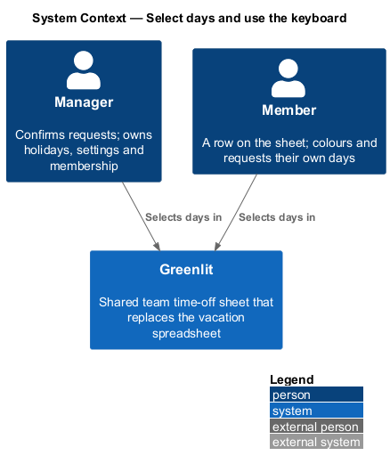
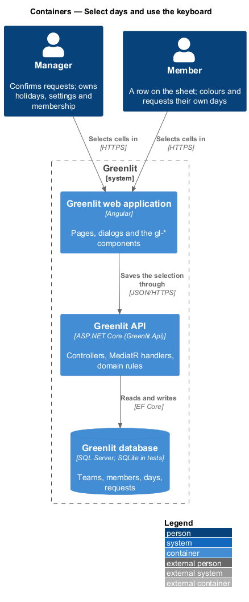
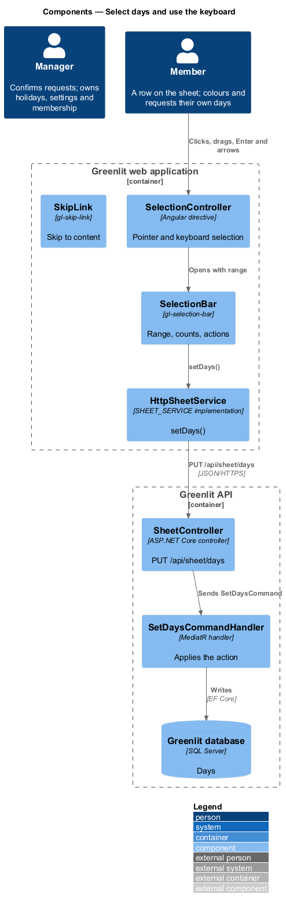
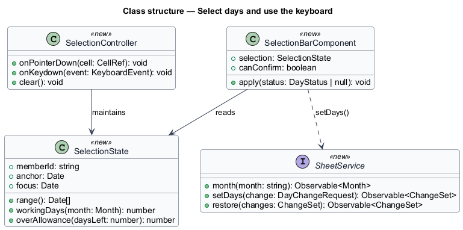
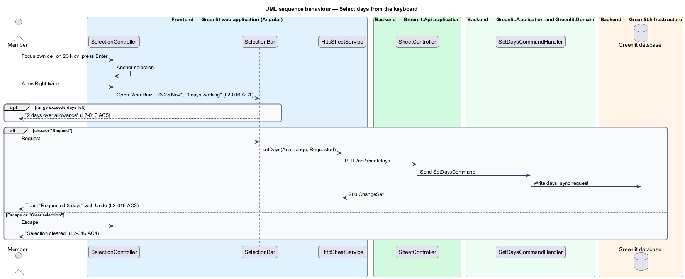

# Select days and use the keyboard

## Overview

Select mode reverses Paint mode: the person marks a range first, then picks what to do with it. A bar labelled "Selected days" names the member and the range, counts the working days, warns when the range goes over allowance, and offers the actions.

Select mode is also the keyboard path into the grid. Every interaction that works with a pointer or touch works from the keyboard: Enter starts a selection on the focused cell, the arrow keys extend it, and Escape clears it.

**selection** — contiguous range of one member's cells chosen before an action

**roving focus** — grid focus model in which one cell holds `tabindex=0` and the arrow keys move it

## Description

The feature is a vertical slice from the Greenlit web application to the Greenlit database.

**Frontend**

- **`SelectionController`** — Directive on `TeamGrid`. With a pointer it selects on click and drag; from the keyboard Enter anchors the selection and the arrow keys extend it within one row; Escape clears it. It keeps roving focus on the cells (WAI-ARIA grid pattern).
- **`SelectionBar`** — `gl-selection-bar` labelled "Selected days". It shows "{member} · {range}", "{n} days working", "{n} days over allowance" when the range exceeds the member's days left, the actions "Confirm" (manager only), "Request", "Tentative", "Clear", and "Clear selection".
- **`SkipLink`** — Existing `gl-skip-link` in the `components` project; it becomes the first focusable element and moves focus to the main content (`L2-047` AC3).
- **`SheetService / SHEET_SERVICE`** — Contract and injection token in the `api` project: `month(yyyyMm)`, `setDays(change)` and `restore(snapshot)`. `HttpSheetService` is the implementation bound in `app.config.ts`.

**Backend**

- **`SetDaysCommandHandler`** — Same command as `sheet/mark-days`: an action from the bar is a `SetDaysCommand` over the selected dates.
- **`GetMonthQueryHandler`** — Supplies each member's `DaysLeft`, from which the bar computes the overage on the client; the server does not block an over-allowance change (`L2-030` AC4).

**Shared plumbing (exists today)**

- **`ExceptionHandlingMiddleware`** — Greenlit.Api middleware. It maps application exceptions (`ValidationException`, `NotFoundException`, `ForbiddenException`, `ConflictException`, `BadRequestException`) to ProblemDetails responses with a `code` extension.
- **`ValidationBehavior`** — MediatR pipeline behaviour in Greenlit.Application. It runs each request's FluentValidation validator before the handler and raises `ValidationException` on failure.
- **`IAppDbContext`** — Greenlit.Application abstraction over the EF Core context, implemented by `AppDbContext` in Greenlit.Infrastructure. Handlers read and write through it in one unit of work.

## Requirements

The feature realizes the following level-2 (L2) requirements. Each L2 requirement refines a level-1 (L1) requirement, cited by identifier; the acceptance criteria for each are in `docs/specs/L2.md`.

| L2 ID | Refines (L1) | Requirement |
|-------|--------------|-------------|
| `L2-016` | `L1-004` | **Select mode and the selection bar.** In Select mode the person picks a range first and then chooses what to do with it. |
| `L2-047` | `L1-013` | **Keyboard on the sheet.** Every sheet interaction works from the keyboard. |

## Diagrams

### System context

Managers and members select days in Greenlit from a pointer, touch or the keyboard.

### Containers

An action from the selection bar is one call to the Greenlit API, the same call that a paint stroke makes.

### Components

`SelectionController` owns the range; `SelectionBar` turns an action into a `SetDaysCommand`.

### Class structure

The frontend `SelectionState` computes the working-day count and the overage that the bar shows.

### Behaviour — select days from the keyboard

Enter and the arrow keys build the selection (`L2-047` AC1), and Escape clears it (`L2-016` AC4, `L2-047` AC2). A member's bar has no "Confirm" (`L2-016` AC2).

## Decisions

Settled while building journey 12; the mocks and L2 are unchanged by them.

- **One owner of the range.** `gl-team-grid` owns the selection (`row`, anchor column, head column) and emits `selectionChange` with `{ memberId, dates } | null`; the page owns what the bar says and does. The grid clears it when the mode leaves Select, when the month changes, and on request (`clearSelection()`); Escape clears it and emits `cleared` so the page can say "Selection cleared".
- **Select is the default mode.** A stray tap never changes data; the picker's other choices stay Paint mode (`sheet/mark-days`), and Paint mode wins for the pointer.
- **Single-row range.** A selection is contiguous on one row. Only the caller's editable rows can be selected, so a member cannot select another member's cells (`L2-017` AC1); the manager can select on any row. Weekends and holidays inside the range are selected but not counted; a range of only red days still goes to the API, which answers "Those are all non-working days".
- **Pointer.** A press selects the cell, a drag extends within the row, and a press on the only selected cell toggles it off. Touch uses the same pointer events as Paint mode (the sheet turns `touch-action: none` on cells while a drag can begin).
- **Roving focus (APG grid).** The grid is one tab stop: the active cell has `tabindex=0`, every other cell `-1`. Weekend and holiday cells are skipped by every key. Arrows move; Home/End go to the row's first/last working day; Ctrl+Home/End to the sheet's first/last; PageUp/PageDown go to the previous/next month (the page navigates and focus returns to the same row and day). Read-only cells take focus too, so a member can read the whole sheet from the keyboard; Enter on them does nothing.
- **Keyboard selection.** In Select mode Enter anchors a selection on the focused cell and enters "extending": Left/Right move the head (the range follows, skipping nothing but focus skipping red days) and Up/Down are ignored; Enter again ends extending and keeps the range. Shift+Left/Right extend from the anchor without Enter. Escape clears and keeps focus on the cell. In Paint mode Enter or Space still paints the cell.
- **The bar.** `gl-selection-bar` follows the grid in the DOM, so Tab from the grid reaches it. It is `role="toolbar"` with a roving tab stop (arrows, Home, End). It appears fixed at the bottom of the viewport. Confirm is offered only to the manager; the actions emit `action` (`Confirmed | Requested | Tentative | null`) and `clear`.
- **Overage.** `over = max(0, requested + extra - left)` from the member's `AllowanceFigures`, where `extra` is the selection's working days that are not already requested, the same rule as the server's `DaysOver` (`L2-030` AC2). It warns and never blocks (`L2-030` AC4).
- **After an action.** The page sends the same `SetDaysCommand` as a paint stroke (`mark-days`), clears the range, and returns focus to the grid's active cell; the toast and Undo are those of `mark-days`. A failed save keeps the selection (the toast says so, `L2-018`).
- **Announcements.** A visually hidden polite status says "{n} days selected" when the range changes; "Selection cleared" is a toast with "Pick days to start again."
