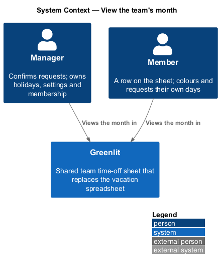
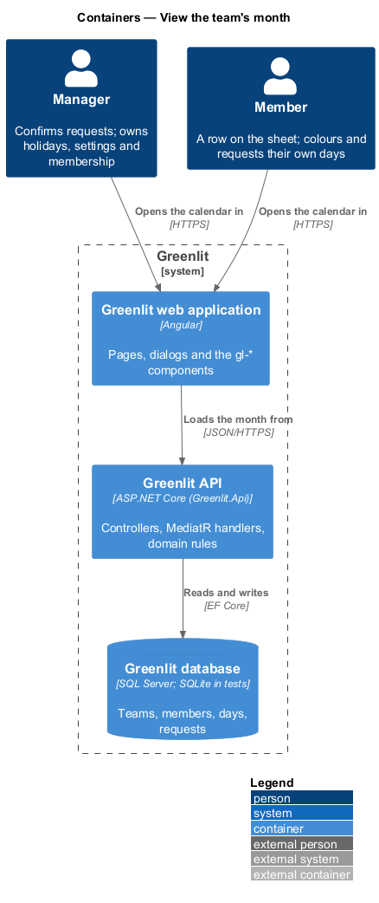
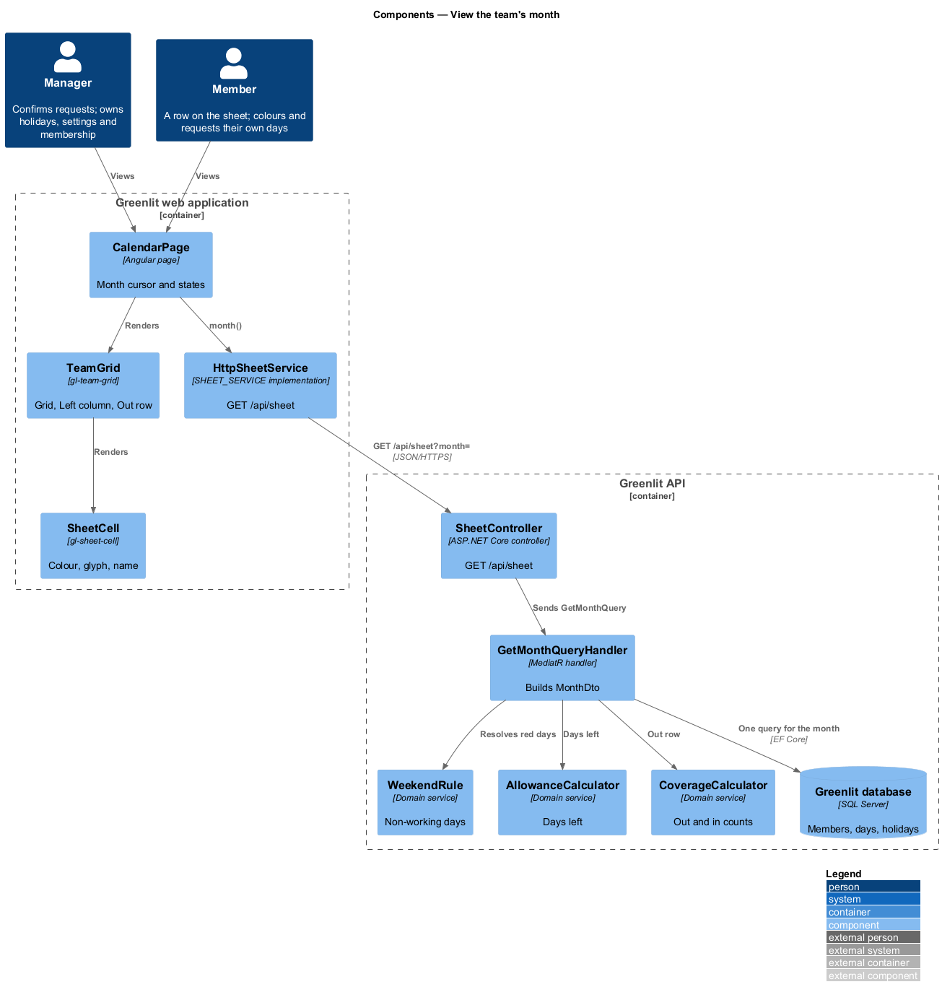
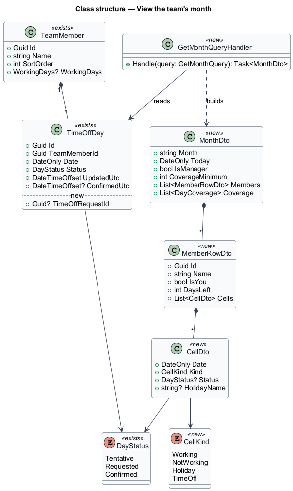
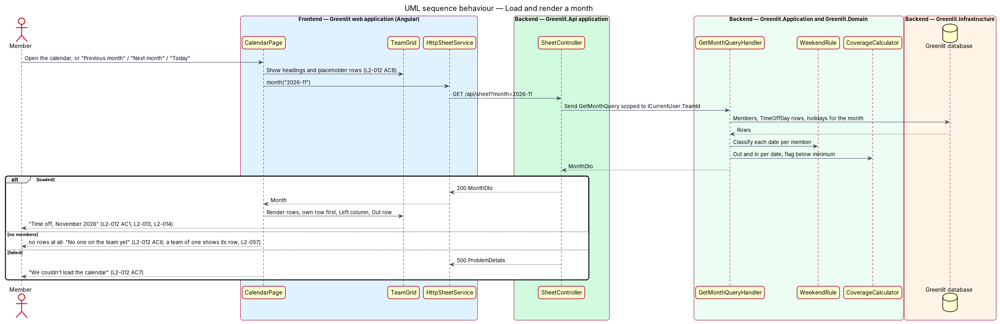

# View the team's month

## Overview

The calendar is the product: one month of the team on one screen, laid out like the spreadsheet it replaces. Members run down the side, days across the top with weekday initials and day numbers. Each cell is one member's day and shows its state in colour, glyph and accessible name.

Two summaries frame the grid. The Left column gives each member's days left for the year. The Out row gives, for each day, how many people are out and how many are in, and flags days below the coverage minimum.

**cell** — one member's day in the grid; a working day, a non-working day (red), or a day with a `DayStatus`

**non-working day** — weekend, team holiday or a day outside the member's working days; red, never stored as a `TimeOffDay`

**out** — member whose day is requested or confirmed; **in** — member who works that day and is not out

## Description

The feature is a vertical slice from the Greenlit web application to the Greenlit database.

**Frontend**

- **`CalendarPage`** — App-shell page at `/` (`page: 'calendar'`). It replaced the old `SheetPage`; `/sheet` shows the not-found page (L2-049 AC5). It owns the month cursor, the "Previous month", "Next month" and "Today" controls, and the loading, empty and error states.
- **`TeamGrid`** — `gl-team-grid` component: a `role="grid"` table labelled "Time off, {Month yyyy}" with column headers "Mon 2 Nov", one row per member, the Left column and the Out row. The signed-in member's row comes first, marked "You".
- **`SheetCell`** — `gl-sheet-cell` component. It renders the colour, the glyph ("?", "…", "✓") and the accessible name "{member}, {Day d Mon}: {state}", where state is Working, Not working, a holiday name, Tentative, Requested or Confirmed.
- **`OutCell`** — Shows "{n}" or "·" and the accessible name "{n} out, {m} in", adding ". Below the minimum of {min}" with an outline when flagged.
- **`SheetService / SHEET_SERVICE`** — Contract and injection token in the `api` project: `month(yyyyMm)` now; `setDays(change)` and `restore(snapshot)` arrive with `sheet/mark-days`. `HttpSheetService` is the implementation bound in `app.config.ts`.

**Backend**

- **`SheetController`** — `GET /api/sheet?month=2026-11`.
- **`GetMonthQueryHandler`** — Loads the caller's team, its active members, their `TimeOffDay` rows in the month and the team's holidays in one round trip (ADR-003). It resolves each cell through `WorkingDayRule`, the Left figures through `AllowanceCalculator` (`allowances/allowance-figures`), and the Out row through `CoverageCalculator` (`teams/coverage-minimum`).
- **`MonthDto`** — Response: `Month`, `Today`, `IsManager`, `CoverageMinimum`, `Members` (each with `Id`, `Name`, `Initials`, `IsYou`, `DaysLeft`, `Cells`), `Coverage` (per date `Out`, `In`, `BelowMinimum`).
- **`ICurrentUser`** — Greenlit.Application abstraction introduced by this design. It exposes the caller's `UserId` from the token's `sub` claim; `GetMonthQueryHandler` resolves the caller's team, member row and manager flag from it, so every query is scoped to the caller's team.
- **`TimeProvider`** — .NET's built-in clock, registered as `TimeProvider.System`. The handler turns its instant into the team's local date, and tests can replace it to fix "today".

**Shared plumbing (exists today)**

- **`ExceptionHandlingMiddleware`** — Greenlit.Api middleware. It maps application exceptions (`ValidationException`, `NotFoundException`, `ForbiddenException`, `ConflictException`, `BadRequestException`) to ProblemDetails responses with a `code` extension.
- **`ValidationBehavior`** — MediatR pipeline behaviour in Greenlit.Application. It runs each request's FluentValidation validator before the handler and raises `ValidationException` on failure.
- **`IAppDbContext`** — Greenlit.Application abstraction over the EF Core context, implemented by `AppDbContext` in Greenlit.Infrastructure. Handlers read and write through it in one unit of work.

## Requirements

The feature realizes the following level-2 (L2) requirements. Each L2 requirement refines a level-1 (L1) requirement, cited by identifier; the acceptance criteria for each are in `docs/specs/L2.md`.

| L2 ID | Refines (L1) | Requirement |
|-------|--------------|-------------|
| `L2-012` | `L1-003` | **Month sheet.** The calendar shows one month for the whole team. |
| `L2-013` | `L1-003` | **Day cells.** Each cell shows one member's day. |
| `L2-014` | `L1-003` | **Days left and the Out row.** The calendar shows each member's days left and a daily count of who is out. |
| `L2-042` | `L1-010` | **Coverage flags.** Days below the minimum are flagged. |
| `L2-048` | `L1-013` | **State carried by more than colour.** A cell's state is always in text, glyph or accessible name too. |
| `L2-057` | `L1-015` | **A team of one.** A team whose only member is its manager is complete and usable on every screen. |
| `L2-060` | `L1-016` | **Child members.** A manager-set member attribute: no allowance, no days left; a login-less child's days are saved as Confirmed. |
| `L2-061` | `L1-016` | **School closures.** Labelled date ranges on one child's or all children's rows, shown with an icon and text, never red, counted nowhere. |

## Diagrams

### System context

Managers and members view the same month in Greenlit; no external system takes part.

### Containers

The calendar page loads one month from the Greenlit API, which reads it from the Greenlit database in one query.

### Components

`GetMonthQueryHandler` combines the stored days with `WeekendRule`, `AllowanceCalculator` and `CoverageCalculator`; the grid components only render.

### Class structure

`MonthDto` holds one `MemberRowDto` per member and one `CellDto` per day; `CellKind` separates red days from time off, so a cell never needs a stored row to be red.

### Behaviour — load and render a month

The member's own row comes first (`L2-012` AC2). Each cell carries its state in its accessible name and glyph as well as its colour (`L2-013`, `L2-048`). Days below the minimum are outlined on the Out row (`L2-042` AC1).

## Decisions (journey 1, 7 Nov 2026)

Journey 1 builds this design before sign-in, allowances, coverage settings and per-member working days exist. These decisions keep it complete for what it owns and leave clear seams for the rest.

| Topic | Decision |
|---|---|
| Month in the address | The calendar reads `?month=yyyy-MM`; without it the page shows the current month in the team's time zone. Previous, Next and Today change the parameter, so a month can be bookmarked and reloaded. |
| Session before sign-in | The endpoint keeps the authenticated fallback policy. The `api` project gets a `SESSION_STORE` contract that holds the bearer token and an interceptor that sends it. Sign-in (`identity-and-access/sign-in`) writes the token. Journey 1's Playwright fixture minted one with the development signing key; since journey 2 it signs in through `POST /api/auth/sign-in` as a seeded user, and `authGuard` sends a visitor without a session to sign-in. No anonymous endpoint is added here. |
| Caller identity | `ICurrentUser` reads the `sub` claim (user id) and resolves the caller's team member row and team; the caller is the manager when `Team.ManagerUserId` is their id. A caller with no team gets 404. |
| Left column | `DaysLeft` is the member's days left in the leave year, computed by `AllowanceCalculator` (`allowances/allowance-figures`, ADR-007); a negative value shows with a minus sign and is marked over. The cell reads "–" with the accessible name "Days left not set up yet" only if the API sends none. |
| Coverage minimum | `Team` has no minimum yet, so `CoverageMinimum` is `null` and no day is flagged. The Out cell already renders the flag when `BelowMinimum` is true; `teams/coverage-minimum` (journey 17) adds the value. L2-042 AC1 is delivered there. |
| Member working days | Only weekends and holidays are non-working until `teams/working-days` (journey 15); L2-013 AC2's part-time case and L2-014 AC3 are delivered there. The query resolves non-working days in one place (`WorkingDayRule`) so that journey only extends it. |
| Read-only cells | Cells render as `role="gridcell"` elements with the mock's classes, not buttons, until `sheet/mark-days` makes them editable; names link to the person page once `allowances/person-page` exists. |
| Seed data | The demo seed is the mocks' cast: "Design team" in Europe/London with the UK holidays and the November days of `pages/calendar/default`, and stable user ids for Maya Chen (manager) and Ana Ruiz (member). |

## Open questions answered (ADR-015, 8 Nov 2026)

- **A team of one** renders the manager's row, the Out row and the legend; nothing asks for more people (`L2-057` AC2, `pages/calendar/team-of-one`).
- **Children.** `MonthMemberDto` gains `isChild` (true only while the school calendar is on); a child's allowance fields are null and the Left column shows "—" with the accessible name "No allowance".
- **Closures.** `MonthDto` gains `schoolCalendar` and `closures` (`{ id, label, firstDay, lastDay, memberId? }`, null member = all children) for the shown month. `gl-team-grid` marks each covered child cell with the school icon (`.cell__closure`) and appends ", school closed: {label}" to its accessible name; the cell keeps its day status and colour, never red. The legend adds "School closed" while the setting is on. Closures never enter the Out row or coverage (`L2-061` AC5).
- **Role on the screen.** `isManager` is per team (ADR-015), so a manager of another team sees the member's sheet here.
