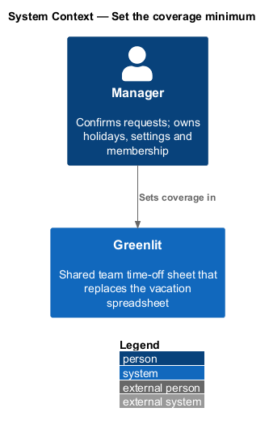
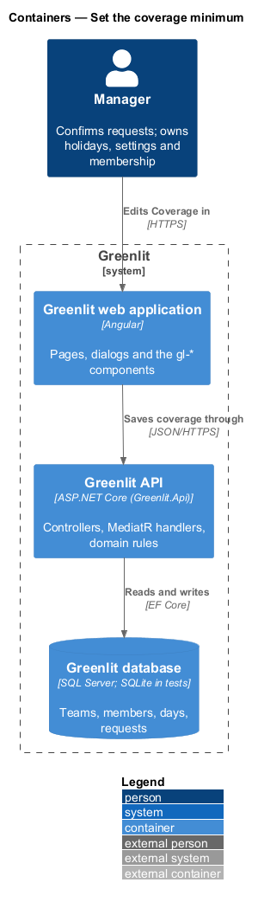
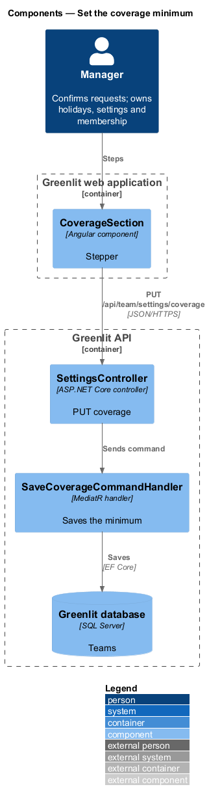
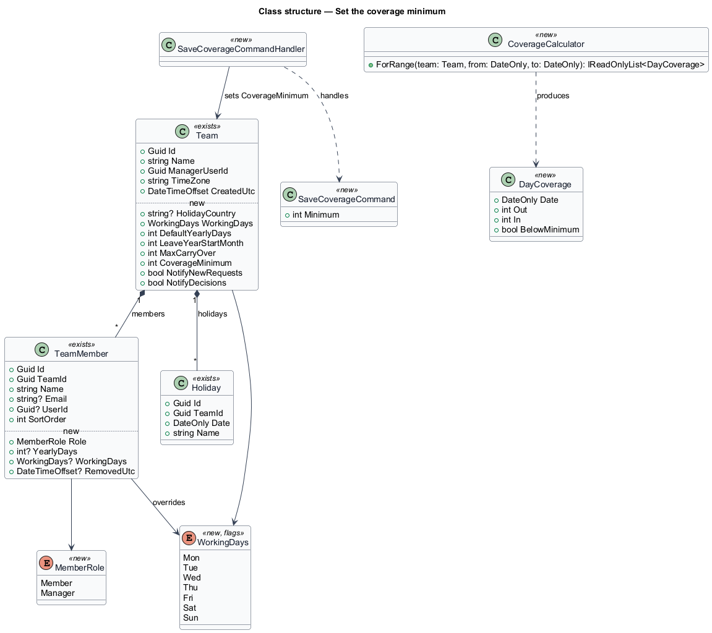
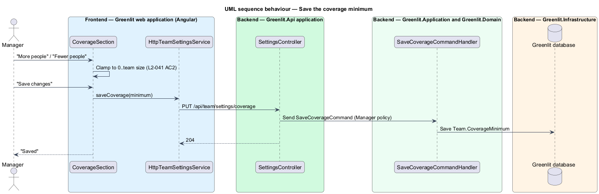

# Set the coverage minimum

## Overview

Coverage is the fewest people who should be in on any working day. The manager sets it in Settings with a stepper bounded by 0 and the team size. Greenlit then flags days below the minimum on the calendar's Out row, in the request dialog and when the manager approves a request (`sheet/view-month`, `requests/approve-request`).

**coverage minimum** — smallest number of members who should be working on a working day; stored as `Team.CoverageMinimum`

## Description

The feature is a vertical slice from the Greenlit web application to the Greenlit database.

**Frontend**

- **`CoverageSection`** — Shows "{n} of {team size} people in" between "Fewer people" and "More people" buttons, clamped to 0 and the team size, and "Save changes".

**Backend**

- **`SettingsController`** — `PUT /api/team/settings/coverage`.
- **`SaveCoverageCommandHandler`** — Saves `Team.CoverageMinimum`. The validator rejects values below 0 or above the number of active members.
- **`CoverageCalculator`** — Domain service shared with the sheet: for each date, counts members out (requested or confirmed) and members in (working and not out), and flags the date when in < minimum.

**Shared plumbing (exists today)**

- **`ExceptionHandlingMiddleware`** — Greenlit.Api middleware. It maps application exceptions (`ValidationException`, `NotFoundException`, `ForbiddenException`, `ConflictException`, `BadRequestException`) to ProblemDetails responses with a `code` extension.
- **`ValidationBehavior`** — MediatR pipeline behaviour in Greenlit.Application. It runs each request's FluentValidation validator before the handler and raises `ValidationException` on failure.
- **`IAppDbContext`** — Greenlit.Application abstraction over the EF Core context, implemented by `AppDbContext` in Greenlit.Infrastructure. Handlers read and write through it in one unit of work.

## Requirements

The feature realizes the following level-2 (L2) requirements. Each L2 requirement refines a level-1 (L1) requirement, cited by identifier; the acceptance criteria for each are in `docs/specs/L2.md`.

| L2 ID | Refines (L1) | Requirement |
|-------|--------------|-------------|
| `L2-041` | `L1-010` | **Coverage minimum.** The manager sets the fewest people who must be in. |

## Diagrams

### System context

The manager sets coverage in Greenlit; no external system takes part.

### Containers

The Coverage section saves the minimum through the Greenlit API.

### Components

One handler stores the minimum; `CoverageCalculator` uses it wherever days are counted.

### Class structure

`CoverageCalculator` turns the team's days into `DayCoverage` values for any date range.

### Behaviour — save the coverage minimum

The stepper never leaves 0 to team size (`L2-041` AC2), and the validator enforces the same bounds.

