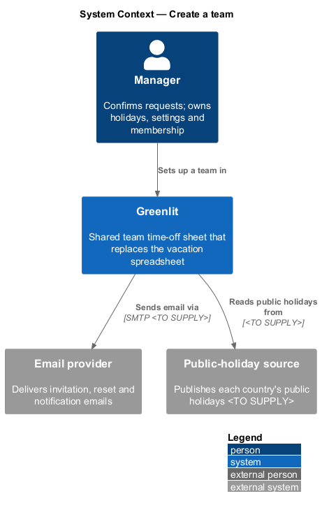
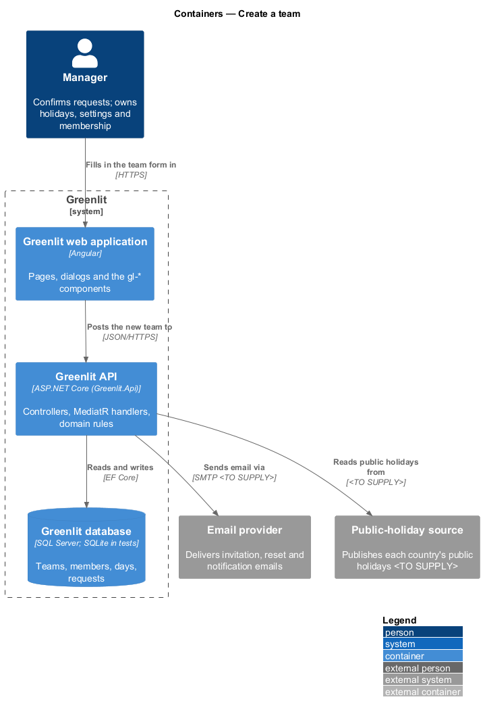
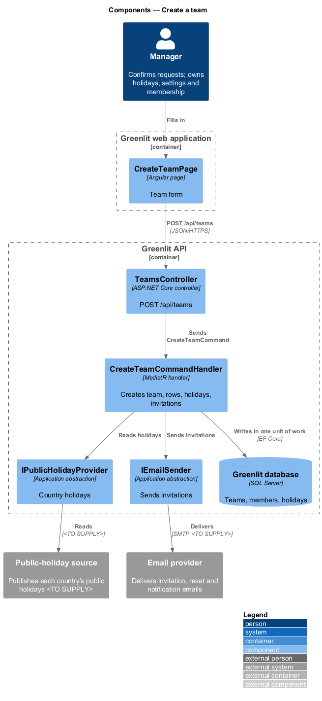
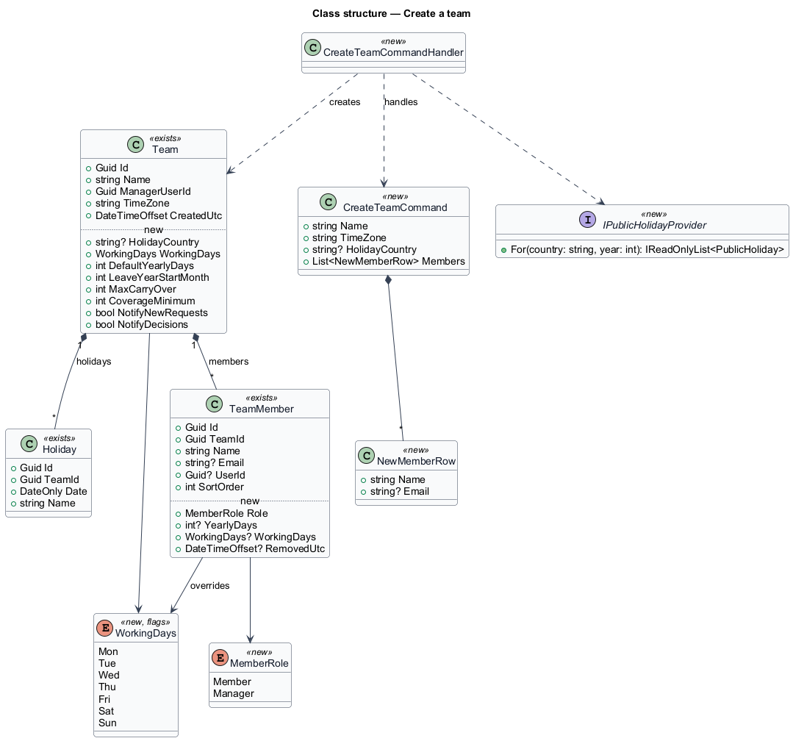
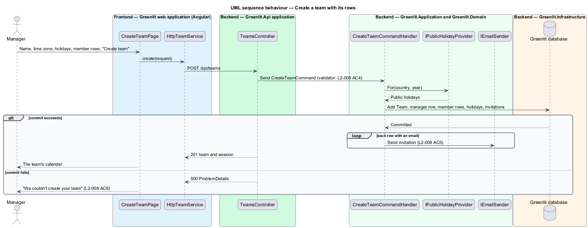

# Create a team

## Overview

A team is one sheet: a manager, the people whose days it shows, a time zone and the team's holidays. This feature creates a team in one form.

The manager names the team, picks a time zone and a public-holiday calendar, and lists the people on the sheet. Each name becomes a row at once; a person with an email also receives an invitation. The creator becomes the team's manager.

**time zone** — IANA zone in which Greenlit decides the date, so weekends and holidays fall on the right days

**public-holiday calendar** — country whose public holidays Greenlit copies into the team's holidays, or none

A person reaches this page by signing in with an account that is not on a team yet: every app screen sends them here, and the page sends anyone already on a team to the calendar (`L2-008` AC8). Sign-in stays invite-only (`L2-001`, `L1-006`); there is no self sign-up, so the account of a new manager is created by the operator (the demo seed creates some, see Decisions).

## Description

The feature is a vertical slice from the Greenlit web application to the Greenlit database.

**Frontend**

- **`CreateTeamPage`** — Bare-shell page at `/create-team` (`page: 'create-team'`). It holds a growing list of member rows ("Add another member") and shows "Give your team a name" beside the team name when it is empty. Member rows are optional and never block the form: a row without a name is left out.
- **`TeamService / TEAM_SERVICE`** — `create(request)` returns the new team and a session for its manager, and stores the session.
- **`teamGuard` / `noTeamGuard`** — Route guards. `teamGuard` sends a signed-in person whose session names no team to `/create-team`; `noTeamGuard` sends one whose session names a team from `/create-team` to the calendar.

**Backend**

- **`TeamsController`** — `POST /api/teams`.
- **`CreateTeamCommand / CreateTeamCommandHandler`** — Creates the `Team` with the caller as `ManagerUserId`, the creator's own `TeamMember` row first, one `TeamMember` per named row, and the holidays from `IPublicHolidayProvider` for the current and the next year in the team's time zone. It makes the caller's account a Manager and returns a new session that names the team. All writes share one unit of work, so a failure saves nothing (`L2-008` AC6). Invitations (`Invitation`, emailed after the commit) arrive with journey 5, Invite a member (`L2-010`).
- **`CreateTeamCommandValidator`** — Requires a team name (120 characters at most), a time zone from the offered list and a public-holiday calendar from the offered list. Member rows are optional: it places no rule on them beyond the 120-character limit on a name.
- **`IPublicHolidayProvider`** — Returns a country's public holidays for a year. `RuleBasedPublicHolidayProvider` in Greenlit.Infrastructure works them out offline from each country's rules (ADR-005).
- **`Team, TeamMember, Holiday`** — Existing entities, unchanged by this journey. The settings fields in the class diagram arrive with the journeys that use them (see Decisions).
- **`IEmailSender`** — Greenlit.Application abstraction for one templated email, implemented in Greenlit.Infrastructure. It arrives with journey 5, with its provider.

**Shared plumbing (exists today)**

- **`ExceptionHandlingMiddleware`** — Greenlit.Api middleware. It maps application exceptions (`ValidationException`, `NotFoundException`, `ForbiddenException`, `ConflictException`, `BadRequestException`) to ProblemDetails responses with a `code` extension.
- **`ValidationBehavior`** — MediatR pipeline behaviour in Greenlit.Application. It runs each request's FluentValidation validator before the handler and raises `ValidationException` on failure.
- **`IAppDbContext`** — Greenlit.Application abstraction over the EF Core context, implemented by `AppDbContext` in Greenlit.Infrastructure. Handlers read and write through it in one unit of work.

**Time-zone options.** The mocks offer six options: London (GMT+0 / BST), Dublin, "Paris, Berlin (CET)", Rome (CET), New York (ET) and Toronto (ET). They map to `Europe/London`, `Europe/Dublin`, `Europe/Paris`, `Europe/Rome`, `America/New_York` and `America/Toronto`. Rome and Toronto keep the same clock as Paris and New York; they are offered so a team in those cities finds its own name.

**Public-holiday calendars.** United Kingdom (`GB`, the bank holidays of England and Wales), Ireland (`IE`), United States (`US`, federal holidays), Canada (`CA`, the statutory holidays of Ontario), Italy (`IT`, national holidays) and "None, I'll add my own" (`none`).

## Requirements

The feature realizes the following level-2 (L2) requirements. Each L2 requirement refines a level-1 (L1) requirement, cited by identifier; the acceptance criteria for each are in `docs/specs/L2.md`.

| L2 ID | Refines (L1) | Requirement |
|-------|--------------|-------------|
| `L2-008` | `L1-002` | **Create a team.** A manager sets up a team and its rows in one form. |

## Diagrams

### System context

The manager sets up a team in Greenlit, which reads public holidays from a holiday source and sends invitations through the email provider.

### Containers

The form posts one request to the Greenlit API, which writes the whole team in one transaction.

### Components

`CreateTeamCommandHandler` gathers the holidays, writes the team and its rows, and sends the invitations after the commit.

### Class structure

The design extends the existing `Team` and `TeamMember` entities with settings, roles and working days, and adds the `WorkingDays` flags.

### Behaviour — create a team with its rows

Validation failures stop the request before any write (`L2-008` AC4). The single unit of work gives "Nothing was saved, so you can try again" its meaning (`L2-008` AC6).

## Decisions (journey 3, 7 Nov 2026)

| Topic | Decision |
|---|---|
| Entry point | `teamGuard` runs after `authGuard` on every app screen and sends a session without a `team_id` claim to `/create-team`. `/create-team` (`authGuard`, `noTeamGuard`) sends a session that names a team to `/`. The session is read locally from the token, as `authGuard` does (ADR-004). |
| New manager accounts | Sign-in stays invite-only and there is no self sign-up (`L1-006`). An account without a team comes from the operator; `greenlit seed` creates four for the demo and the e2e suite: Noor Haddad (`noor@northwind.studio`), who only opens the page, and Priya Shah, Sam Lee and Tomás Silva (`priya@`, `sam@`, `tomas@northwind.studio`), one per Playwright viewport, who each create a team. A run that creates teams needs a fresh e2e database (`eng/Start-E2eApi.ps1` starts one). |
| Endpoint and response | `POST /api/teams`, authenticated by the fallback policy. Body: `name`, `timeZone`, `holidayCountry` (`GB`, `IE`, `US`, `CA`, `IT` or `none`), `members` (`name`, `email`). Success is `201` with `CreatedTeamDto` (`teamId`, `name`, `invited`, `session`). `invited` counts the invitations sent, `0` until journey 5. |
| Member rows | Names and emails are trimmed. Members are optional (a team may start with only its manager), and a row without a name is ignored, even when it has an email (changed 8 Nov 2026: a stray email must not stop the manager creating the team). Emails are stored on the row so journey 5 can invite them; this journey sends nothing. The creator's own row comes first (`SortOrder` 0) with their display name and email, then the rows in the order entered. A row is removed by clearing it: the mocks show no Remove control. |
| Manager | `Team.ManagerUserId` is the caller, and the caller's `User.Role` becomes Manager. The `MemberRole` on `TeamMember` in the class diagram arrives with journey 18 (roles in Settings), so the schema does not change in this journey and needs no migration. The other new fields in the class diagram arrive with their journeys: working days (15), yearly days (11), coverage (17), notifications (25), removal (24) and the holiday country (14, 18). |
| One team per person | A caller who already manages a team or has a row on one gets `409` ProblemDetails with code `team_exists` and the detail "You're already on a team." Nothing is written. |
| Validation | `400` validation ProblemDetails: `Name` "Give your team a name." (empty) or "Use 120 characters or fewer." (too long), `TimeZone` "Choose a time zone from the list.", `HolidayCountry` "Choose a public-holiday calendar from the list.", `Members[i].Name` "Use 120 characters or fewer." (too long). The page checks the name rules before sending, so the API rules are the backstop; the selects can only hold offered values. |
| Holidays | `RuleBasedPublicHolidayProvider` (ADR-005) gives the chosen country's holidays for the current and the next year in the team's time zone, stored as team `Holiday` rows. `none` stores no holidays. |
| Session after creating | The response carries a new session (ADR-004) whose token names the team and the creator's row; the page stores it, so `teamGuard` lets the calendar open. |
| Busy and failed states | While the request runs, the button is busy (`aria-busy="true"`, disabled) and every text field is read-only (`pages/create-team/submitting`). Any failure other than validation shows "We couldn't create your team" with "Something went wrong on our side. Nothing was saved, so you can try again." above the form, keeping every value (`pages/create-team/error`). |
| Success | The card becomes `pages/create-team/success`: "You're all set", "Your sheet is ready.", "{team name} is ready" and "Open the calendar". With `invited` above zero the alert says "We've emailed invitations to N people…"; with none it says "Everyone is on the calendar now, and you can invite them later from Settings." (`pages/create-team/success-no-invites`, added in this journey). Until journey 5 every team shows the second. |
| Loading state | `pages/create-team/loading` is not reached in this journey: the page needs no data before it renders. |
| Time-zone list | Six options, as the mocks and `L2-008` AC2 show; `Europe/Berlin` is not offered on its own ("Paris, Berlin (CET)" is `Europe/Paris`). |
| Diagrams | The `.puml` sources record this journey's shape; their PNGs are regenerated with PlantUML when a renderer is available. |

## Security and privacy

- **Who may call it.** `POST /api/teams` needs a session (fallback policy). Any signed-in person may call it once, while they are on no team; the caller becomes the manager of the team they create and can reach no other team through it.
- **Team scoping.** The handler resolves the caller from `sub` only. The new team, its rows and its holidays belong to that caller; nothing in the request names an existing team or member.
- **What an error reveals.** `team_exists` says only that the caller is already on a team, which they know. Validation errors name only the request's own fields. A server failure says nothing about the cause.
- **Personal data.** Member names and emails are stored on the team's rows and shown only to that team. No email is sent in this journey, and emails are not logged (the logging behaviour logs request type names only).
