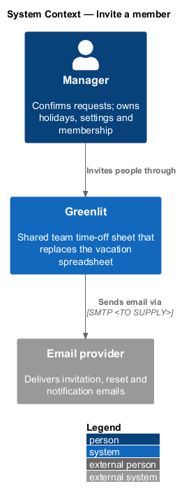
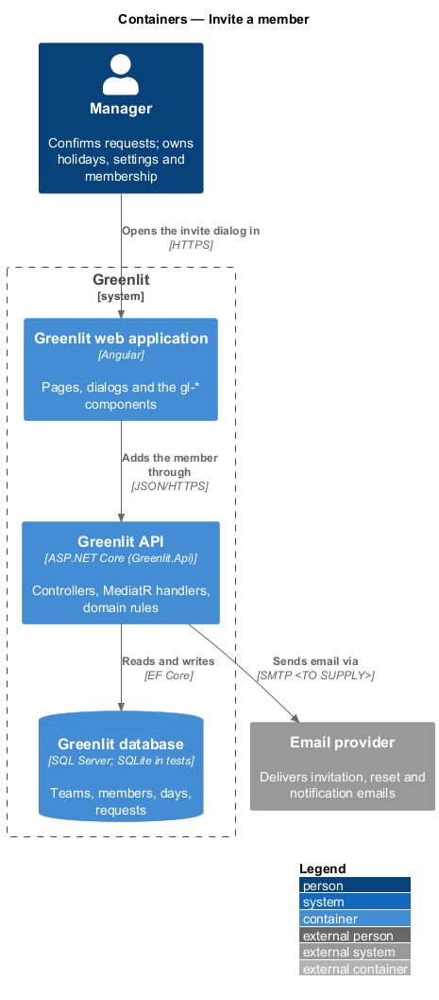
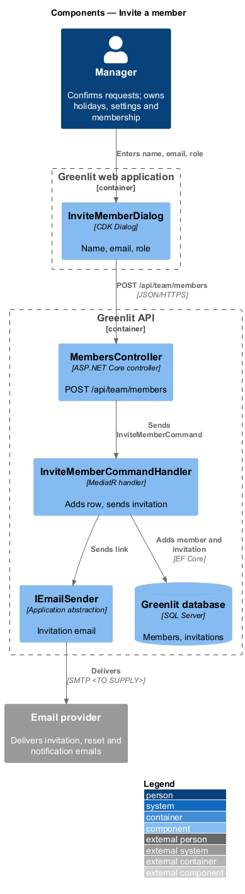
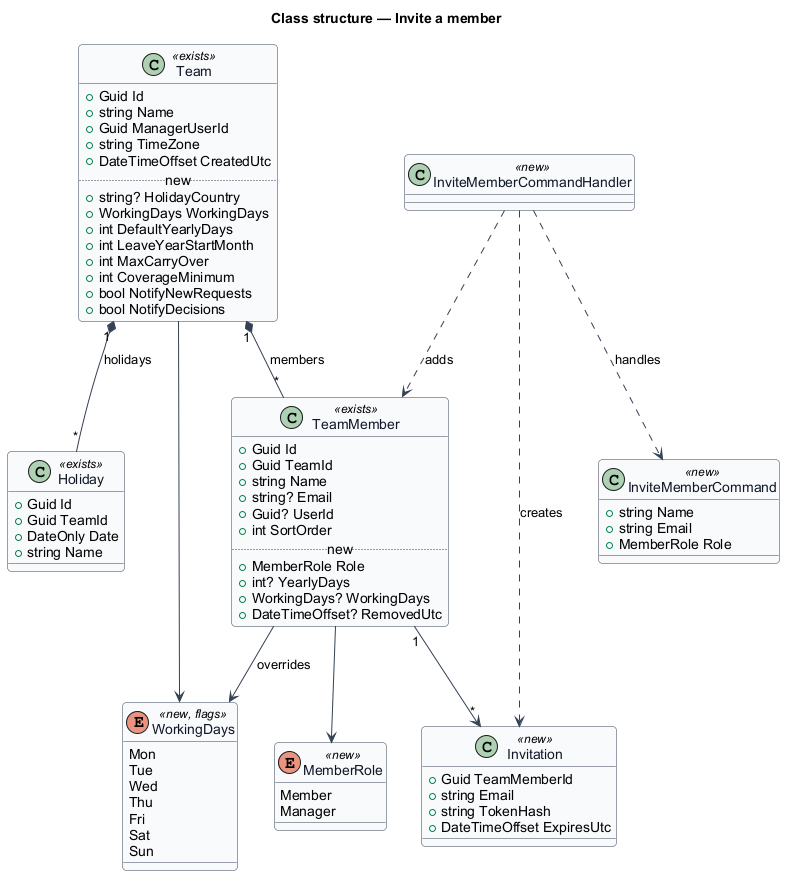
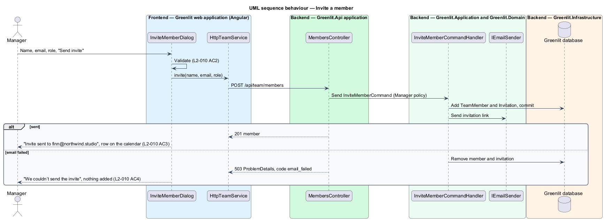

# Invite a member

## Overview

The manager adds a person to an existing team from Settings. The person appears on the calendar as a row at once, before they accept, and receives an email with a link to set a password.

The invite dialog asks for a name, an email and a role. The link works for seven days; accepting it is covered by `identity-and-access/accept-invitation`.

## Description

The feature is a vertical slice from the Greenlit web application to the Greenlit database.

**Frontend**

- **`InviteMemberDialog`** — CDK Dialog in `app/dialogs/invite-member`. It validates the name and email, shows "Sending…", and on success shows "Invite sent to {email}" with "Invite another" and "Done".
- **`TeamService / TEAM_SERVICE`** — `invite(name, email, role)`.

**Backend**

- **`MembersController`** — `POST /api/team/members` behind the `Manager` policy.
- **`InviteMemberCommandHandler`** — Adds the `TeamMember` at the end of the sort order, creates the `Invitation` with `ExpiresUtc` 7 days after sending, commits, then emails the link. If the email fails, the handler rolls back the member so "Nothing was added to the team" holds (`L2-010` AC4).
- **`InviteMemberCommandValidator`** — Requires a name ("Enter a name.") and a valid email ("Enter a valid email address, like name@company.com.").
- **`Invitation`** — Entity defined in `identity-and-access/accept-invitation`. This design introduces it: only the SHA-256 hash of the token is stored; the token itself exists only in the email.
- **`TeamMember.Role`** — New property (`Member` or `Manager`), set from the dialog and applied to the account when the invitation is accepted.
- **`IEmailSender`** — Greenlit.Application abstraction introduced by this design, implemented in Greenlit.Infrastructure. It sends one message (`EmailMessage`: recipient, subject, text). The provider is the log: `LoggingEmailSender` writes each message to the application log in development and in the e2e API, so no SMTP is needed (ADR-006). The text of each email lives in one class beside the handler (`InvitationEmail`).
- **`IInvitationLinks`** — Greenlit.Application abstraction that turns a token into the link the email carries, `{Greenlit:App:Origin}/accept-invite/{token}`; implemented in Greenlit.Infrastructure.

**Shared plumbing (exists today)**

- **`ExceptionHandlingMiddleware`** — Greenlit.Api middleware. It maps application exceptions (`ValidationException`, `NotFoundException`, `ForbiddenException`, `ConflictException`, `BadRequestException`) to ProblemDetails responses with a `code` extension.
- **`ValidationBehavior`** — MediatR pipeline behaviour in Greenlit.Application. It runs each request's FluentValidation validator before the handler and raises `ValidationException` on failure.
- **`IAppDbContext`** — Greenlit.Application abstraction over the EF Core context, implemented by `AppDbContext` in Greenlit.Infrastructure. Handlers read and write through it in one unit of work.

## Requirements

The feature realizes the following level-2 (L2) requirements. Each L2 requirement refines a level-1 (L1) requirement, cited by identifier; the acceptance criteria for each are in `docs/specs/L2.md`.

| L2 ID | Refines (L1) | Requirement |
|-------|--------------|-------------|
| `L2-010` | `L1-002` | **Invite a member.** The manager adds a person to the team by name and email; the person appears on the calendar at once and receives an email link to set a password. |

## Diagrams

### System context

The manager invites a person through Greenlit, which emails the link through the email provider.

### Containers

The dialog posts the invitation to the Greenlit API, which writes the row and sends the email.

### Components

`InviteMemberCommandHandler` writes the member and the invitation, then sends the email.

### Class structure

An invitation hangs off the new `TeamMember`, whose role comes from the dialog.

### Behaviour — invite a member

The new row appears on the calendar as soon as the request succeeds (`L2-010` AC3). A failed email removes the row again (`L2-010` AC4).

## Decisions (journey 5)

- **Who may call it.** `POST /api/team/members` requires a signed-in caller whose account role is Manager (the `Manager` policy) and who is the manager of a team; the team is always the caller's own, never a parameter. A member gets 403, a signed-out caller 401.
- **Duplicate email.** The email is compared case-insensitively within the caller's team only, so the answer reveals nothing about other teams. A row with that email that has not accepted yet is a *re-invite*: no second row is added, the earlier link stops working, a new link valid for seven days is emailed and the answer is the same as for a new invite. A row whose person already has an account is refused with `409` and code `member_exists`.
- **Email failure.** The member and invitation are committed first, then the email is sent. If sending throws, the handler removes both again (a re-invite instead keeps the existing row and its old link) and the request fails with `500`, so nothing is added to the team (`L2-010` AC4).
- **Invitations from create-team.** Every named member with an email who is added when a team is created gets the same invitation, and `invited` counts them (`L2-008` AC5, AC7).
- **Entry point.** The invite dialog opens from the Team section of Settings. Journey 5 builds that section's member list and the "Invite a member" button only; role, yearly days, team name, time zone and "Save changes" belong to journey 18 (`L2-009`).
- **Migrations.** The Invitation table and `TeamMember.Role` are added to the SQL Server migrations (ADR-006).
