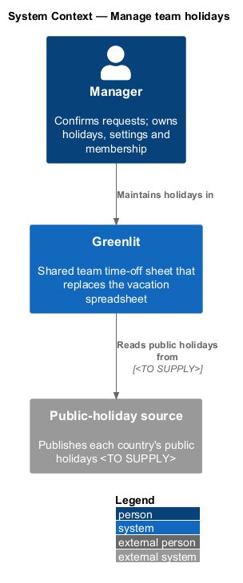
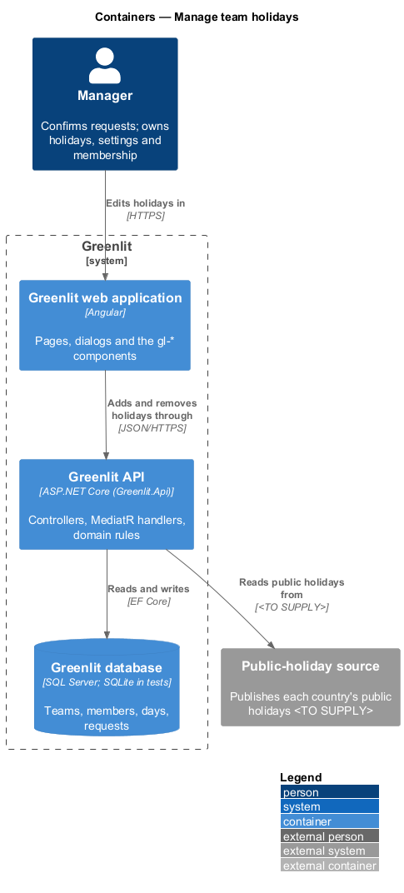
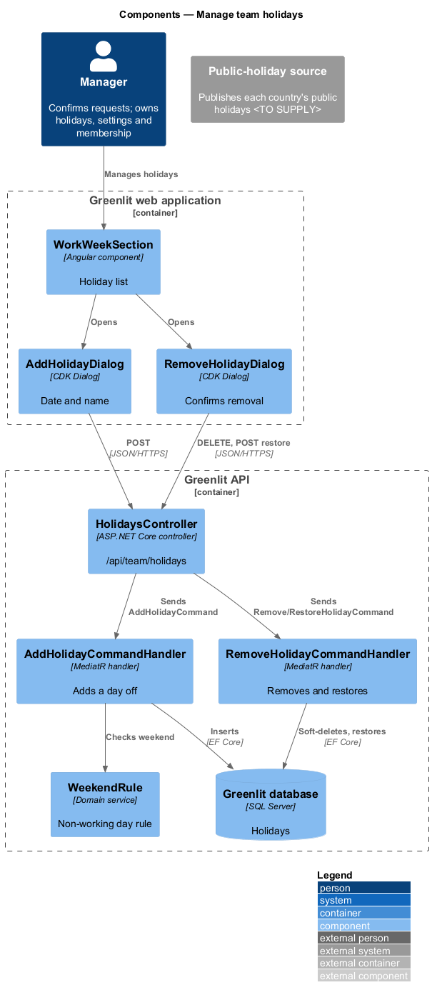
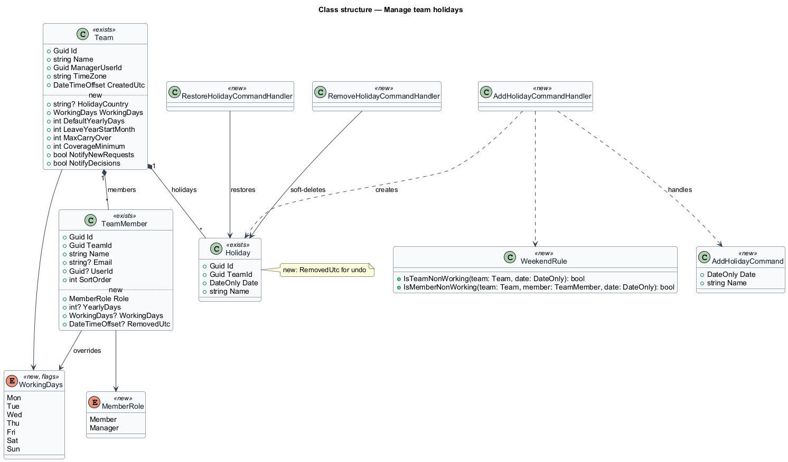
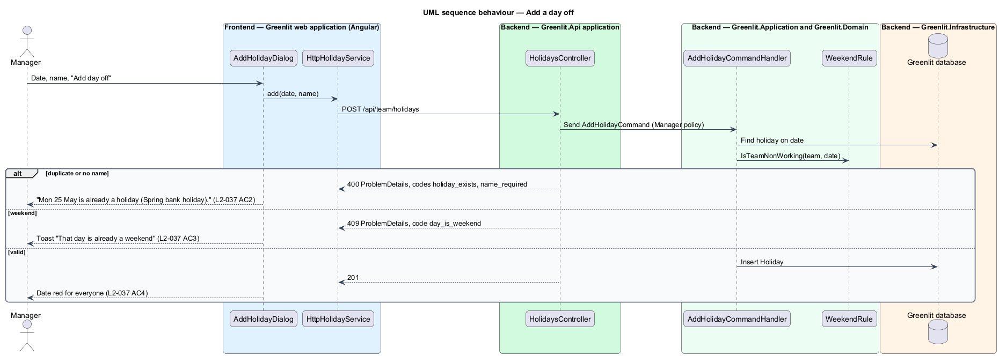
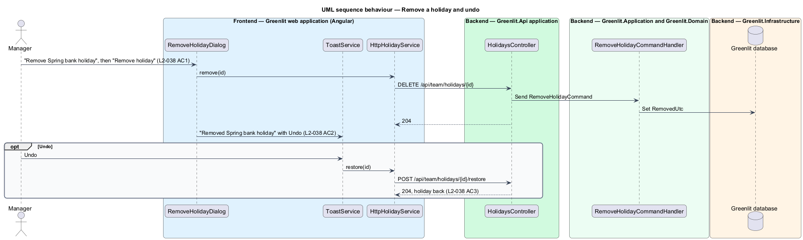

# Manage team holidays

## Overview

A holiday is a red day for the whole team. It never counts against anyone's allowance and cannot be booked. The team's holidays start from the public-holiday calendar chosen when the team was created; the manager then adds company days off and removes holidays the team does not observe.

The holidays live in the Work week & holidays section of Settings. Adding a holiday opens a dialog; removing one asks for confirmation and offers Undo. When the next year's public holidays become available, a banner invites the manager to review them.

**day off** — holiday added by the manager, such as a company offsite, as opposed to a public holiday

## Description

The feature is a vertical slice from the Greenlit web application to the Greenlit database.

**Frontend**

- **`WorkWeekSection`** — Lists the holidays ("Thu 1 Jan New Year's Day") with "Remove {name}" buttons and "Add day off", or the empty state "No holidays yet".
- **`AddHolidayDialog`** — CDK Dialog in `app/dialogs/add-holiday` with Date and Name.
- **`RemoveHolidayDialog`** — CDK Dialog in `app/dialogs/remove-holiday`. On success the page shows the toast "Removed {name}" with Undo.
- **`HolidayService / HOLIDAY_SERVICE`** — `add(date, name)`, `remove(id)` and `restore(id)`.

**Backend**

- **`HolidaysController`** — `POST /api/team/holidays`, `DELETE /api/team/holidays/{id}` and `POST /api/team/holidays/{id}/restore`, behind the `Manager` policy.
- **`AddHolidayCommandHandler`** — Rejects a date that is already a holiday (code `holiday_exists`, "Mon 25 May is already a holiday (Spring bank holiday).") and a weekend date (code `day_is_weekend`). Existing `TimeOffDay` rows on the new holiday are `<TO SUPPLY>`: ADR-003 forbids a day on a holiday.
- **`RemoveHolidayCommandHandler / RestoreHolidayCommandHandler`** — Remove soft-deletes the row (`RemovedUtc`) so Undo can restore it with its name.
- **`GetHolidayReviewQueryHandler`** — Reports whether `IPublicHolidayProvider` has the next year's holidays not yet reviewed, for the banner "2027 UK bank holidays are ready". The review flow behind "Review holidays" is `<TO SUPPLY>`.
- **`WeekendRule`** — Domain service that decides whether a date is a non-working day for the team or a member (shared with `teams/working-days`).

**Shared plumbing (exists today)**

- **`ExceptionHandlingMiddleware`** — Greenlit.Api middleware. It maps application exceptions (`ValidationException`, `NotFoundException`, `ForbiddenException`, `ConflictException`, `BadRequestException`) to ProblemDetails responses with a `code` extension.
- **`ValidationBehavior`** — MediatR pipeline behaviour in Greenlit.Application. It runs each request's FluentValidation validator before the handler and raises `ValidationException` on failure.
- **`IAppDbContext`** — Greenlit.Application abstraction over the EF Core context, implemented by `AppDbContext` in Greenlit.Infrastructure. Handlers read and write through it in one unit of work.

## Requirements

The feature realizes the following level-2 (L2) requirements. Each L2 requirement refines a level-1 (L1) requirement, cited by identifier; the acceptance criteria for each are in `docs/specs/L2.md`.

| L2 ID | Refines (L1) | Requirement |
|-------|--------------|-------------|
| `L2-036` | `L1-009` | **Team holidays.** The Work week & holidays section lists the team's holidays. |
| `L2-037` | `L1-009` | **Add a holiday.** The manager adds a team day off. |
| `L2-038` | `L1-009` | **Remove a holiday.** The manager removes a team holiday. |

## Diagrams

### System context

The manager maintains holidays in Greenlit, which can read the next year's public holidays from the holiday source.

### Containers

The section and its dialogs call the Greenlit API, which stores the holidays in the Greenlit database.

### Components

`AddHolidayCommandHandler` checks duplicates and weekends through `WeekendRule`; removal is a soft delete so Undo can restore it.

### Class structure

`Holiday` gains `RemovedUtc`; `WeekendRule` is the one place that decides non-working days.

### Behaviour — add a day off

A duplicate date and a missing name come back together under "Fix 2 things to continue" (`L2-037` AC2); a weekend date adds nothing (`L2-037` AC3).

### Behaviour — remove a holiday and undo

The soft delete keeps the name and date, so Undo restores the same holiday (`L2-038` AC3).

