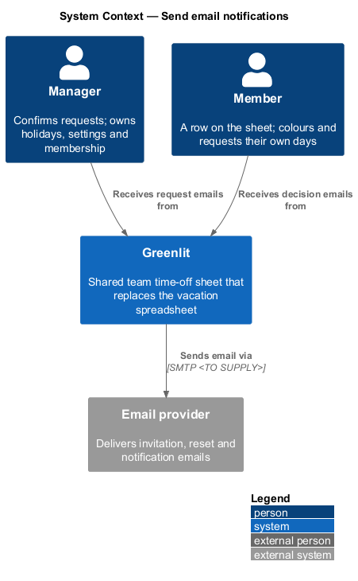
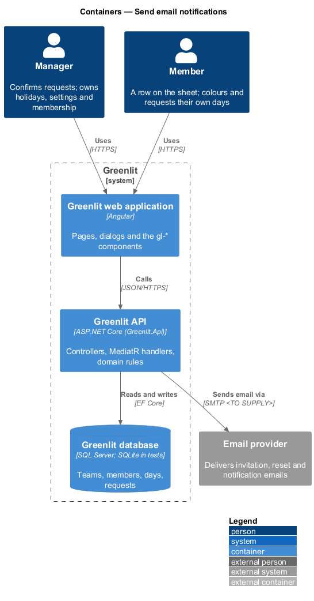
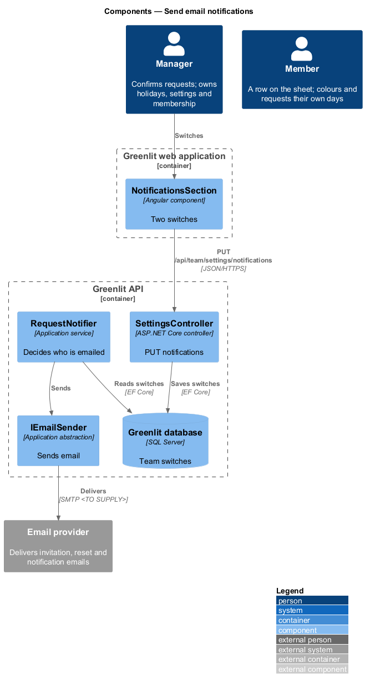
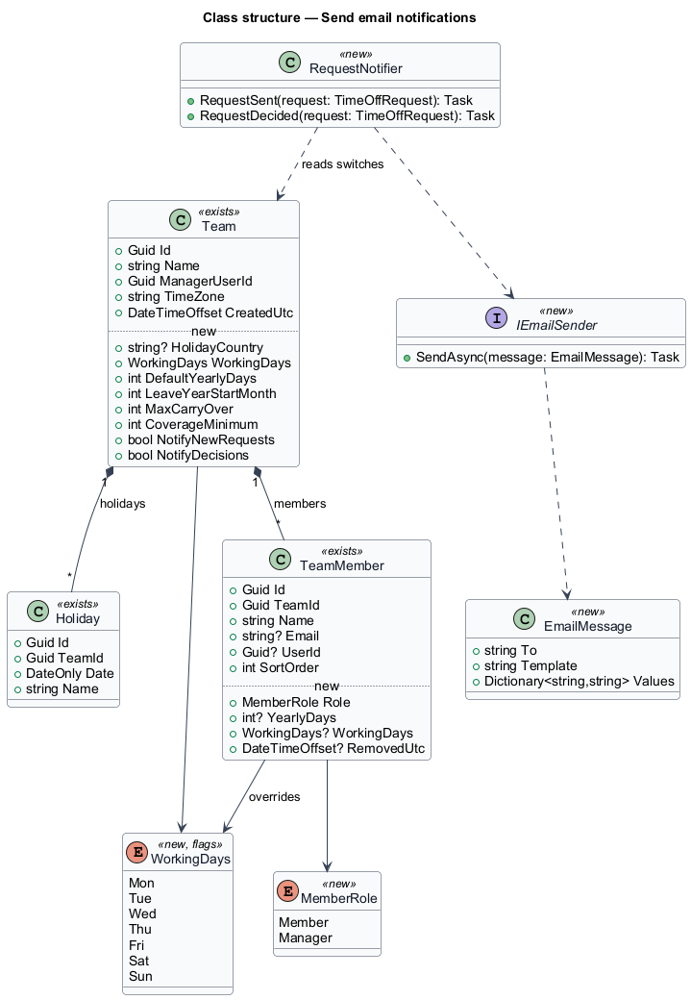
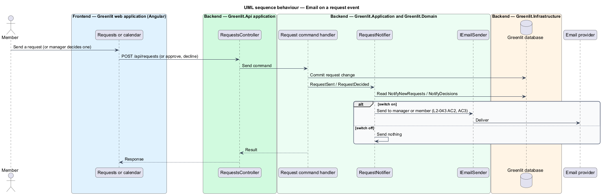

# Send email notifications

## Overview

Greenlit sends email only, and only for two events: a member sends a request (to the manager), and the manager approves or declines a request (to the member). Each event has a switch in Settings. Greenlit never sends a daily digest.

**notification** — single email sent in response to one request event, governed by a team switch

## Description

The feature is a vertical slice from the Greenlit web application to the Greenlit database.

**Frontend**

- **`NotificationsSection`** — Shows "New requests" and "Decisions" as `gl-switch` controls and "Save changes".

**Backend**

- **`SettingsController`** — `PUT /api/team/settings/notifications` saves `Team.NotifyNewRequests` and `Team.NotifyDecisions`.
- **`RequestNotifier`** — Application service called by the request handlers after commit. `RequestSent` emails the manager when `NotifyNewRequests` is on; `RequestDecided` emails the member, with the decline reason, when `NotifyDecisions` is on.
- **`IEmailSender`** — Greenlit.Application abstraction introduced by this design, implemented in Greenlit.Infrastructure. It sends one templated email; the provider is `<TO SUPPLY>`.

**Shared plumbing (exists today)**

- **`ExceptionHandlingMiddleware`** — Greenlit.Api middleware. It maps application exceptions (`ValidationException`, `NotFoundException`, `ForbiddenException`, `ConflictException`, `BadRequestException`) to ProblemDetails responses with a `code` extension.
- **`ValidationBehavior`** — MediatR pipeline behaviour in Greenlit.Application. It runs each request's FluentValidation validator before the handler and raises `ValidationException` on failure.
- **`IAppDbContext`** — Greenlit.Application abstraction over the EF Core context, implemented by `AppDbContext` in Greenlit.Infrastructure. Handlers read and write through it in one unit of work.

Delivery failures after the commit are logged and do not undo the decision. Retry behaviour is `<TO SUPPLY>`.

## Requirements

The feature realizes the following level-2 (L2) requirements. Each L2 requirement refines a level-1 (L1) requirement, cited by identifier; the acceptance criteria for each are in `docs/specs/L2.md`.

| L2 ID | Refines (L1) | Requirement |
|-------|--------------|-------------|
| `L2-043` | `L1-011` | **Email notifications.** Two switches decide which emails Greenlit sends. |

## Diagrams

### System context

Greenlit emails the manager about requests and the members about decisions through the email provider.

### Containers

The API reads the team's switches before sending each email.

### Components

`RequestNotifier` is the only place that decides whether an email goes out.

### Class structure

`RequestNotifier` reads the two `Team` switches and hands an `EmailMessage` to `IEmailSender`.

### Behaviour — email on a request event

Each switch gates its own event (`L2-043` AC2, AC3); no scheduled job exists, so no digest is sent (`L2-043` AC4).

