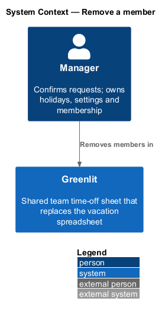
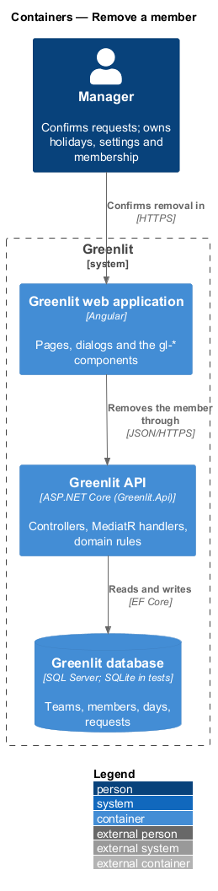
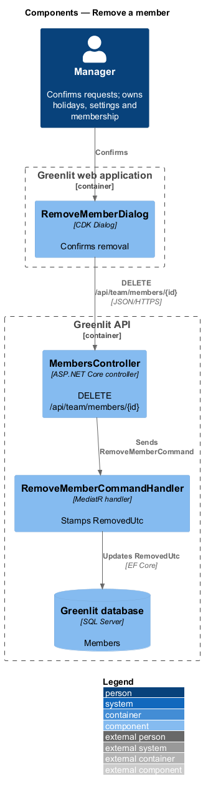
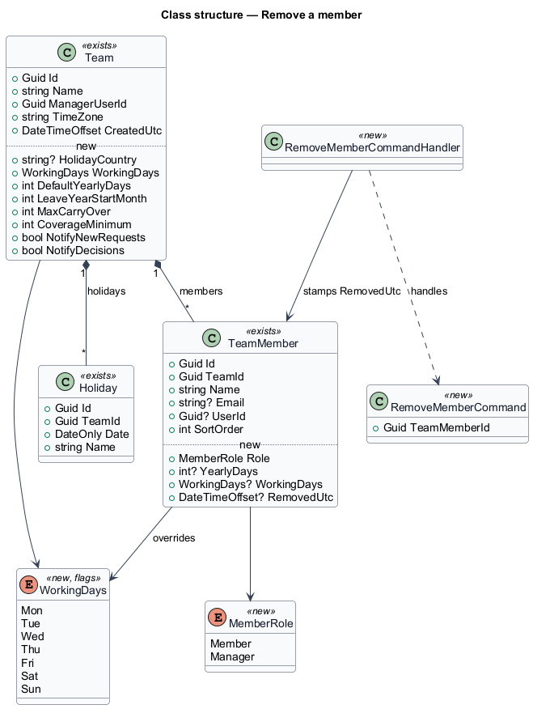
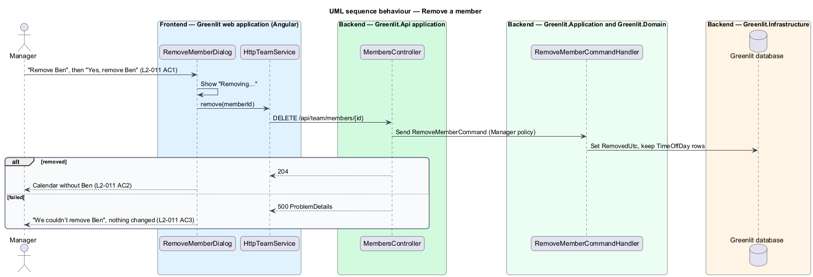

# Remove a member

## Overview

The manager removes a person from the team from that person's page. Removal hides the person from the calendar, the year and the requests, and stops them signing in. Their days stay in the history, and the manager can invite them back later.

**soft removal** — removal that stamps `TeamMember.RemovedUtc` instead of deleting the row, so history and totals stay intact

## Description

The feature is a vertical slice from the Greenlit web application to the Greenlit database.

**Frontend**

- **`RemoveMemberDialog`** — CDK Dialog in `app/dialogs/remove-member`, opened by "Remove {first name}" on the person page. It shows "Removing…" while busy.
- **`PersonPage`** — Navigates to the calendar after removal; the page for a removed member shows "Person not found".

**Backend**

- **`MembersController`** — `DELETE /api/team/members/{id}` behind the `Manager` policy.
- **`RemoveMemberCommandHandler`** — Stamps `RemovedUtc`. A global EF Core query filter hides removed members from sheet, year and request queries; history queries opt out of it. The manager cannot remove themselves: code `cannot_remove_self` (409), which also keeps the team from losing its last manager, since only the team's manager may remove anyone. A member of another team or one already removed is `404 person_not_found`, so nothing about other teams leaks.
- **`SignInCommandHandler`** — Refuses to sign in an account whose team rows are all removed: `401` with code `member_removed`, only after the password matched, so a wrong password still reveals nothing. A person invited back has a live row again and signs in.
- **Bearer `OnTokenValidated` event** — Existing tokens stop working: a token whose account is a removed member is refused with `401` and code `member_removed` on its next request.

**Shared plumbing (exists today)**

- **`ExceptionHandlingMiddleware`** — Greenlit.Api middleware. It maps application exceptions (`ValidationException`, `NotFoundException`, `ForbiddenException`, `ConflictException`, `BadRequestException`) to ProblemDetails responses with a `code` extension.
- **`ValidationBehavior`** — MediatR pipeline behaviour in Greenlit.Application. It runs each request's FluentValidation validator before the handler and raises `ValidationException` on failure.
- **`IAppDbContext`** — Greenlit.Application abstraction over the EF Core context, implemented by `AppDbContext` in Greenlit.Infrastructure. Handlers read and write through it in one unit of work.

## Requirements

The feature realizes the following level-2 (L2) requirements. Each L2 requirement refines a level-1 (L1) requirement, cited by identifier; the acceptance criteria for each are in `docs/specs/L2.md`.

| L2 ID | Refines (L1) | Requirement |
|-------|--------------|-------------|
| `L2-011` | `L1-002` | **Remove a member.** The manager removes a member from the team; their history is kept. |

## Diagrams

### System context

The manager removes a member in Greenlit; no external system takes part.

### Containers

The dialog calls the Greenlit API, which marks the member removed in the Greenlit database.

### Components

One command handler stamps the removal; a query filter keeps removed members out of every team view.

### Class structure

Removal changes one field, `TeamMember.RemovedUtc`; the member's `TimeOffDay` rows stay.

### Behaviour — remove a member

Nothing changes when the request fails (`L2-011` AC3); a removed member's page shows "Person not found" (`L2-011` AC4).

