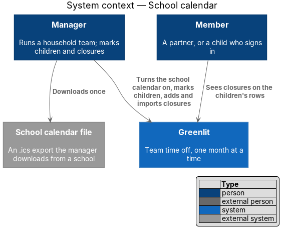
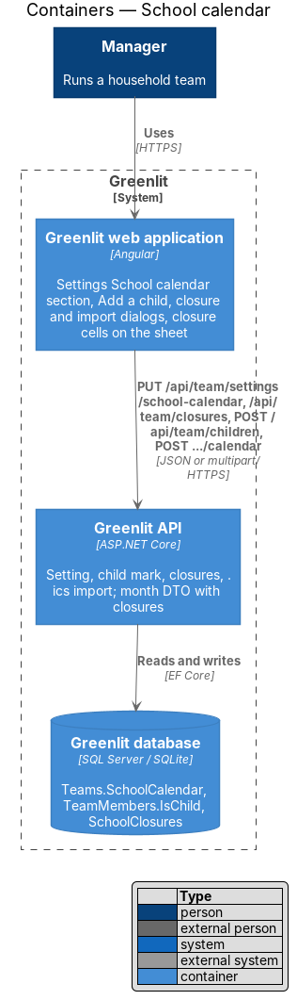
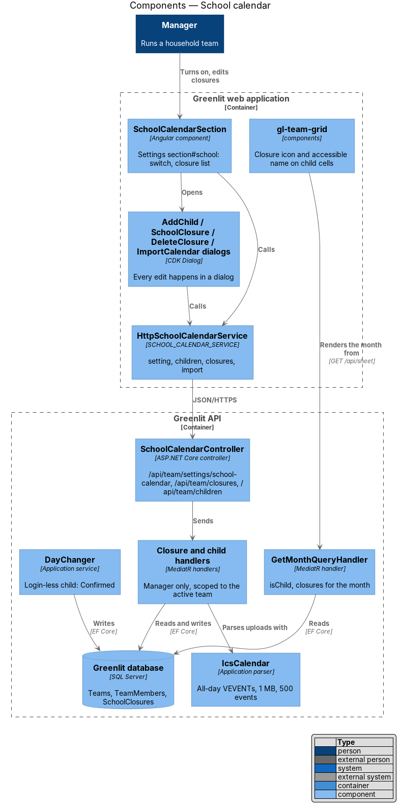
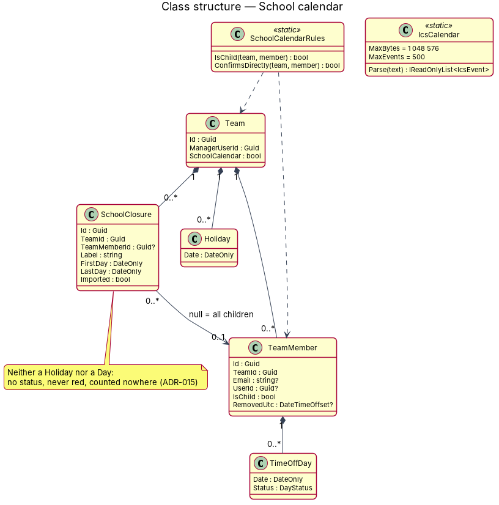
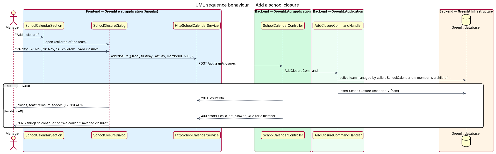
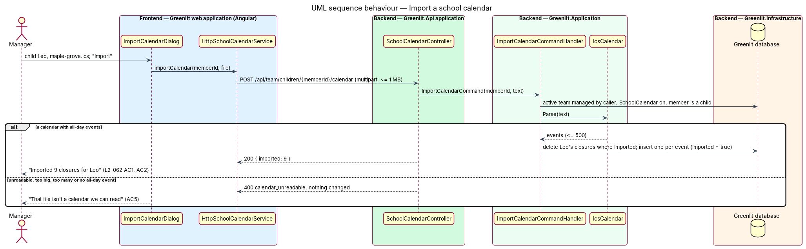
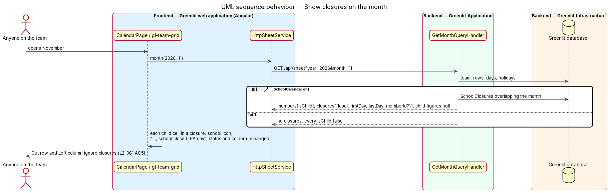
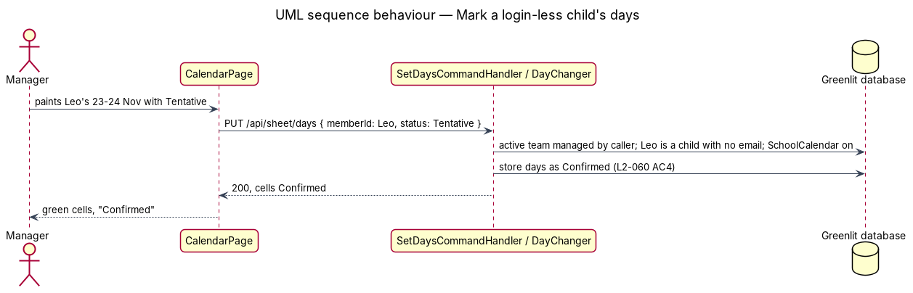

# Keep a school calendar: children and school closures

## Overview

A team can be a household. The manager of any team can turn on the **school calendar**, a team setting that is off by default. While it is on, the manager can mark members as **children**, add children by name without an email, and record **school closures** on the children's rows, either by typing them in or by importing a school's calendar file. Turning the setting off hides the children's marks and the closures and keeps them; turning it on again shows them as they were. There is no team type: this setting is the only thing that separates a family from a workplace (ADR-015).

**school calendar** — the team setting `Team.SchoolCalendar`; only the manager changes it, in Settings

**child** — a member with `TeamMember.IsChild` set while the school calendar is on: no yearly allowance and no days-left figure. It is an attribute, not a role; the manager's own row is never a child

**login-less child** — a child whose row has no email; only the manager marks their days, and those days are saved as Confirmed

**school closure** — a labelled run of dates (a PA day, a school vacation) on one child's row or on every child's row; not a Holiday (never red, never team-wide) and not a Day (no `DayStatus`)

**import** — a one-time upload of a school's `.ics` file for one child; it adds that file's all-day events as closures and replaces only that child's earlier import

## Description

The feature is a vertical slice from the Greenlit web application to the Greenlit database.

**Frontend**

- **`SchoolCalendarService / SCHOOL_CALENDAR_SERVICE`** — Contract and token in the `api` project; `HttpSchoolCalendarService` implements it. `save(on)`, `closures()`, `addClosure(closure)`, `updateClosure(id, closure)`, `deleteClosure(id)`, `addChild(child)` and `importCalendar(memberId, file)`. Writes answer a result union (`ok`, `invalid` with the field errors, `unreadable` for `calendar_unreadable`, `failed`) and never throw.
- **`SchoolCalendarSection`** — Settings section `section#school`, nav "School calendar", after Notifications and before Your teams (`pages/settings/school-calendar*`). The switch "Use the school calendar" with its hint, saved by the section's "Save changes" ("Saving…", "Saved", the shared "No changes to save" and failure toasts of `L2-009`). While on, the closure list: one row per closure with its label, its dates, whose calendar ("All children" or the child's name) and "Imported" in text for imported rows, and "Edit" / "Delete" buttons named "Edit {label}" / "Delete {label}". Below the list "Add a closure" and "Import a calendar". With no closures: "No closures yet"; with no children: "Mark someone as a child in Team to add closures." and no actions. A member sees the switch and the list read-only.
- **Team section** (`team-section.ts`, exists) — While the school calendar is on: the checkbox "Child" on every row but the manager's (`aria-label` "{name} is a child"), "No allowance" instead of the yearly-days field on a child's row, and "Add a child" beside "Invite a member". The checkbox is saved with the section's "Save changes".
- **`AddChildDialog`** — CDK Dialog (`dialogs/add-child/`): Name, Email (optional). With a name only the row is added and the success state says "{name} is on the calendar"; with an email an invitation is sent and the success state is the invite's.
- **`SchoolClosureDialog`** — CDK Dialog (`dialogs/school-closure/`) for add and edit: "What is it?", "First day", "Last day" (native date inputs), "Whose calendar?" (a select of "All children" and each child). Validation: a label, both days, the last day not before the first, at most 366 days.
- **`DeleteClosureDialog`** — CDK Dialog (`dialogs/delete-closure/`): "Delete {label}?", "Yes, delete".
- **`ImportCalendarDialog`** — CDK Dialog (`dialogs/import-calendar/`): a child select, a file input (`accept=".ics,text/calendar"`), the replace note when the chosen child already has imported closures, and the success count.
- **`gl-team-grid`** (`components`, exists) — Reads the month's `closures` and each member's `isChild`. A covered child cell gets `.cell__closure` (the school icon, `aria-hidden`) beside its status glyph, `data-closure="true"`, and ", school closed: {label}" at the end of its accessible name. Its status, colour and paint behaviour are unchanged. A child's Left cell shows "—" with the accessible name "No allowance".
- **`gl-legend`** (exists) — Gains the "School closed" item while the school calendar is on.

**Backend**

- **`Team.SchoolCalendar`**, **`TeamMember.IsChild`** and **`SchoolClosure`** — Domain (`Greenlit.Domain`). `SchoolClosure { Id, TeamId, TeamMemberId?, Label, FirstDay, LastDay, Imported }`; a null `TeamMemberId` means every child on the team.
- **`SchoolCalendarRules`** — Application helper: `IsChild(team, member)` is `team.SchoolCalendar && member.IsChild`; `ConfirmsDirectly(team, member)` adds `member.Email is null`. Every reader goes through it, so turning the setting off changes every screen without touching data.
- **`SaveSchoolCalendarCommandHandler`** — `PUT /api/team/settings/school-calendar` (`{ schoolCalendar }`), manager of the active team only (`RequestCaller.FindManagedTeamAsync`: 403 for a member). `GET /api/team/settings` gains `schoolCalendar`.
- **`SaveTeamSectionCommandHandler`** (exists) — Takes `isChild` per row; a child mark on the manager's row or while the setting is off is `400 child_not_allowed` and nothing is saved. `GET /api/team/settings/team` returns `isChild` and `schoolCalendar`.
- **`AddChildCommandHandler`** — `POST /api/team/children` (`{ name, email? }`), manager only and only while the setting is on (`400 child_not_allowed` otherwise). Adds a row with `IsChild`; with an email it sends the invitation through `InvitationIssuer`, as `InviteMemberCommandHandler` does.
- **`SchoolCalendarController`** — `GET /api/team/closures` (any member of the active team; `[]` while off), `POST /api/team/closures`, `PUT /api/team/closures/{id}`, `DELETE /api/team/closures/{id}` and `POST /api/team/children/{memberId}/calendar` (multipart field `file`, `[RequestSizeLimit]` 1 MB plus headroom), all but the read manager only.
- **Closure handlers** — `AddClosure`, `UpdateClosure`, `DeleteClosure`: validators require a label (at most 120 characters), both days, `LastDay >= FirstDay` and at most 366 days; a member id must be a live child of the active team, else `400 child_not_allowed`. Editing sets `Imported = false`. An id on another team is `404`.
- **`ImportCalendarCommandHandler`** — Reads the file, `IcsCalendar.Parse`, then in one `SaveChanges` deletes the child's closures with `Imported = true` and adds one per event. Answers `{ imported }`. Any parser refusal is `400 calendar_unreadable`.
- **`IcsCalendar`** — Application parser (ADR-015): must start with `BEGIN:VCALENDAR`; unfolds lines; reads `VEVENT` blocks; keeps all-day events (`DTSTART;VALUE=DATE` or an 8-digit date), with `DTEND` exclusive and one day when missing; leaves out timed and `RRULE` events; at most 500 events and 1 MB; at least one all-day event.
- **`GetMonthQueryHandler`** (exists) — `MonthDto` gains `SchoolCalendar` and `Closures` (overlapping the month, while on); `MonthMemberDto` gains `IsChild`; a child's allowance fields are null. Coverage and the Out row never read closures.
- **`DayChanger`** (exists) — When the manager sets a status on a login-less child's row (`ConfirmsDirectly`), the stored status is Confirmed.
- **Allowance readers** (`GetYearQueryHandler`, `GetPersonQueryHandler`, `QuoteRequestQueryHandler`) — Return null figures for a child.
- **EF configuration and migration** — `SchoolClosureConfiguration` (index on `TeamId, TeamMemberId`; label 120), the two new columns with defaults, and the migration `AddSchoolCalendar`. SQLite takes the model.

## Requirements

The feature realizes the following level-2 (L2) requirements. Each L2 requirement refines a level-1 (L1) requirement, cited by identifier; the acceptance criteria for each are in `docs/specs/L2.md`.

| L2 ID | Refines (L1) | Requirement |
|-------|--------------|-------------|
| `L2-059` | `L1-016` | **School calendar setting.** A manager-only team setting, off by default; off hides children and closures and keeps them. |
| `L2-060` | `L1-016` | **Child members.** A manager-set member attribute: no allowance, no days left; a login-less child's days are saved as Confirmed. |
| `L2-061` | `L1-016` | **School closures.** Labelled date ranges on one child's or all children's rows, shown with an icon and text, never red, counted nowhere. |
| `L2-062` | `L1-016` | **Import a school calendar.** A one-time `.ics` upload per child; a re-import replaces only that child's earlier import. |
| `L2-009` | `L1-002` | **Team settings.** AC8: the School calendar section follows Notifications. |
| `L2-057` | `L1-015` | **A team of one.** AC4: the school calendar is the only family-related setting. |

## API

| Method and path | Body | Answers |
|---|---|---|
| `PUT /api/team/settings/school-calendar` | `{ schoolCalendar }` | `200` team settings; `403` for a member |
| `POST /api/team/children` | `{ name, email? }` | `200` `{ id, name, email, invited }`; `400` errors or `child_not_allowed`; `409 member_exists` |
| `GET /api/team/closures` | — | `200` `[{ id, label, firstDay, lastDay, memberId, imported }]`; `[]` while off |
| `POST /api/team/closures` | `{ label, firstDay, lastDay, memberId? }` | `201` closure; `400` errors or `child_not_allowed`; `403` for a member |
| `PUT /api/team/closures/{id}` | same | `200` closure (`imported: false`); `404` for another team's closure |
| `DELETE /api/team/closures/{id}` | — | `204`; `404` |
| `POST /api/team/children/{memberId}/calendar` | multipart `file` | `200` `{ imported }`; `400 calendar_unreadable`; `400 child_not_allowed`; `403` |

## Diagrams

### System context

The manager keeps the household's school days in Greenlit; a school's calendar file comes in once, by hand.

### Containers

### Components

Every edit happens in a dialog; the sheet only reads closures through the month.

### Class structure

A closure belongs to the team and to one child or to all of them; it is neither a Holiday nor a Day.

### Behaviour — add a closure

### Behaviour — import a school calendar

A re-import replaces only the child's earlier imported closures (`L2-062` AC2, AC3).

### Behaviour — show closures on the month

### Behaviour — mark a login-less child's days

## Tests

- **API** (`backend/tests/Greenlit.Api.Tests/SchoolCalendar/`): the setting (default off, manager only, off keeps data), children (mark, refusals, add a child with and without email, no figures), login-less child days, closures (add, edit, delete, one or all children, scoped, not counted in the Out row or allowances) and import (count, replace on re-import, typed kept, other child kept, unreadable, manager only). `Support/Ics.cs` builds calendar files.
- **Playwright** (`e2e/tests/school-calendar*.spec.ts`): page objects `settings.page.ts` (School calendar section, Team section child checkbox), `dialogs/*` for the four dialogs and `calendar.page.ts` for closure cells; a household seeded through the API in the spec's fixture.
- **Visual** (`e2e/tests/visual/school-calendar.spec.ts`): the School calendar section and a closure cell against `pages/settings/school-calendar` and `pages/calendar/school-calendar`.

## Open questions answered (ADR-015, 8 Nov 2026)

- **One row or one per child for "All children"?** One row with a null member, so children marked later are covered and edit or delete changes one row.
- **Does an edited imported closure survive a re-import?** Yes: editing makes it typed, so a re-import does not undo the manager's edit (`L2-062` AC3).
- **What happens to a child's figures while the school calendar is off?** The child counts as an ordinary member again; nothing stored changes (`L2-059` AC1).
- **Which child days are confirmed directly?** A child's row with no email, while the setting is on; a child with an email (signed in or still invited) follows `L2-017`.
- **Undo for a deleted closure?** Not asked for; the delete dialog confirms instead.
- **Timed or repeating events in an `.ics` file?** Left out; school closures are all-day events. A file with none is refused, so a wrong export never wipes an import.
- **Where do closures live in the UI?** In Settings → School calendar (list, add, edit, delete, import) and on the sheet (read only); the sheet's cells keep their paint behaviour.
