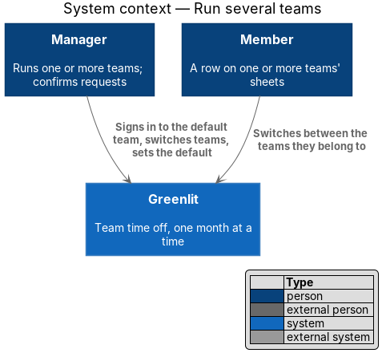
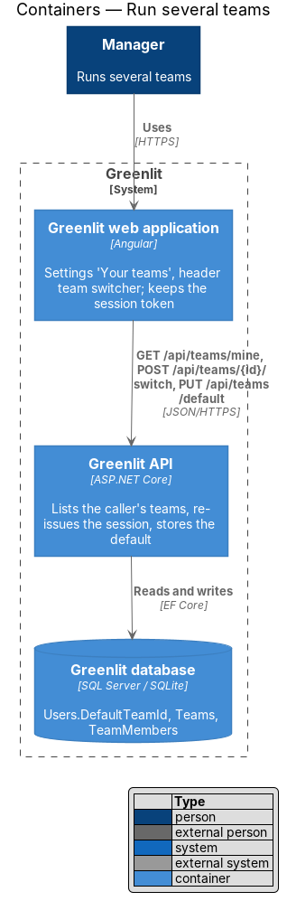
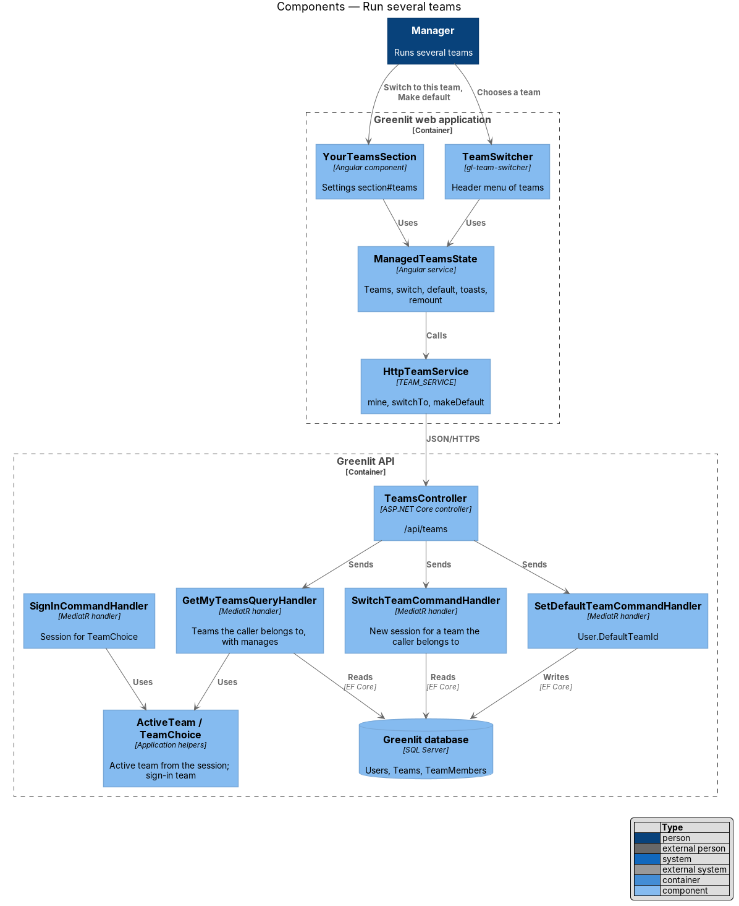
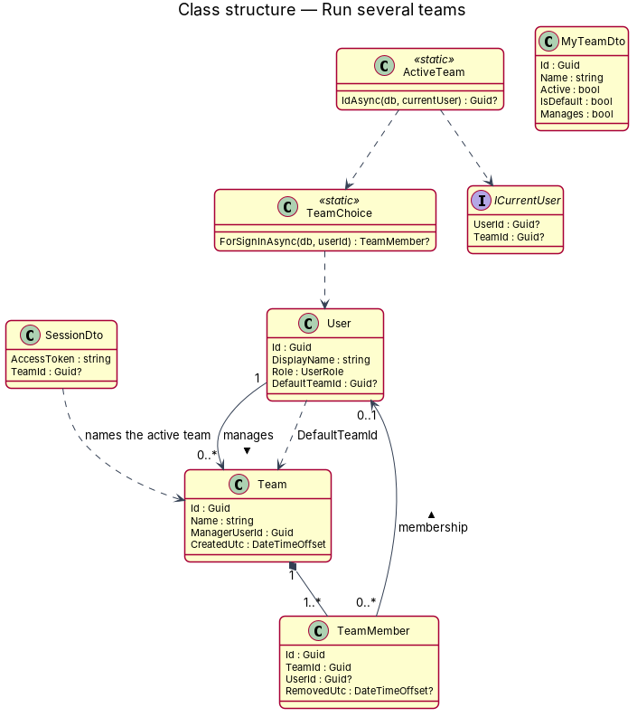
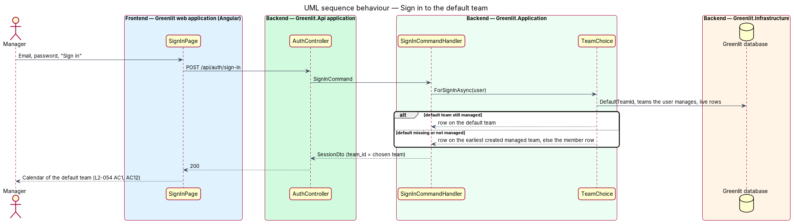
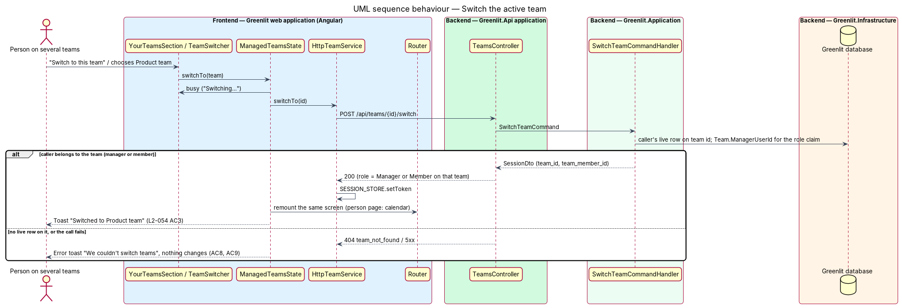
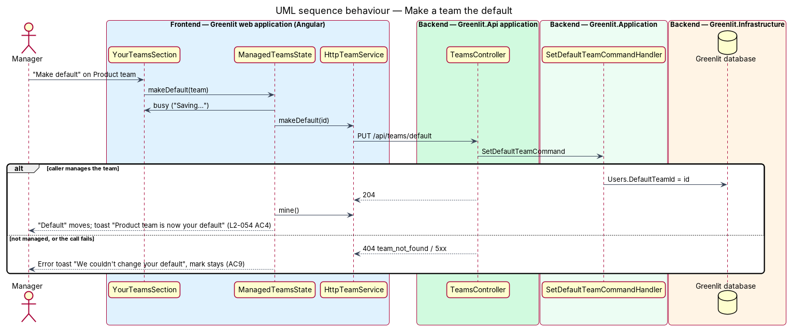

# Run several teams and switch between them

## Overview

A manager can run more than one team. Signing in opens their **default team**; the session names one team at a time, the **active team**, and every screen shows that team only. Settings gains the section "Your teams", where the manager switches the active team, makes a team the default and adds another team. The header gains the **team switcher**, which switches from any screen. A member is still on exactly one team, and a team still has exactly one manager.

**active team** — the one team the session names (`team_id` claim, ADR-004); every team-scoped read and write uses it

**default team** — the team sign-in opens for a manager; stored on the account (`User.DefaultTeamId`, ADR-014)

**switch** — exchange the session for a new one that names another team the caller manages

## Description

The feature is a vertical slice from the Greenlit web application to the Greenlit database.

**Frontend**

- **`TeamService / TEAM_SERVICE`** — Contract and token in the `api` project (exists) gains three methods: `mine()` reads the teams the caller manages (`ManagedTeam`: `id`, `name`, `active`, `isDefault`), `switchTo(teamId)` exchanges the session and stores the new token in `SESSION_STORE` (as `create()` already does), and `makeDefault(teamId)`. Both writes answer `{ ok: boolean }` and never throw. `HttpTeamService` implements them.
- **`ManagedTeamsState`** — Root service in the app (`app/teams/managed-teams.ts`). It holds the managed teams as a signal, reloads them after every app navigation for a manager's session (as `AccountState` does), and runs a switch and a default change for both callers: the busy state, the call, the toast and, after a switch, the reload of the current screen. On failure it shows the error toast with "Try again" and changes nothing.
- **`TeamSwitchReuseStrategy`** — The app's `RouteReuseStrategy`. After a switch the state asks it to remount the next navigation, then navigates to the same URL with `onSameUrlNavigation: 'reload'`. Every screen is built again and reads its data under the new session, so the old team's data is never shown under the new team's name. A person page (`/people/:id`, `/person`) belongs to one team, so a switch from it navigates to the calendar instead.
- **`YourTeamsSection`** — Settings section (`section#teams`, `app/pages/settings/your-teams-section.ts`), shown to the manager of the active team (the month's `isManager`), the last section and the last nav item; it renders `ManagedTeamsState.load` and never reads the API itself. One row per team, oldest first: the name, an "Active" badge and a "Default" badge (icon and text), "Switch to this team" (`aria-label` "Switch to {team}") on every other team and "Make default" (`aria-label` "Make {team} your default") on every team that is not the default. While a write runs, its button says "Switching…" or "Saving…" and every action is disabled. "Add another team" navigates to `/create-team`. Loading shows a skeleton; a failed read shows "We couldn't load your teams" with "Try again".
- **Scroll to the section** — "Manage your teams" and "Back to Settings" open `/settings#teams`. The section exists only once the teams load, after the router's anchor scroll, so `SettingsPage` scrolls to it once every section above has its data.
- **`TeamSwitcher`** — `gl-team-switcher` in `components` (`docs/design-system/components/team-switcher.html`), modelled on `gl-user-menu`: a button showing the active team's name with the label "Switch team, current team {team}", and a CDK Menu labelled "Your teams" with one `menuitemradio` per team (`aria-checked` on the active one, a check icon, "Default" in text on the default), then "Add another team" and "Manage your teams" (`/settings#teams`). It emits `chosen` with a team id and shows a busy state on its button. The app shell renders it in the `gl-top-bar` end slot before the account menu, only when `ManagedTeamsState` holds two or more teams.
- **`CreateTeamPage`** — When the session already names a team, the page opens as "Set up another team" with the lead "… Your other teams stay as they are." and a "Back to Settings" link (`pages/create-team/another`). The rest of `L2-008` is unchanged; the response's session names the new team.
- **`noTeamGuard`** — Lets a session that names a team open `/create-team` when `mine()` returns at least one team; anyone else on a team still goes to the calendar.

**Backend**

- **`TeamsController`** — Exists (`POST /api/teams`) and gains `GET /api/teams/mine`, `POST /api/teams/{id}/switch` and `PUT /api/teams/default`. All three are authenticated by the fallback policy and carry no role policy: the handlers decide.
- **`GetMyTeamsQueryHandler`** — Returns the teams whose `ManagerUserId` is the caller, oldest first, each with `Active` (its id is the session's team) and `IsDefault` (it is what sign-in would open, see `TeamChoice`). Anyone who manages no team gets an empty list.
- **`SwitchTeamCommandHandler`** — Finds the team by id among the teams the caller manages and the caller's own live row on it, and returns `ITokenService.Issue(user, row)`. Any other id is `404 team_not_found`.
- **`SetDefaultTeamCommandHandler`** — Sets `User.DefaultTeamId` to a team the caller manages; any other id is `404 team_not_found`. The validator requires the id (400 with `errors`).
- **`TeamChoice`** — Application helper: the team sign-in opens. The caller's `DefaultTeamId` when they manage it; else the earliest created team they manage; else their live member row's team; else none (`L2-054` AC12). `SignInCommandHandler` and `SignInWithGoogleCommandHandler` issue the session for the row it picks.
- **`ActiveTeam`** — Application helper every team-scoped handler uses instead of "any team I am on": the session's `team_id`, while the caller still manages that team or has a live row on it; a session without the claim falls back to `TeamChoice`. `RequestCaller`, `GetMonthQueryHandler`, `DayChanger`, `GetYearQueryHandler`, `GetPersonQueryHandler` and `InviteMemberCommandHandler` filter on it.
- **`ICurrentUser`** — Gains `TeamId`, read from the `team_id` claim by `HttpCurrentUser`.
- **`CreateTeamCommandHandler`** — No longer refuses a manager: it refuses (`409 team_exists`) only a caller with a live row on a team they do not manage. The first team a person creates sets `User.DefaultTeamId`; later teams do not.
- **`UpdateProfileCommandHandler`** — Renames the caller's row on every team they are on, not only the first.
- **EF configuration and migration** — `UserConfiguration` maps `DefaultTeamId` (nullable, no foreign key, ADR-014). The migration `AddDefaultTeam` (`backend/src/Greenlit.Infrastructure/Persistence/Migrations/`) adds the column and back-fills every manager's earliest created team. SQLite takes the column from the model; the fallback of `TeamChoice` covers data that was never back-filled.

**Shared plumbing (exists today)**

- **`ExceptionHandlingMiddleware`** — Maps `NotFoundException` to `404` ProblemDetails with its `code` extension.
- **`ITokenService`** — Issues the session for a user and a row (ADR-004); a switch reuses it unchanged.
- **`SESSION_STORE`** — Keeps the token in `localStorage`, so the active team survives a reload and a second tab (`L2-054` AC10).

**Seed.** The demo seed adds three managers who each manage two teams, "Design team" (created first, their default, with the name-only member Kit Brown) and "Product team" (with Raj Mehta): Hana Ito, Iris Novak and Jude Owens, one per e2e viewport, because "Make default" changes stored data. It also adds three founders who manage one team, "Studio team": Leo Grant, Mia Rossi and Ned Shaw, for the spec that adds another team (a run that adds teams needs a fresh e2e database, as create-team does). Maya Chen and the demo team are unchanged; Maya's default is the demo team.

## Requirements

The feature realizes the following level-2 (L2) requirements. Each L2 requirement refines a level-1 (L1) requirement, cited by identifier; the acceptance criteria for each are in `docs/specs/L2.md`.

| L2 ID | Refines (L1) | Requirement |
|-------|--------------|-------------|
| `L2-054` | `L1-002` | **Manager with several teams.** Sign-in opens the default team; "Your teams" in Settings switches, sets the default and adds a team; the header switcher switches from any screen. |
| `L2-008` | `L1-002` | **Create a team.** AC8 reworded: a manager may create another team; a person who is only a member still may not. |
| `L2-049` | `L1-013` | **App shell.** The header holds the team switcher for a manager of two or more teams. |

## API

| Method and path | Body | Answers |
|---|---|---|
| `GET /api/teams/mine` | — | `200` `[{ id, name, active, isDefault }]`, oldest first; `[]` for anyone who manages no team |
| `POST /api/teams/{id}/switch` | — | `200` `SessionDto` naming team `{id}`; `404 team_not_found` for a team the caller does not manage |
| `PUT /api/teams/default` | `{ teamId }` | `204`; `400` without `teamId`; `404 team_not_found` for a team the caller does not manage |

## Diagrams

### System context

A manager runs several teams in Greenlit; members still see one.

### Containers

The web application exchanges its session for another team's; the API checks ownership and issues it.

### Components

Settings and the header switcher share one state service; every team-scoped handler resolves the active team through `ActiveTeam`.

### Class structure

The account holds the default team; the session holds the active one.

### Behaviour — sign in to the default team

### Behaviour — switch the active team

A team the caller does not manage is a 404 and nothing changes (`L2-054` AC8, AC9).

### Behaviour — make a team the default

## Tests

- **API** (`backend/tests/Greenlit.Api.Tests/Teams/`): `DefaultTeamTests` (the first team is the default; sign-in opens the default; the fallback when the default is no longer managed), `CreateTeamTests` (a manager's second team; a member is still refused), `MyTeamsTests`, `SwitchTeamTests` (new session claims; refusal of other teams; the active team scopes the sheet), `SetDefaultTeamTests`. `Support/TestTeam.cs` gains `AddTeamAsync` for a second team under the same manager and a session-aware client.
- **Playwright** (`e2e/tests/your-teams.spec.ts`, `e2e/tests/team-switcher.spec.ts`, `e2e/tests/several-teams.spec.ts`): page objects `settings.page.ts` (Your teams) and `team-switcher.ts`; `fixtures/teams.ts` reads and resets each manager's teams through the API, and the `teamsApi` fixture in `fixtures/gl-test.ts` holds or fails the list, switch and default calls.
- **Visual** (`e2e/tests/visual/your-teams.spec.ts`): the team list and the "Add another team" row against `pages/settings/your-teams`, region by region, each aligned to whole pixels in both captures (the Settings content above ends at different fractions of a pixel in the mock and the app).
- **Unit**: none; the behaviour is covered end to end.

## Decisions

- **A one-team manager sees the section** with that team marked Active and Default and no actions, so "Add another team" has a home (`L2-054` AC6).
- **"Your teams" is the last section** of Settings, after Notifications, so the existing sections keep their place and anchors.
- **404, not 403,** for a team the caller does not manage: the answer does not tell another manager's team from a missing one.
- **An empty list, not 403,** for `GET /api/teams/mine` from a member: the app shell asks for every manager-role session, and a member promoted to the Manager role on someone else's team manages nothing.
- **Button icons follow the button's size.** The visual comparison showed `gl-button` icons at 20px in a small button where the design system sizes them at 1.25em; the `.btn .icon` rule joins the shared foundations, so every small icon button now matches its mock.
- **Remount, not reload.** The app rebuilds the current screen through the router rather than reloading the page, so the toast survives the switch and nothing is fetched twice.
