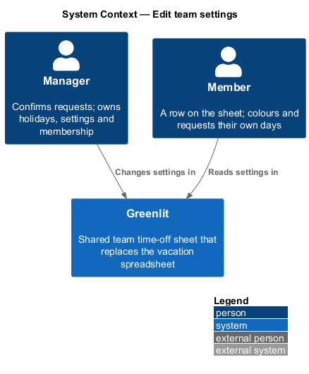
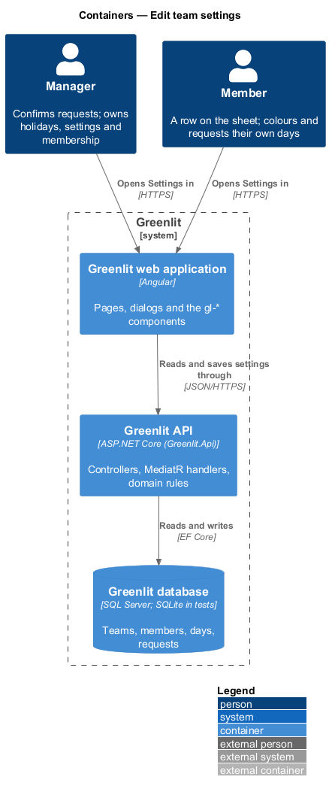
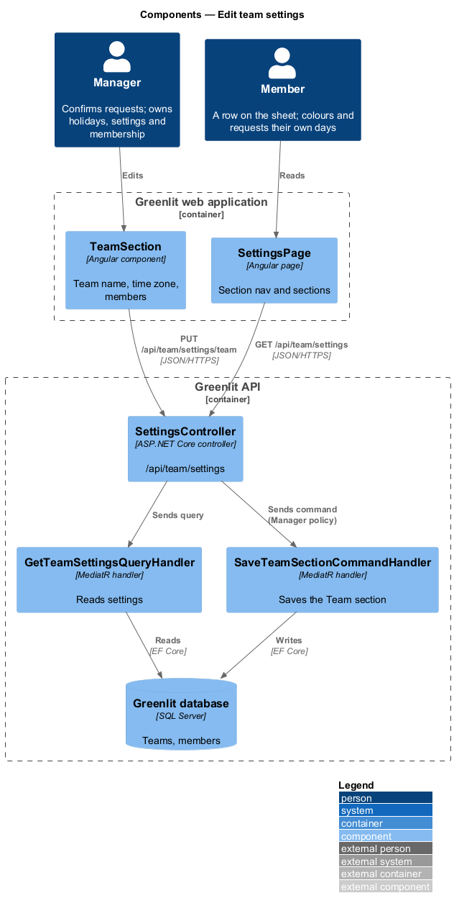
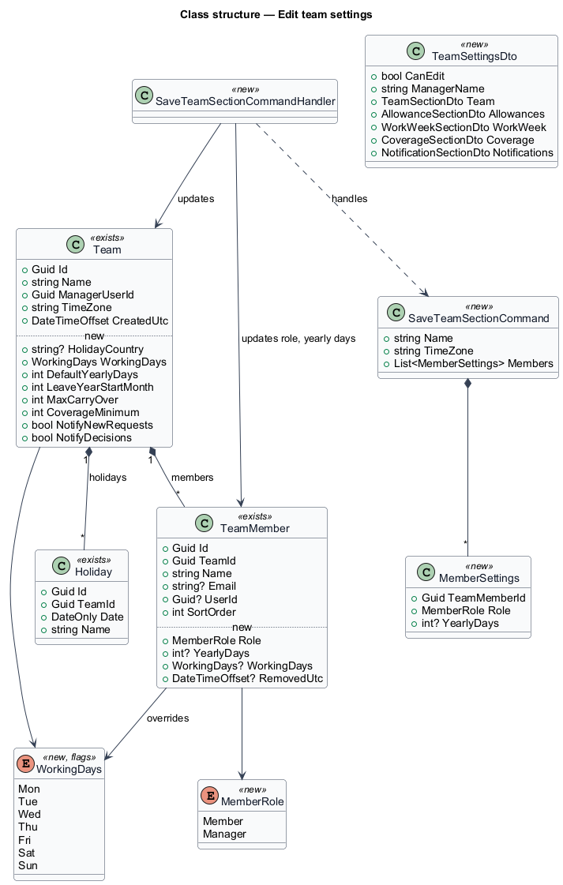
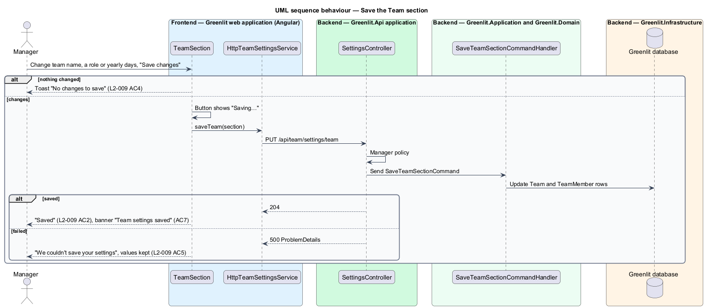

# Edit team settings

## Overview

Settings holds everything the manager decides about the team, split into five sections: Team, Allowances, Work week & holidays, Coverage and Notifications. Each section saves on its own, so a change in one section never saves or discards another.

This feature covers the page and the Team section: the team name, the time zone, and each member's role and yearly days. The other sections have their own designs (`allowances/allowance-defaults`, `teams/manage-holidays`, `teams/working-days`, `teams/coverage-minimum`, `teams/notification-settings`).

Members can open Settings but see every section read-only, with a note naming the manager to ask.

**section save** — save of one settings section's fields as one request, with its own busy, saved and failed states

## Description

The feature is a vertical slice from the Greenlit web application to the Greenlit database.

**Frontend**

- **`SettingsPage`** — App-shell page (`page: 'settings'`) with the section nav Team, Allowances, Work week & holidays, Coverage and Notifications. Each section is a child component with its own "Save changes" button and its own busy, saved and failed states.
- **`TeamSettingsService / TEAM_SETTINGS_SERVICE`** — Contract and token in the `api` project: `get()` and one `save…` method per section.
- **`TeamSection`** — Renders Team name, Time zone and the member rows with the role control "Role for {name}" and the field "Yearly days for {name}". It compares the form with the loaded values and shows the toast "No changes to save" when nothing differs (`L2-009` AC4).

**Backend**

- **`SettingsController`** — `GET /api/team/settings` returns every section; `PUT /api/team/settings/team` saves this section. Write endpoints carry the existing `Manager` policy.
- **`GetTeamSettingsQueryHandler`** — Returns the settings of the caller's team with `CanEdit` set from `ICurrentUser.IsManager`.
- **`SaveTeamSectionCommandHandler`** — Updates `Team.Name`, `Team.TimeZone`, and each listed member's `Role` and `YearlyDays`.
- **`ICurrentUser`** — Greenlit.Application abstraction introduced by this design. It exposes the caller's `UserId`, `TeamId`, `TeamMemberId` and `IsManager` from the JWT claims, so every handler scopes data to the caller's team.

**Shared plumbing (exists today)**

- **`ExceptionHandlingMiddleware`** — Greenlit.Api middleware. It maps application exceptions (`ValidationException`, `NotFoundException`, `ForbiddenException`, `ConflictException`, `BadRequestException`) to ProblemDetails responses with a `code` extension.
- **`ValidationBehavior`** — MediatR pipeline behaviour in Greenlit.Application. It runs each request's FluentValidation validator before the handler and raises `ValidationException` on failure.
- **`IAppDbContext`** — Greenlit.Application abstraction over the EF Core context, implemented by `AppDbContext` in Greenlit.Infrastructure. Handlers read and write through it in one unit of work.

**Role on the membership.** The mocks give each membership a role (Member / Manager), while today `User.Role` holds it. This design adds `TeamMember.Role` and issues the `role` claim from it; `User.Role` keeps only `Admin`. `<TO SUPPLY>`: whether a team may have more than one manager, given `Team.ManagerUserId`.

## Requirements

The feature realizes the following level-2 (L2) requirements. Each L2 requirement refines a level-1 (L1) requirement, cited by identifier; the acceptance criteria for each are in `docs/specs/L2.md`.

| L2 ID | Refines (L1) | Requirement |
|-------|--------------|-------------|
| `L2-009` | `L1-002` | **Team settings.** Settings has the sections Team, Allowances, Work week & holidays, Coverage and Notifications, each saved on its own. Only managers can change them. |

## Diagrams

### System context

Managers change and members read the team's settings in Greenlit.

### Containers

The Settings page loads all sections in one call and saves each section with its own call.

### Components

Reads go to one query handler; the Team section saves through its own command handler behind the `Manager` policy.

### Class structure

`TeamSettingsDto` carries every section and `CanEdit`; the Team section's command updates the `Team` and its `TeamMember` rows.

### Behaviour — save the Team section

A section with no edits never calls the API (`L2-009` AC4). A failure keeps the values as entered (`L2-009` AC5). A member never sees the save button (`L2-009` AC3).

