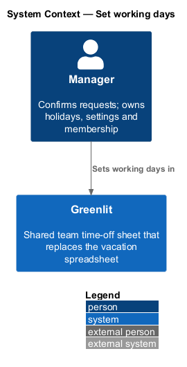
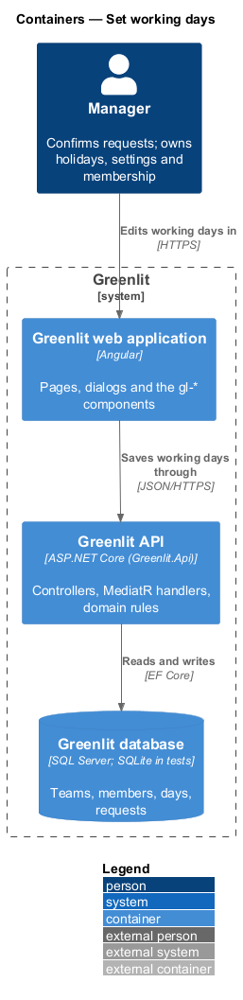
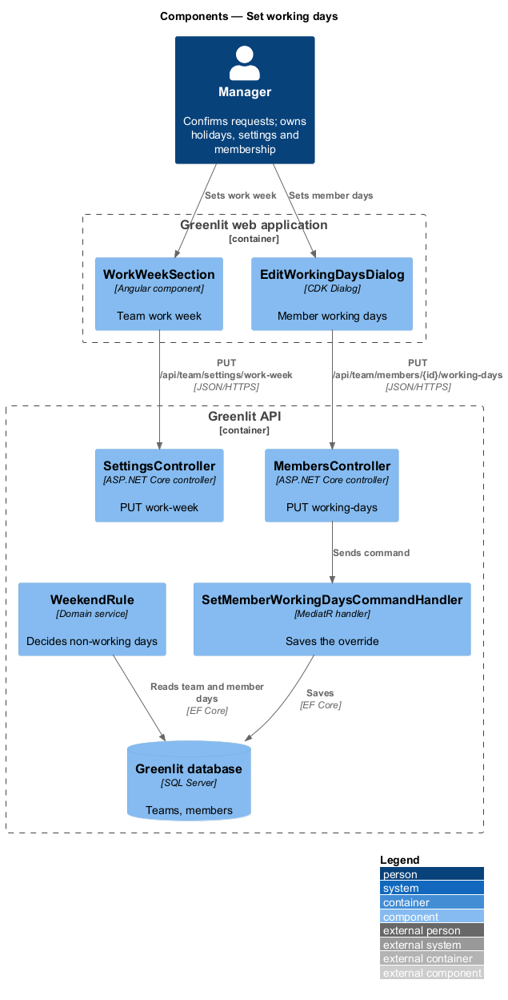
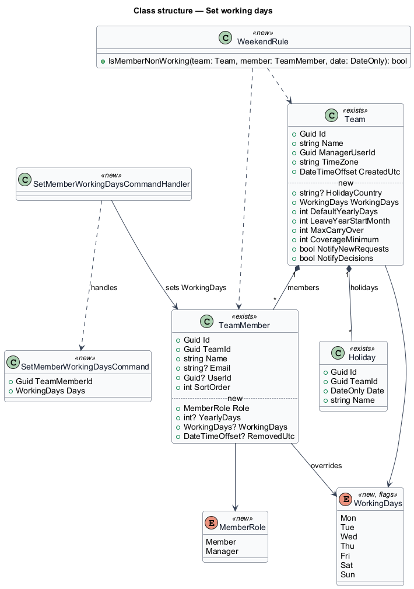
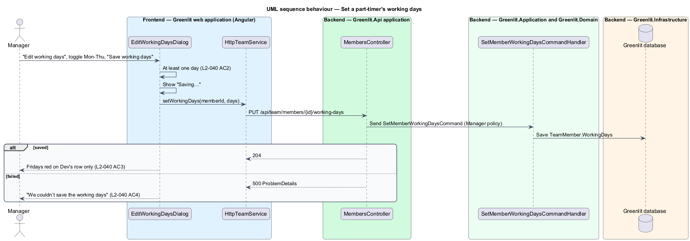

# Set working days

## Overview

Working days decide which weekdays are red. The team has a work week, Mon–Fri for most teams, which applies to everyone. A part-time member may work fewer days; their other days are red on their row only.

A non-working day, for the team or for one member, never counts against allowance, cannot be booked, and does not count as "in" on the calendar's Out row.

**work week** — set of weekdays on which the team works; the others are red for every row

**member working days** — per-member override of the work week for a part-timer, stored only when it differs from the team's

## Description

The feature is a vertical slice from the Greenlit web application to the Greenlit database.

**Frontend**

- **`WorkWeekSection`** — Shows the team's Working days as toggles Mon to Sun and saves them with the section's own "Save changes" (disabled until an edit; "Saving…", then "Saved"; a failure keeps the chips and offers Try again in a toast).
- **`EditWorkingDaysDialog`** — CDK Dialog in `app/dialogs/edit-working-days`, opened from a member's "Edit working days" button (also offered on the person page, `allowances/person-page`). It requires at least one day ("Pick at least one working day.").

**Backend**

- **`TeamSettingsController`** — `PUT /api/team/settings/work-week` saves `Team.WorkingDays`.
- **`MembersController`** — `PUT /api/team/members/{id}/working-days` saves `TeamMember.WorkingDays`; sending the team's days clears the override.
- **`SaveWorkWeekCommandHandler / SetMemberWorkingDaysCommandHandler`** (Application/Teams) — Validate a non-empty set and save it.
- **`WorkingDayRule`** — Domain service: a date is non-working for a member when it is a holiday, or its weekday is outside the member's working days (or the team's when the member has none).
- **`WorkingDays`** — New `[Flags]` enum, Mon = 1 … Sun = 64.

**Shared plumbing (exists today)**

- **`ExceptionHandlingMiddleware`** — Greenlit.Api middleware. It maps application exceptions (`ValidationException`, `NotFoundException`, `ForbiddenException`, `ConflictException`, `BadRequestException`) to ProblemDetails responses with a `code` extension.
- **`ValidationBehavior`** — MediatR pipeline behaviour in Greenlit.Application. It runs each request's FluentValidation validator before the handler and raises `ValidationException` on failure.
- **`IAppDbContext`** — Greenlit.Application abstraction over the EF Core context, implemented by `AppDbContext` in Greenlit.Infrastructure. Handlers read and write through it in one unit of work.

**Existing days when the work week changes** (ADR-009): stored `TimeOffDay` rows are kept. On a non-working weekday a stored day reads "Not working" (red), counts in no figure and is not "in" or "out" on the Out row; it comes back unchanged if the weekday is switched on again. New days on a non-working weekday are dropped like weekends.

**API shapes.** Days are spelled `"Mon"` to `"Sun"`. `GET /api/team/settings` returns `workingDays`; `PUT /api/team/settings/work-week` takes `{ days }`; `PUT /api/team/members/{id}/working-days` takes `{ days }` and returns the member's effective `workingDays`; each sheet row carries its effective `workingDays`. An empty set answers 400 with `errors.Days = ["Pick at least one working day."]`; a member outside the caller's team answers 404; a non-manager answers 403.

**Entry points.** "Edit working days" is a button on each member row of Settings > Team and on the manager's view of a person's page (`allowances/person-page`), opening the same dialog.

## Requirements

The feature realizes the following level-2 (L2) requirements. Each L2 requirement refines a level-1 (L1) requirement, cited by identifier; the acceptance criteria for each are in `docs/specs/L2.md`.

| L2 ID | Refines (L1) | Requirement |
|-------|--------------|-------------|
| `L2-039` | `L1-009` | **Team work week.** The team's working days decide which weekdays are red for everyone. |
| `L2-040` | `L1-009` | **A member's working days.** A part-time member works fewer days; the others are red on their row only. |

## Diagrams

### System context

The manager sets the team's and each part-timer's working days in Greenlit.

### Containers

The section and the dialog save through the Greenlit API; every view reads the result through `WorkingDayRule`.

### Components

Two endpoints save the two levels; `WorkingDayRule` combines them with the holidays.

### Class structure

`Team.WorkingDays` is the default; `TeamMember.WorkingDays` overrides it when set.

### Behaviour — set a part-timer's working days

An empty selection never reaches the API (`L2-040` AC2). After saving, the member's off days read "Not working" on their row only (`L2-040` AC3).

