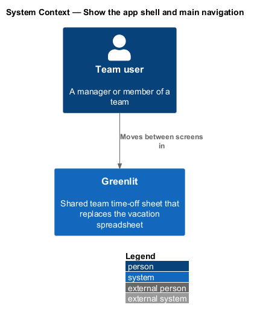
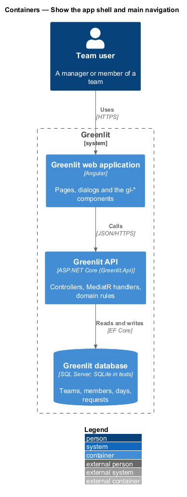
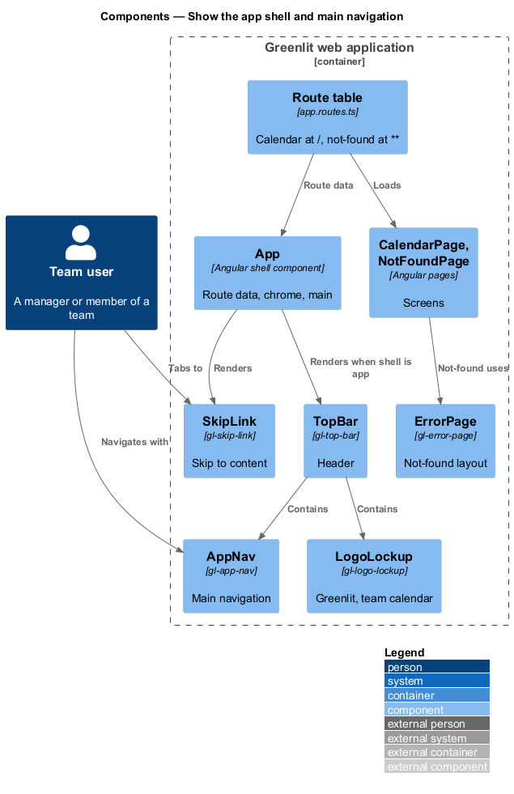
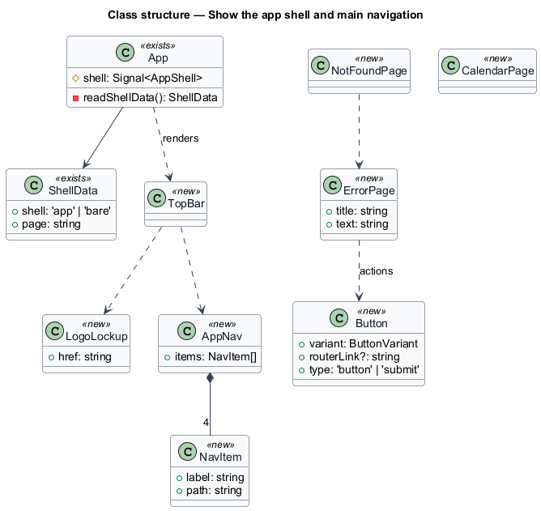
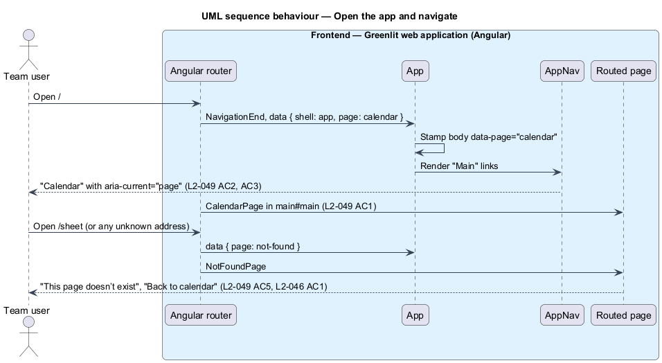

# Show the app shell and main navigation

## Overview

Every signed-in screen of Greenlit sits in the same chrome: a skip link, a header with the Greenlit logo and the main navigation, and one `main` landmark that holds the screen. The calendar is the home screen at `/`; the other sections are Year, Requests and Settings.

This feature also sets the baseline the other features build on. The design tokens from `docs/design-system/` live in the `components` library, and a first set of `gl-*` components implements the design system's pages. Screens shall reuse these components and shall not repeat their markup.

**chrome** — parts of the page that stay the same across screens: skip link, header, navigation

**route data** — `shell` (`app` or `bare`) and `page` values on each route; `shell` picks the chrome and `page` is stamped on `<body data-page>` as the e2e anchor

**core components** — `gl-*` components that implement design-system pages and are the only allowed markup for what they cover

## Description

The feature is a vertical slice from the Greenlit web application to the Greenlit database.

**Frontend — application (`frontend/projects/greenlit`)**

- **`App`** — Existing shell component (`app.ts`, `app.html`). It merges route data along the active route, stamps `<body data-page>`, renders `gl-skip-link` always and `gl-top-bar` when `shell` is `app`, around one always-mounted `router-outlet` in `main#main`.
- **`routes`** — `app.routes.ts`: `''` maps to `CalendarPage` (`page: 'calendar'`) and `**` to `NotFoundPage` (`page: 'not-found'`). `/sheet` has no route, so it falls to not-found (`L2-049` AC5). Year, Requests and Settings have no route until their journeys land, so their links show not-found meanwhile.
- **`CalendarPage`** — `pages/calendar/calendar.page.ts`. It replaces `SheetPage` and holds the calendar's heading until journey 1 (`sheet/view-month`) fills it.
- **`NotFoundPage`** — `pages/not-found/not-found.page.ts`. It renders `gl-error-page` with the copy of `L2-046` AC1.
- **`styles.scss`** — Global entry. It loads the tokens and foundations from the components library and keeps only shared foundations and utilities.

**Frontend — components library (`frontend/projects/components`)**

- **`styles/_tokens.scss`** — The design tokens copied from `docs/design-system/tokens/tokens.css`: primitives, semantic roles, light and dark themes. `docs/design-system/tokens/tokens.css` stays the source; the copy is refreshed when it changes.
- **`styles/_foundations.scss`** — Base type, colour scheme, `.shell` width and `.visually-hidden`, from `docs/design-system/assets/components.css`.
- **`SkipLink`** — Existing `gl-skip-link`, restyled from the tokens.
- **`TopBar`** — `gl-top-bar`: `header.topbar.topbar--app` with `.topbar__inner.shell`, the brand and navigation content, and an end slot.
- **`LogoLockup`** — `gl-logo-lockup`: the mark and wordmark, a link labelled "Greenlit, team calendar".
- **`AppNav`** — `gl-app-nav`: `nav.app-nav` labelled "Main"; each item is a router link whose `routerLinkActive` state sets `aria-current="page"`.
- **`Button`** — `gl-button`: `.btn` with variants from `components/button.html`, rendered as `<a>` or `<button>` by input with one `ng-content` template.
- **`ErrorPage`** — `gl-error-page`: the not-found and error layout (`.card-plain` > `.empty`) with title, text and an actions slot.
- **`Avatar, Badge, EmptyState, InlineMessage, Alert, Skeleton`** — `gl-avatar`, `gl-badge`, `gl-empty-state`, `gl-inline-message`, `gl-alert` and `gl-skeleton`, built to their design-system pages for the journeys that use them next.

**Decisions.** `/sheet` shows not-found instead of redirecting: nothing depends on it and the mocks have no sheet page. The tokens are copied into the library rather than referenced from `docs/`, so the Angular build depends only on the frontend workspace.

## Requirements

The feature realizes the following level-2 (L2) requirements. Each L2 requirement refines a level-1 (L1) requirement, cited by identifier; the acceptance criteria for each are in `docs/specs/L2.md`.

| L2 ID | Refines (L1) | Requirement |
|-------|--------------|-------------|
| `L2-049` | `L1-013` | **App shell and main navigation.** Every signed-in screen sits in the same chrome: a skip link, the Greenlit logo and the main navigation. The calendar is the home screen. |
| `L2-046` | `L1-012` | **Error pages.** Full-page states for missing, forbidden, failed and offline. |
| `L2-047` | `L1-013` | **Keyboard on the sheet.** Every sheet interaction works from the keyboard. |

## Diagrams

### System context

A team user moves between Greenlit's screens through the shell; no external system takes part.

### Containers

The shell lives entirely in the Greenlit web application.

### Components

Route data drives `App`, which renders the skip link and the top bar; the top bar holds the logo and the main navigation.

### Class structure

`AppNav` holds four `NavItem` values in mock order; `NotFoundPage` composes `ErrorPage`, whose actions use `Button`.

### Behaviour — open the app and navigate

`/` opens the calendar with "Calendar" marked current (`L2-049` AC1, AC3); an address with no route, including `/sheet`, shows not-found (`L2-049` AC5, `L2-046` AC1).

