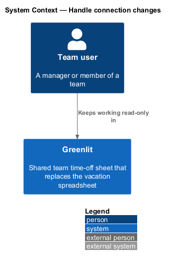
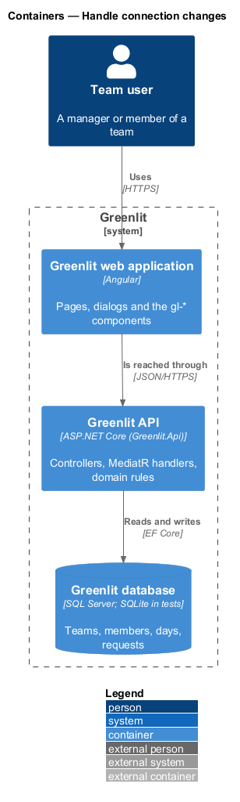
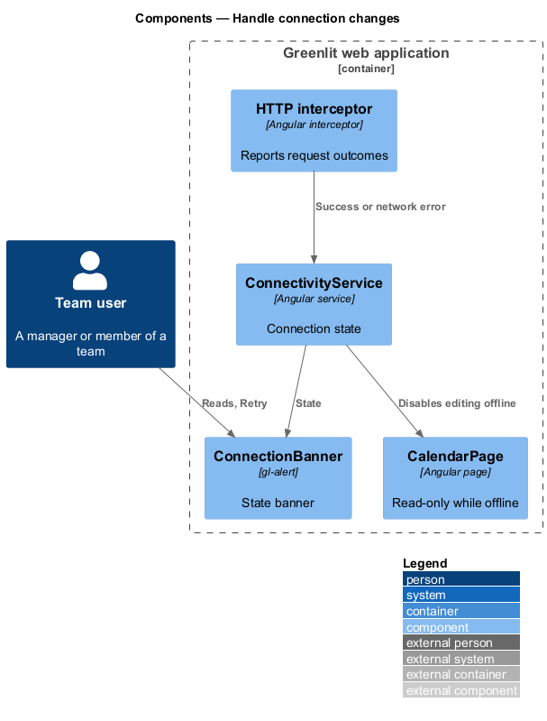
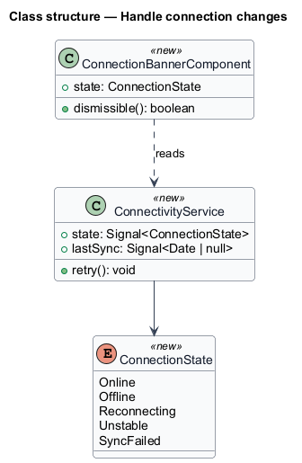
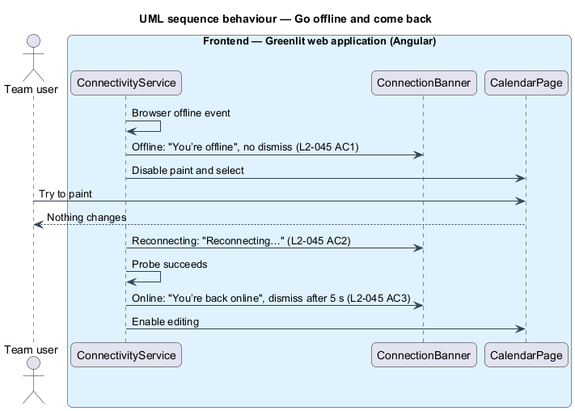

# Handle connection changes

## Overview

Greenlit keeps showing what it last loaded when the connection drops, and stops anything that would change data. A banner at the top of the page says what is happening: offline, reconnecting, unstable, back online, or unable to sync the latest changes.

While offline the calendar is read-only: painting and selecting are disabled until the connection returns. If a page has nothing loaded to show, the offline page replaces it.

**connection state** — one of online, offline, reconnecting, unstable or sync-failed, held by the web application

**last sync** — time of the last successful load, shown as "You’re looking at the calendar as of 10:42."

## Description

The feature is a vertical slice from the Greenlit web application to the Greenlit database.

**Frontend**

- **`ConnectivityService`** — Angular service that combines the browser `online`/`offline` events with the outcome of API calls into a `ConnectionState` signal. Offline is the browser's `offline` event; the `online` event starts "Reconnecting…" with a `no-cors` `HEAD` probe of the API origin; one API call that fails with no response is "unstable", one answered 5xx is "sync-failed" (ADR-012).
- **`ConnectionBanner`** — `gl-alert` banner in the app shell. Offline has no dismiss button; back online dismisses itself after 5 s; sync-failed offers "Retry" and the last sync time.
- **`Read-only guard`** — `CalendarPage` and the editing directives read `ConnectionState` and make the sheet rows non-editable and disable the paint picker and "Request time off" while offline or reconnecting (`L2-045` AC1).
- **`OfflinePage`** — Full-page state used when there is no cached data (`web-experience/error-pages`, not part of this journey).
- **Retry** — "Retry" on the sync-failed banner probes the API and asks the open page to load again; back online shows when the probe answers. The last sync time is the browser-local time of the last successful API response.

**Backend**

- **`Greenlit API`** — The API takes no part; a failed request is the signal.

## Requirements

The feature realizes the following level-2 (L2) requirements. Each L2 requirement refines a level-1 (L1) requirement, cited by identifier; the acceptance criteria for each are in `docs/specs/L2.md`.

| L2 ID | Refines (L1) | Requirement |
|-------|--------------|-------------|
| `L2-045` | `L1-012` | **Connection banners.** A banner reports the connection state; while offline the calendar is read-only. |

## Diagrams

### System context

A team user keeps reading Greenlit while the connection is down.

### Containers

The connection state lives in the Greenlit web application, derived from browser events and API call outcomes.

### Components

`ConnectivityService` drives both the banner and the read-only guard on the calendar.

### Class structure

`ConnectionState` has one value per banner in the mocks.

### Behaviour — go offline and come back

Offline has no dismiss button and disables editing (`L2-045` AC1); back online leaves after 5 s (`L2-045` AC3).

