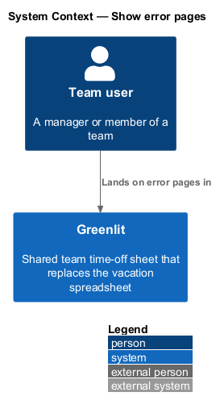
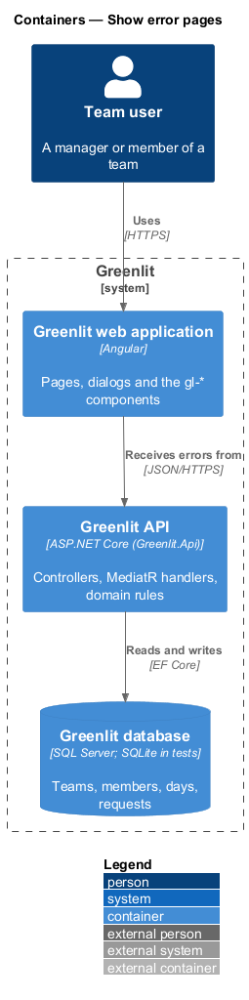
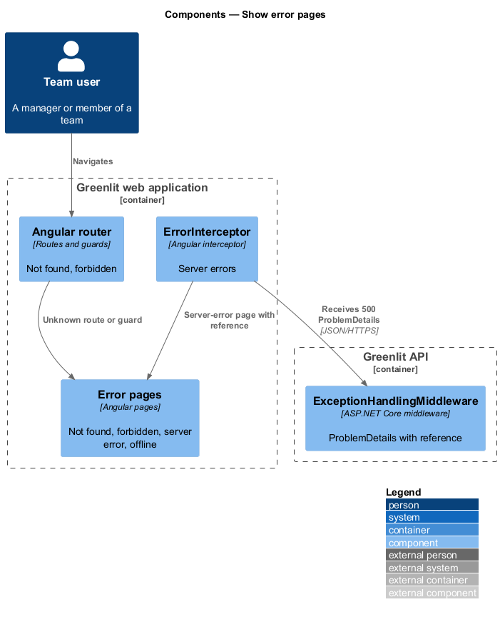
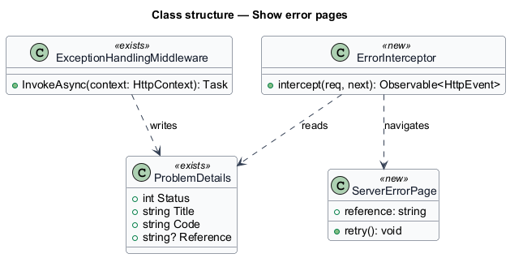
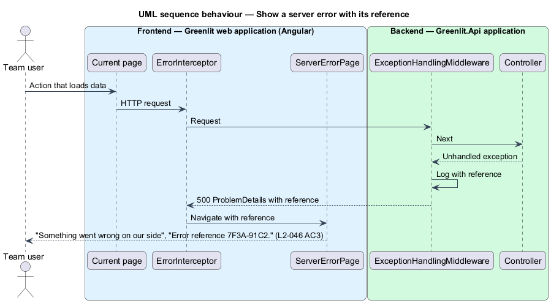

# Show error pages

## Overview

Some states replace a whole page: an address that does not exist, a manager-only page opened by a member, an unexpected server error, and being offline with nothing loaded. Each has a full page that says what happened, reassures that days are safe where that applies, and offers a way on.

The server-error page shows an error reference so a report can be matched to the failure.

**error reference** — short identifier shown on the server-error page and written to the API log for the same request, such as `7F3A-91C2`

## Description

The feature is a vertical slice from the Greenlit web application to the Greenlit database.

**Frontend**

- **`NotFoundPage`** — Route `**` (`page: 'not-found'`): "This page doesn’t exist". It replaces the former `**` redirect to `/sheet`; `/sheet` itself now shows this page (`L2-049` AC5).
- **`ForbiddenPage`** — `page: 'forbidden'`: "You don’t have access to this" and "Ask {manager} if you need it.", the manager's name read from the team's month. The Requests page opens it when the API answers its ledger with `403`. No route is manager-only by guard today: screens a member may open show a member's view (Requests becomes My requests), so the API's `403` is the source of truth.
- **`ServerErrorPage`** — `page: 'server-error'`: "Something went wrong on our side" with "Error reference {ref}.", "Try again" and "Back to calendar".
- **`OfflinePage`** — `page: 'offline'`: "You’re offline" with "Try again". It is part of the main bundle, so it renders with no network. `onlineGuard` (`canActivateChild` over the app screens) opens `/offline?returnUrl=…` when a screen is opened while the connection is down (offline or reconnecting); nothing is cached, so every screen opened then has nothing loaded. A screen already open stays, read-only (`L2-045`). "Try again" asks the connectivity service to check; when it answers, the wanted screen opens.
- **`serverErrorInterceptor`** — For a `GET` to the API that fails with a `500` ProblemDetails carrying a `reference`, opens `/server-error?reference=…&returnUrl=…`; "Try again" opens `returnUrl` again. A `500` without a reference, and any failed change, stay with the page that made the call (in-place error states and toasts).

Decision: the not-found page keeps the app shell for everyone (a signed-out visitor sees the top bar without an account menu).

**Backend**

- **`ExceptionHandlingMiddleware`** — Existing middleware. For an unhandled exception it adds a `reference` extension to the ProblemDetails, a random eight-hex-digit code written `XXXX-XXXX` (the mocks show `7F3A-91C2`), and logs it with the exception.
- **`Manager policy`** — Existing authorization policy; a member's call to a manager endpoint returns `403`.

## Requirements

The feature realizes the following level-2 (L2) requirements. Each L2 requirement refines a level-1 (L1) requirement, cited by identifier; the acceptance criteria for each are in `docs/specs/L2.md`.

| L2 ID | Refines (L1) | Requirement |
|-------|--------------|-------------|
| `L2-046` | `L1-012` | **Error pages.** Full-page states for missing, forbidden, failed and offline. |

## Diagrams

### System context

A team user lands on an error page in Greenlit when a page cannot be shown.

### Containers

Not-found and forbidden are decided in the web application; server errors come from the Greenlit API as ProblemDetails.

### Components

The middleware attaches the reference; the interceptor carries it to the server-error page.

### Class structure

`Reference` is new on the existing ProblemDetails shape; it is what the server-error page prints.

### Behaviour — show a server error with its reference

The same reference appears on the page and in the API log (`L2-046` AC3).

