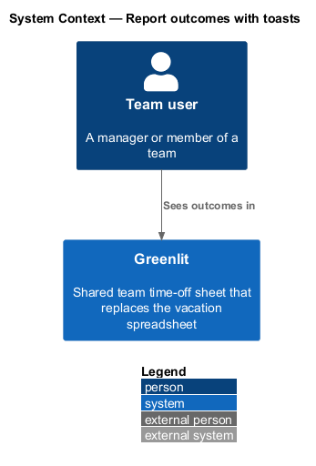
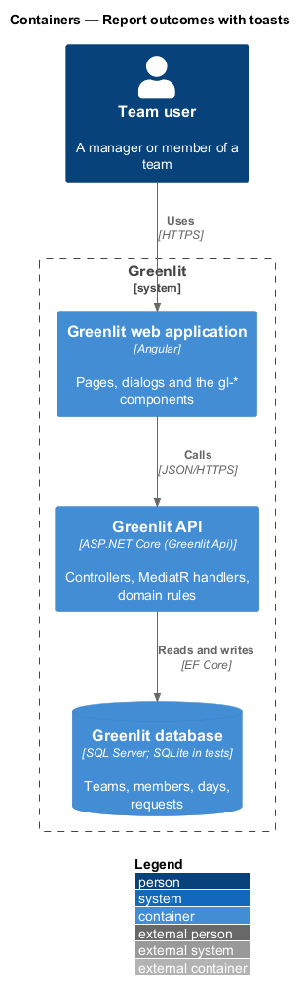
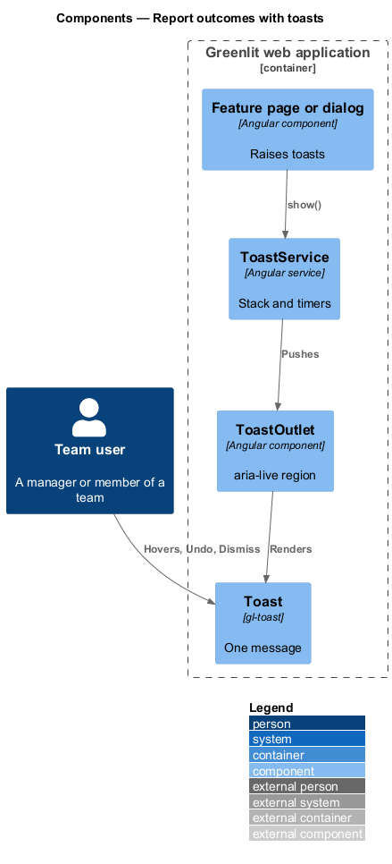
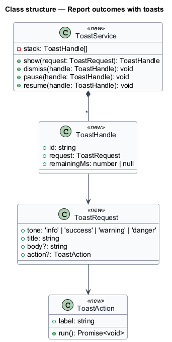
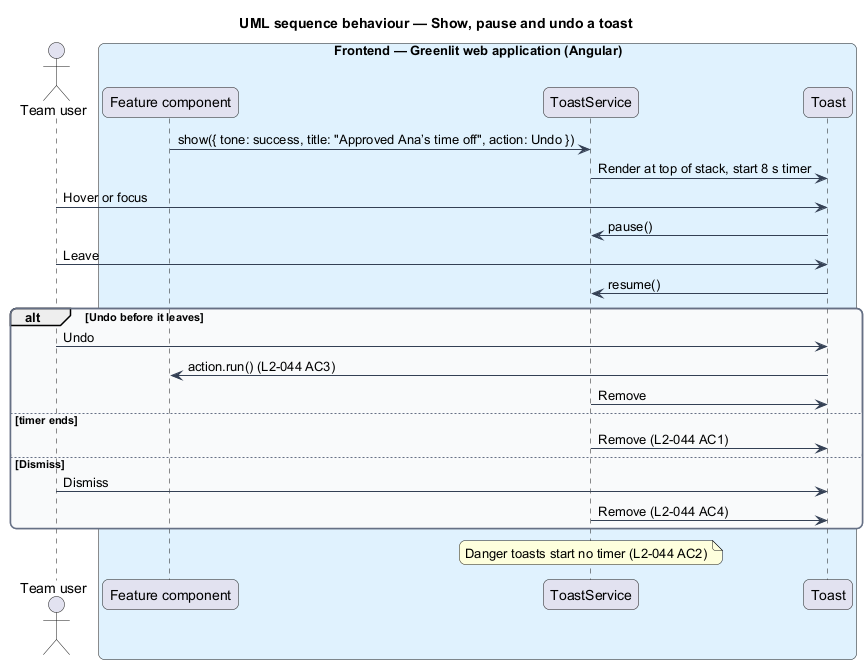

# Report outcomes with toasts

## Overview

A toast is a short message that reports the outcome of an action without moving focus: "3 days marked confirmed for Ana", "Approved Ana’s time off", "We couldn’t save those days". Many features raise toasts; this feature defines how every toast behaves.

Info, success and warning toasts leave after 8 s; the timer pauses while the toast is hovered or focused. Error toasts stay until dismissed. A toast with Undo keeps Undo working for its whole lifetime. Several toasts stack, newest first.

**toast** — transient, non-modal status message with a tone (info, success, warning, danger), optional action and a dismiss button

## Description

The feature is a vertical slice from the Greenlit web application to the Greenlit database.

**Frontend**

- **`ToastService`** — Angular service in the `greenlit` app. `show(toast)` returns a handle; the service owns the stack, the 8 s timers and their pause and resume. Danger toasts have no timer.
- **`ToastOutlet`** — Region rendered once by the app shell. It hosts the `gl-toast` stack in an `aria-live` region: `polite` for info and success, `assertive` for warning and danger.
- **`Toast`** — `gl-toast` component with tone, title, body, optional action ("Undo", "Try again") and "Dismiss".
- **`ToastRequest`** — Value passed by a feature: `tone`, `title`, `body`, `action?: { label, run() }`.

**Backend**

- **`Greenlit API`** — Toasts are a frontend concern. Undo and Try again call the owning feature's own endpoints (for example `POST /api/sheet/days/restore`).

## Requirements

The feature realizes the following level-2 (L2) requirements. Each L2 requirement refines a level-1 (L1) requirement, cited by identifier; the acceptance criteria for each are in `docs/specs/L2.md`.

| L2 ID | Refines (L1) | Requirement |
|-------|--------------|-------------|
| `L2-044` | `L1-012` | **Toasts.** Toasts report outcomes. |
| `L2-018` | `L1-004` | **Undo and failed saves on the calendar.** Every change made on the calendar can be undone, and a failed save keeps the selection. |

## Diagrams

### System context

A team user sees the outcome of each action in Greenlit; no external system takes part.

### Containers

Toasts live entirely in the Greenlit web application; their actions call the Greenlit API through the owning feature.

### Components

Features call `ToastService`, which renders through one outlet so stacking and timing behave the same everywhere.

### Class structure

`ToastHandle.remainingMs` is null for danger toasts, which have no timer.

### Behaviour — show, pause and undo a toast

Hover or focus pauses the 8 s timer (`L2-044` AC1); Undo works until the toast leaves (`L2-044` AC3); error toasts wait for Dismiss (`L2-044` AC2).

