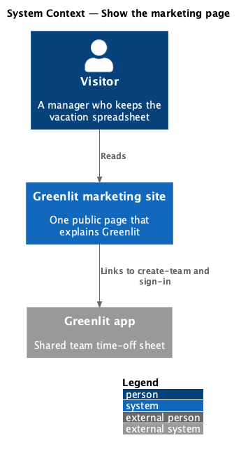
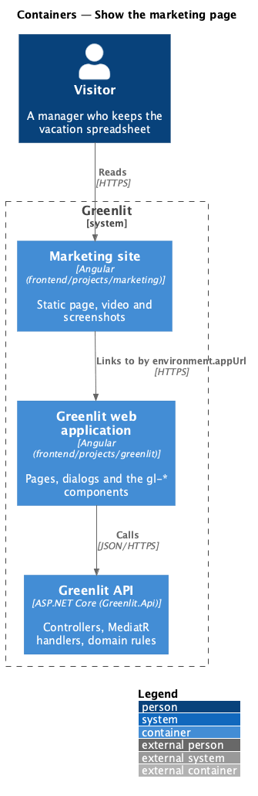
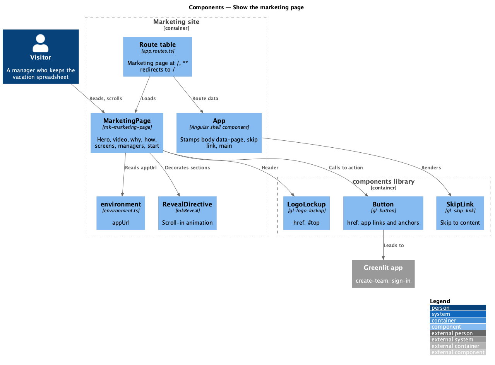
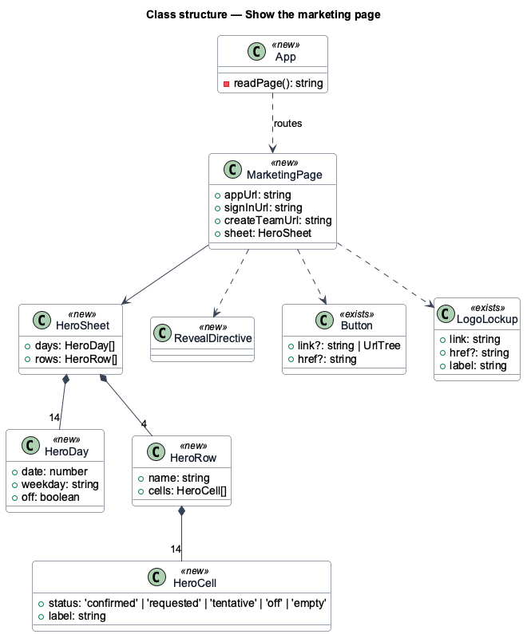
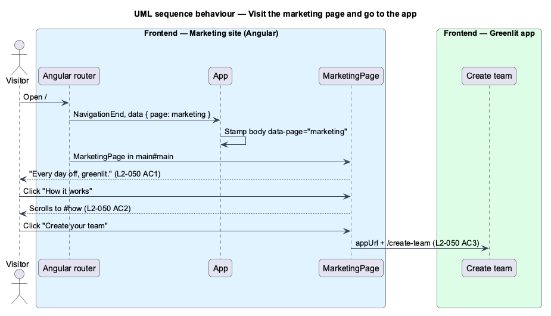

# Show the marketing page

## Overview

A manager who still keeps the vacation spreadsheet lands on one public page that explains Greenlit and sends them into the app: a hero with the sheet in miniature, a twenty-second narrated video, why it beats the spreadsheet, the three colours, real screens, what the manager gets, and a closing call to action. The page never needs a session.

The page is its own Angular application, `marketing`, so it builds and deploys apart from the app and carries none of the app's services. It consumes the `components` library for the design system and links into the app by an absolute address from its environment.

**marketing site** — the `marketing` application: one route, one page, no API

**app URL** — `environment.appUrl`, the origin of the Greenlit app the site links into for create-team and sign-in

**section anchors** — `#top`, `#watch`, `#why`, `#how`, `#screens`, `#managers`, `#start`: the in-page targets the header navigation and the hero's secondary link scroll to

## Description

The feature is a frontend-only slice: a second application in the workspace and two small additions to the components library.

**Frontend — marketing application (`frontend/projects/marketing`)**

- **`App`** — Shell component (`app.ts`). It stamps `<body data-page>` from route data the same way the Greenlit app's shell does (the code is copied, not imported: the site must not depend on the app project) and renders `gl-skip-link` and one `router-outlet` in `main#main`.
- **`routes`** — `app.routes.ts`: `''` maps to `MarketingPage` (`page: 'marketing'`); `**` redirects to `''` (`L2-050` AC11).
- **`MarketingPage`** — `pages/marketing/marketing.page.ts`, selector `mk-marketing-page`. The template is the mock section by section with the mock's `mk-*` classes; app links are built from `environment.appUrl`. The hero sheet is a typed constant (`HERO_SHEET`): the calendar mock's cast over 16–29 November, weekends and Dev's non-working days off, each cell rendered with `data-status` and an accessible name.
- **`RevealDirective`** — `mkReveal`: adds `is-in` when the element scrolls into view through `IntersectionObserver`; honours `prefers-reduced-motion`; purely decorative, so no acceptance criterion covers it.
- **`environment.ts` / `environment.prod.ts`** — `appUrl`: `http://localhost:4200` in development; the production value is a placeholder until hosting lands and is swapped by `fileReplacements`.
- **`styles.scss`** — Loads the tokens and foundations from `components` and the page's styles ported from `docs/mocks/assets/marketing.css`, by token role only.
- **`public/`** — The video (`meet-greenlit.mp4`), its poster and caption file, and the four screenshots, copied from `docs/mocks/assets/marketing/`.

**Frontend — components library (`frontend/projects/components`)**

- **`Button`** — `gl-button` gains an `href` input. When set it renders `<a class="btn" href>` (an external or in-page address); `link` keeps rendering a router link. The slots stay in one `ng-template`.
- **`LogoLockup`** — `gl-logo-lockup` gains an `href` input with the same rule, so the marketing header's logo can lead to `#top` with the label "Greenlit, back to the top".

**Workspace and tooling**

- **`angular.json`** — The `marketing` application: prefix `mk`, scss, `@angular/build:application`, assets from `projects/marketing/public`, the same `stylePreprocessorOptions` as the app, production budgets and the environment file replacement.
- **`package.json`** — `start:marketing` serves the site on port 4300 so it can run beside the app on 4200.
- **CI** — `test-frontend` also runs `ng build marketing --configuration production`; `ng lint` and `ng test` already cover every project.
- **e2e** — `playwright.config.ts` starts the site as a second web server on 4300; `fixtures/routes.ts` gives a route an optional `origin`, which `pathFor` prefixes outside baseline runs; `pages/marketing.page.ts` owns the selectors.

**Decisions.** A separate application rather than a route in the app: the page is public and must not pull the app's auth, API or guards, and it deploys on its own cadence. The app address lives in the environment, not in a config call at runtime, because the site has no API to ask. `href` inputs on two existing components rather than plain markup in the page, so the site keeps reusing the design system. Visual regression is deferred: behaviour specs cover this feature first.

## Requirements

The feature realizes the following level-2 (L2) requirements. Each L2 requirement refines a level-1 (L1) requirement, cited by identifier; the acceptance criteria for each are in `docs/specs/L2.md`.

| L2 ID | Refines (L1) | Requirement |
|-------|--------------|-------------|
| `L2-050` | `L1-014` | **Marketing page.** One public page sells Greenlit to the manager who keeps the vacation spreadsheet and links into the app to create a team or sign in. |

## Diagrams

### System context

A visitor reads the marketing site; it hands them to the Greenlit app and talks to nothing else.

### Containers

The site is a static Angular build beside the app, with no API behind it.

### Components

One route, one page, the design-system components it reuses, and the environment that names the app.

### Class structure

`MarketingPage` renders `HERO_SHEET` and builds its app links from `environment.appUrl`; `Button` and `LogoLockup` gain `href`.

### Behaviour — visit and go to the app

`/` renders the page (`L2-050` AC1); a section link scrolls in place (AC2); "Create your team" leaves for the app (AC3).

